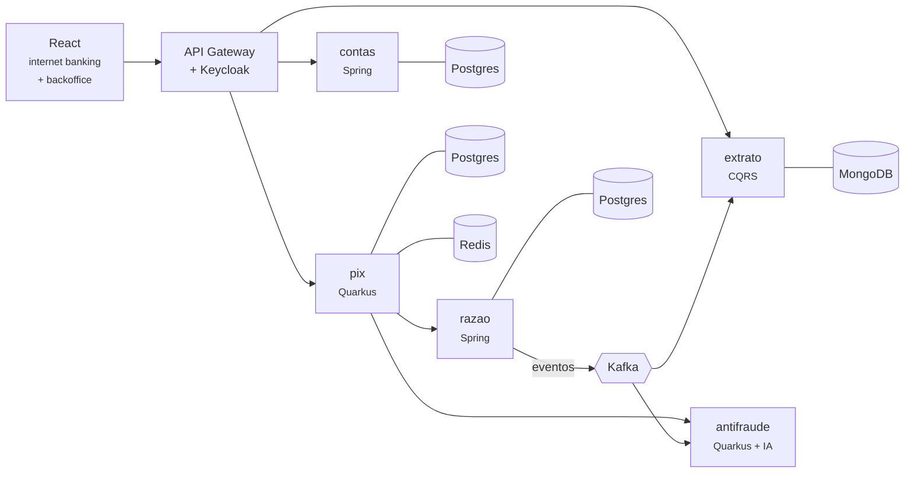

<div align="center">

# 🏦 Ledgerly Bank

**Um banco digital construído do zero, em público, para estudar engenharia de software
de nível sênior: razão contábil, Pix, concorrência, antifraude com IA e nuvem.**

[](https://github.com/alanjoffre/ledgerly-bank/actions/workflows/ci.yml)


</div>

> ⚠️ **Projeto de estudo.** O Ledgerly Bank é fictício: não é um banco, não movimenta dinheiro
> real e não se conecta a nenhum sistema do Banco Central. Todos os dados são sintéticos.

---

## O que é

O Ledgerly Bank simula o núcleo de um banco digital brasileiro:

- **Contas** de clientes, com abertura, bloqueio e encerramento;
- **Razão contábil** em partidas dobradas — o saldo é a soma dos lançamentos, e nada é apagado;
- **Pix** com chaves, transferência instantânea e estorno automático quando algo falha;
- **Antifraude com IA**, que dá nota de risco em milissegundos e explica o alerta ao analista;
- **Extrato em tempo real**, montado a partir de eventos.

O objetivo não é só funcionar: é mostrar **por que** cada peça é como é. Cada decisão importante
está registrada numa [ADR](docs/adr/README.md), com as alternativas descartadas e o preço pago.

## Competências demonstradas

| Competência | Onde aparece |
| --- | --- |
| **Back-end com Spring e Quarkus + IA aplicada** | Contas e razão em Spring Boot; Pix e antifraude em Quarkus (imagem nativa); IA com LangChain4j e modelo ONNX |
| **Front-end com React** | Internet banking e backoffice de fraude (React + TypeScript) |
| **Arquitetura de sistemas** | Microsserviços orientados a eventos, Saga, Outbox, CQRS — [visão geral](docs/arquitetura/visao-geral.md) |
| **Software design e system design** | DDD, arquitetura hexagonal, *value objects*, diagramas C4, [ADRs](docs/adr/README.md) |
| **Concorrência e multithreading em Java** | Prova de saldo sem gasto duplo sob 1.000 débitos simultâneos, *virtual threads*, *Structured Concurrency*, JMH |
| **Infra e nuvem: Docker, Kubernetes e AWS** | Docker Compose, Kubernetes com Helm, Terraform da AWS validado no CI |
| **Bancos relacionais e NoSQL** | PostgreSQL (um banco por serviço), MongoDB, Redis, pgvector |
| **Testes automatizados e qualidade** | JUnit, Testcontainers, ArchUnit, testes de propriedade, contrato (Pact), *mutation testing* (PIT), cobertura mínima no build |

## Arquitetura



Detalhes, o fluxo completo de um Pix e os princípios estão na
[visão geral da arquitetura](docs/arquitetura/visao-geral.md).

## Andamento

| Fase | Entrega | Status |
| --- | --- | --- |
| 0 | Fundação: monorepo, `Dinheiro`, infraestrutura local, CI, documentação | ✅ |
| 1 | Razão contábil e contas (Spring Boot), prova de concorrência, idempotência | ✅ |
| 2 | Pix, Saga, Outbox, Kafka e extrato CQRS (Quarkus) | ⬜ |
| 3 | Concorrência e desempenho: *virtual threads*, JMH, teste de carga | ⬜ |
| 4 | Segurança (Keycloak) e front-end React | ⬜ |
| 5 | IA aplicada: antifraude e assistente do extrato | ⬜ |
| 6 | Kubernetes, Terraform da AWS e observabilidade | ⬜ |
| 7 | Qualidade (PIT, Pact, SonarCloud) e lançamento | ⬜ |

O detalhe de cada fase está no [roteiro](docs/roadmap.md).

## Como rodar

Pré-requisitos: **JDK 25** e **Docker**. O Maven não precisa ser instalado (o projeto usa o
Maven Wrapper). Passo a passo completo no [guia de ambiente local](docs/guias/ambiente-local.md).

```bash
git clone https://github.com/alanjoffre/ledgerly-bank.git
cd ledgerly-bank

# Compilar e rodar todos os testes
./mvnw verify

# Subir PostgreSQL, MongoDB, Redis e Kafka
docker compose -f infra/docker/compose.yaml up -d --wait
```

Para rodar os serviços e ver o banco funcionando pela API, siga a
[demonstração da Fase 1](docs/guias/demo-fase-1.md).

## Destaque: o razão aguenta mil pedidos ao mesmo tempo

O [teste de concorrência](servicos/razao/src/test/java/io/github/alanjoffre/ledgerly/razao/integracao/ConcorrenciaIT.java)
dispara pedidos simultâneos em *virtual threads* contra um PostgreSQL de verdade. Para provar que
o teste pega o erro, a trava foi removida de propósito — e o resultado mudou assim:

| Cenário | Com a trava | Sem a trava |
|---|---|---|
| 1.500 saques de R$ 1,00 numa conta com R$ 1.000,00 | 1.000 aprovados, 500 recusados | **1.500 aprovados** — R$ 500 de gasto duplo |
| 400 transferências cruzadas A↔B ao mesmo tempo | nenhum deadlock, total intacto | **R$ 11,00 sumiram** |
| 100 cliques no mesmo depósito (mesma `Idempotency-Key`) | 1 lançamento | **20 lançamentos** |

A solução — travar as contas sempre na mesma ordem (`SELECT ... ORDER BY id FOR UPDATE`) — e as
alternativas descartadas estão na [ADR-0009](docs/adr/0009-concorrencia-com-trava-pessimista-ordenada.md).
E o banco não confia cegamente na aplicação: saldo negativo, lançamento desbalanceado e alteração
do razão são recusados pelo próprio PostgreSQL.

Quer ver rodando? [Demonstração em 3 minutos](docs/guias/demo-fase-1.md).

## Destaque: dinheiro sem perder centavo

Antes de qualquer serviço, o projeto define o tipo [`Dinheiro`](bibliotecas/nucleo-compartilhado/src/main/java/io/github/alanjoffre/ledgerly/nucleo/Dinheiro.java),
que resolve três erros clássicos de sistemas financeiros:

```java
// 1. double perde precisão; Dinheiro não
0.1 + 0.2                                             // 0.30000000000000004
Dinheiro.reais("0.10").somar(Dinheiro.reais("0.20"))  // BRL 0.30

// 2. Dividir R$ 100,00 em 3 sem perder o centavo
Dinheiro.reais("100.00").ratear(3)                    // [33.34, 33.33, 33.33]

// 3. Real com dólar não se soma
Dinheiro.reais("10").somar(dolares)                   // MoedasDiferentesException
```

Um **teste de propriedade** confere que, para 10 mil valores e divisões aleatórias, a soma do
rateio é sempre exatamente o original. O motivo de usar `BigDecimal` e arredondamento bancário
está na [ADR-0007](docs/adr/0007-dinheiro-com-bigdecimal.md).

## Estrutura do repositório

```text
ledgerly-bank/
├── bibliotecas/
│   └── nucleo-compartilhado/   # tipos de domínio comuns (Dinheiro), Java puro
├── servicos/
│   ├── contas/                 # clientes e contas (Spring Boot + JPA)
│   └── razao/                  # razão contábil (Spring Boot + JDBC)
├── infra/
│   └── docker/                 # Docker Compose da infraestrutura local
├── scripts/                    # demonstração pela API
├── docs/
│   ├── adr/                    # decisões de arquitetura
│   ├── arquitetura/            # diagramas C4
│   ├── guias/                  # como fazer (ambiente local...)
│   └── glossario.md            # termos de banco e de tecnologia
├── .github/workflows/          # CI no GitHub Actions
└── pom.xml                     # POM pai do Maven
```

## Documentação

- [Visão geral da arquitetura](docs/arquitetura/visao-geral.md)
- [Decisões de arquitetura (ADR)](docs/adr/README.md)
- [Roteiro de fases](docs/roadmap.md)
- [Glossário](docs/glossario.md) — termos de banco e de tecnologia explicados
- [Guia de ambiente local](docs/guias/ambiente-local.md)
- [Demonstração da Fase 1](docs/guias/demo-fase-1.md)
- Serviços: [razão](servicos/razao/README.md) · [contas](servicos/contas/README.md)
- [Como contribuir](CONTRIBUTING.md)

## Autor

**Alan Joffre** — [GitHub](https://github.com/alanjoffre)

## Licença

[MIT](LICENSE) — pode usar, copiar e modificar, mantendo o aviso de autoria.
