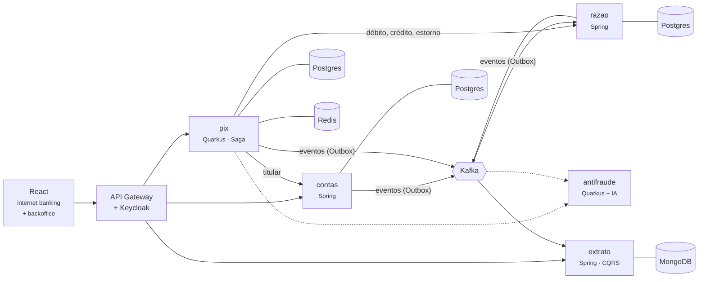

<div align="center">

# 🏦 Ledgerly Bank

**Um banco digital construído do zero, em público, para estudar engenharia de software
de nível sênior: razão contábil, Pix, concorrência, antifraude com IA e nuvem.**

[](https://github.com/alanjoffre/ledgerly-bank/actions/workflows/ci.yml)


</div>

> ⚠️ **Projeto de estudo.** O Ledgerly Bank é fictício: não é um banco, não movimenta dinheiro
> real e não se conecta a nenhum sistema do Banco Central. Todos os dados são sintéticos.

---

## O que é

O Ledgerly Bank simula o núcleo de um banco digital brasileiro:

- **Contas** de clientes, com abertura, bloqueio e encerramento;
- **Razão contábil** em partidas dobradas — o saldo é a soma dos lançamentos, e nada é apagado;
- **Pix** com chaves, QR Code, transferência instantânea e estorno automático quando algo falha;
- **Antifraude com IA**, que dá nota de risco em milissegundos e explica o alerta ao analista;
- **Extrato em tempo real**, montado a partir de eventos.

O objetivo não é só funcionar: é mostrar **por que** cada peça é como é. Cada decisão importante
está registrada numa [ADR](docs/adr/README.md), com as alternativas descartadas e o preço pago.

## Competências demonstradas

| Competência | Onde aparece |
| --- | --- |
| **Back-end com Spring e Quarkus + IA aplicada** | Contas e razão em Spring Boot; Pix em Quarkus (imagem nativa compilada e medida); antifraude com LangChain4j e ONNX (planejado: Fase 5) |
| **Front-end com React** | Internet banking e backoffice de fraude em React + TypeScript (planejado: Fase 4) |
| **Arquitetura de sistemas** | Microsserviços orientados a eventos, [Saga](docs/adr/0015-saga-orquestrada-no-pix.md), [Outbox](docs/adr/0013-outbox-para-publicar-eventos.md), [CQRS](docs/adr/0016-extrato-em-cqrs-no-mongodb.md) — [visão geral](docs/arquitetura/visao-geral.md) |
| **Software design e system design** | DDD, arquitetura hexagonal, *value objects*, diagramas C4, [ADRs](docs/adr/README.md) |
| **Concorrência e multithreading em Java** | Prova de saldo sem gasto duplo sob 1.500 saques simultâneos; [contas quentes em sub-contas](docs/adr/0019-contas-quentes-em-subcontas.md), medidas com Gatling; [*virtual threads* medidas](docs/adr/0020-virtual-threads-medidas-no-razao.md); conciliação em lote com [*Structured Concurrency* e *Scoped Values*](docs/adr/0022-conciliacao-em-lote-com-structured-concurrency.md); [JMH](docs/adr/0023-micro-benchmarks-com-jmh.md) |
| **Infra e nuvem: Docker, Kubernetes e AWS** | Docker Compose; Kubernetes com Helm e Terraform da AWS validado no CI (planejado: Fase 6) |
| **Bancos relacionais e NoSQL** | PostgreSQL (um banco por serviço), MongoDB, Redis; pgvector (planejado: Fase 5) |
| **Testes automatizados e qualidade** | JUnit, Testcontainers, ArchUnit, testes de propriedade, cobertura mínima no build; contrato (Pact) e *mutation testing* (PIT) (planejado: Fase 7) |

## Arquitetura



Linha tracejada: ainda não existe (antifraude, Fase 5). Detalhes, o fluxo completo de um Pix e os
princípios estão na [visão geral da arquitetura](docs/arquitetura/visao-geral.md); o formato de cada
evento, no [contrato dos eventos](docs/arquitetura/eventos.md).

## Andamento

| Fase | Entrega | Status |
| --- | --- | --- |
| 0 | Fundação: monorepo, `Dinheiro`, infraestrutura local, CI, documentação | ✅ |
| 1 | Razão contábil e contas (Spring Boot), prova de concorrência, idempotência | ✅ |
| 2 | Pix em Quarkus, Saga com estorno, Outbox + Kafka, extrato em CQRS (MongoDB) | ✅ |
| 3 | Concorrência e desempenho: contas quentes em sub-contas, teste de carga, conciliação em lote, JMH | ✅ |
| 4 | Segurança (Keycloak) e front-end React | ⬜ |
| 5 | IA aplicada: antifraude e assistente do extrato | ⬜ |
| 6 | Kubernetes, Terraform da AWS e observabilidade | ⬜ |
| 7 | Qualidade (PIT, Pact, SonarCloud) e lançamento | ⬜ |

O detalhe de cada fase está no [roteiro](docs/roadmap.md).

## Como rodar

Pré-requisitos: **JDK 25** e **Docker**. O Maven não precisa ser instalado (o projeto usa o
Maven Wrapper). Passo a passo completo no [guia de ambiente local](docs/guias/ambiente-local.md).

```bash
git clone https://github.com/alanjoffre/ledgerly-bank.git
cd ledgerly-bank

# Compilar e rodar todos os testes (precisa do Docker: os testes sobem bancos e Kafka de verdade)
./mvnw verify

# Subir PostgreSQL, MongoDB, Redis e Kafka (com os tópicos)
docker compose -f infra/docker/compose.yaml up -d --wait

# Gerar os pacotes e subir os quatro serviços
./mvnw package -DskipTests
./scripts/servicos.sh subir

# Pix de ponta a ponta, com o razão derrubado no meio de uma transferência
./scripts/demo-fase-2.sh

# As contas quentes medidas antes e depois, e a conciliação em lote
./scripts/demo-fase-3.sh
```

O que cada passo mostra está nas demonstrações da [Fase 2](docs/guias/demo-fase-2.md) e da
[Fase 3](docs/guias/demo-fase-3.md).

## Destaque: medir antes de acreditar

Todo depósito passa pelo **Caixa** e todo Pix passa pela **Liquidação Pix**. Cada lançamento trava
a linha das suas contas até o `COMMIT`, então pedidos de clientes **diferentes** faziam fila na
mesma linha. É a **conta quente** (*hot account*). O
[teste de carga](docs/adr/0021-teste-de-carga-com-gatling.md) mostrou o tamanho do problema, e a
solução foi dividir cada conta quente em 16 sub-contas, com o saldo sendo a soma delas
([ADR-0019](docs/adr/0019-contas-quentes-em-subcontas.md)):

| 64 clientes simultâneos, mesma sessão | Caixa numa linha só | 16 sub-contas |
| --- | --- | --- |
| Depósitos por segundo | 99 | **489** (5,0×) |
| Envios de Pix por segundo | 114 | **543** (4,8×) |
| Latência p99 dos depósitos | 1.043 ms | **288 ms** |

No caminho apareceu um buraco que nenhum teste pegava: o razão aceitava **receber e também
estornar** o mesmo Pix, e o dinheiro aparecia do nada. Agora um envio tem no máximo uma saída, na
aplicação e num índice único do banco.

E nem toda promessa se cumpriu. As *virtual threads*, ligadas no razão desde a Fase 1, foram
medidas em rodadas alternadas contra as threads de plataforma, e **perderam** (de 14% a 28% a menos
de vazão). O gargalo era o *pool* de conexões com o banco: com 64 conexões em vez de 20, a vazão
quase dobrou nos dois modos. O razão voltou às threads de plataforma, com os números na
[ADR-0020](docs/adr/0020-virtual-threads-medidas-no-razao.md).

Já na [conciliação em lote](docs/adr/0022-conciliacao-em-lote-com-structured-concurrency.md), o
paralelo vale a pena: **100 milhões de lançamentos por lado em menos de 1,5 s**, com *Structured
Concurrency* (se uma faixa falha, as outras param) e o mesmo resultado da execução em sequência.

## Destaque: sem resposta não é recusa

Um Pix atravessa dois serviços: o pedido mora no **pix** e o dinheiro no **razão**. Não existe uma
transação de banco que cubra os dois, e por isso a transferência é uma **Saga**: passos em ordem
(debitar o pagador, creditar o recebedor), cada um com a sua compensação (o estorno).

A armadilha está no meio. Quando o razão demora a responder, a tentação é estornar "por
segurança". O [teste](servicos/pix/src/test/java/io/github/alanjoffre/ledgerly/pix/integracao/TransferenciaIT.java)
faz exatamente esse cenário: o razão **credita** o recebedor e só depois demora. Para provar que o
teste pega o erro, a Saga foi alterada de propósito para estornar ali — e, com outro Pix em trânsito,
o pagador recebeu os R$ 80 de volta, o recebedor ficou com eles, e o estorno saiu do dinheiro de
**outro cliente**.

| O razão... | Significa | A Saga faz |
|---|---|---|
| respondeu que fez | o dinheiro se moveu | avança |
| respondeu que recusou (conta encerrada) | **certeza** de que nada se moveu | estorna ao pagador |
| não respondeu (fora do ar, lento) | **não se sabe** | repete o mesmo passo, com a mesma chave, até ter resposta |

Repetir é seguro porque cada passo tem uma chave de idempotência fixa: o razão devolve o lançamento
original em vez de mover o dinheiro de novo. Na [demonstração](docs/guias/demo-fase-2.md), o razão é
derrubado no meio de um Pix: o cliente recebe `202 Accepted` ("em processamento"), e a transferência
termina sozinha depois que o razão volta. Os detalhes estão na
[ADR-0015](docs/adr/0015-saga-orquestrada-no-pix.md).

E o extrato chega por eventos: o razão grava o evento na **mesma transação** do lançamento
([Outbox](docs/adr/0013-outbox-para-publicar-eventos.md)), o Kafka entrega, e o extrato monta a
leitura no MongoDB ([CQRS](docs/adr/0016-extrato-em-cqrs-no-mongodb.md)) — em cerca de 20 ms depois
de o evento chegar ao Kafka. Apagado o MongoDB, o extrato se reconstrói inteiro a partir do tópico.

## Destaque: Spring Boot × Quarkus, medido

O Pix é o serviço que precisa escalar em pico (dia de pagamento, Black Friday): uma cópia nova
tem que ficar pronta rápido. Ele é escrito em Quarkus e roda também como **imagem nativa**
(compilado direto para código de máquina, sem JVM). O
[script de medição](scripts/medir-subida.sh) sobe cada serviço 5 vezes, do comando até "pronto
para receber tráfego":

| Serviço | Subida | Memória |
|---|---|---|
| razão — Spring Boot, JVM | 5,9 – 6,7 s | ~400 MB |
| extrato — Spring Boot, JVM | 5,4 – 6,4 s | ~390 MB |
| pix — Quarkus, JVM | 2,2 – 2,6 s | ~300 MB |
| pix — Quarkus, **nativo** | **~0,1 s** | **~80 MB** |

Não é o mesmo programa escrito duas vezes — as limitações da comparação, e o preço da imagem
nativa (quase 4 minutos de compilação), estão na [ADR-0017](docs/adr/0017-quarkus-no-pix.md).

## Destaque: o razão aguenta 1.500 pedidos ao mesmo tempo

O [teste de concorrência](servicos/razao/src/test/java/io/github/alanjoffre/ledgerly/razao/integracao/ConcorrenciaIT.java)
dispara pedidos simultâneos em *virtual threads* contra um PostgreSQL de verdade. Para provar que
o teste pega o erro, a trava foi removida de propósito — e o resultado mudou assim:

| Cenário | Com a trava | Sem a trava |
|---|---|---|
| 1.500 saques de R$ 1,00 numa conta com R$ 1.000,00 | 1.000 aprovados, 500 recusados | **1.500 aprovados** — R$ 500 de gasto duplo |
| 400 transferências cruzadas A↔B ao mesmo tempo | nenhum deadlock, total intacto | **dinheiro sumiu** (R$ 11,00 numa rodada; o valor varia) |
| 100 cliques no mesmo depósito (mesma `Idempotency-Key`) | 1 lançamento + 99 respostas repetidas | 1 lançamento (o `UNIQUE` do banco segura), mas **19 clientes recebem um erro falso** de "chave já usada para outro pedido" |

A solução — travar as contas sempre na mesma ordem (`SELECT ... ORDER BY id FOR UPDATE`) — e as
alternativas descartadas estão na [ADR-0009](docs/adr/0009-concorrencia-com-trava-pessimista-ordenada.md).
E o banco não confia cegamente na aplicação: saldo negativo, lançamento desbalanceado e alteração
do razão são recusados pelo próprio PostgreSQL.

Quer ver rodando? [Demonstração da Fase 1](docs/guias/demo-fase-1.md).

## Destaque: dinheiro sem perder centavo

Antes de qualquer serviço, o projeto define o tipo [`Dinheiro`](bibliotecas/nucleo-compartilhado/src/main/java/io/github/alanjoffre/ledgerly/nucleo/Dinheiro.java),
que resolve três erros clássicos de sistemas financeiros:

```java
// 1. double perde precisão; Dinheiro não
0.1 + 0.2                                             // 0.30000000000000004
Dinheiro.reais("0.10").somar(Dinheiro.reais("0.20"))  // BRL 0.30

// 2. Dividir R$ 100,00 em 3 sem perder o centavo
Dinheiro.reais("100.00").ratear(3)                    // [33.34, 33.33, 33.33]

// 3. Real com dólar não se soma
Dinheiro.reais("10").somar(dolares)                   // MoedasDiferentesException
```

Um **teste de propriedade** confere que, para 10 mil valores e divisões aleatórias, a soma do
rateio é sempre exatamente o original. O motivo de usar `BigDecimal` e arredondamento bancário
está na [ADR-0007](docs/adr/0007-dinheiro-com-bigdecimal.md).

## Estrutura do repositório

```text
ledgerly-bank/
├── bibliotecas/
│   └── nucleo-compartilhado/   # tipos de domínio comuns (Dinheiro), Java puro
├── servicos/
│   ├── contas/                 # clientes e contas (Spring Boot + JPA)
│   ├── razao/                  # razão contábil (Spring Boot + JDBC)
│   ├── pix/                    # chaves, QR Code e a Saga (Quarkus)
│   └── extrato/                # extrato em CQRS (Spring Boot + MongoDB)
├── lotes/
│   └── conciliacao/            # conciliação em lote Pix × razão (Structured Concurrency)
├── desempenho/                 # medições: carga, micro-benchmarks e os números
│   ├── carga/                  # teste de carga (Gatling)
│   ├── jmh/                    # micro-benchmarks (JMH)
│   └── resultados/             # os números de cada medição
├── infra/
│   └── docker/                 # Docker Compose, bancos e tópicos do Kafka
├── scripts/                    # subir os serviços, demonstrações, medições
├── docs/
│   ├── adr/                    # decisões de arquitetura
│   ├── arquitetura/            # diagramas C4 e o contrato dos eventos
│   ├── guias/                  # como fazer (ambiente local...)
│   └── glossario.md            # termos de banco e de tecnologia
├── .github/workflows/          # CI no GitHub Actions
└── pom.xml                     # POM pai do Maven
```

## Documentação

- [Visão geral da arquitetura](docs/arquitetura/visao-geral.md)
- [Decisões de arquitetura (ADR)](docs/adr/README.md)
- [Roteiro de fases](docs/roadmap.md)
- [Glossário](docs/glossario.md) — termos de banco e de tecnologia explicados
- [Guia de ambiente local](docs/guias/ambiente-local.md)
- [Contrato dos eventos](docs/arquitetura/eventos.md) — tópicos do Kafka e formato de cada evento
- Demonstrações: [Fase 1](docs/guias/demo-fase-1.md) · [Fase 2](docs/guias/demo-fase-2.md) ·
  [Fase 3](docs/guias/demo-fase-3.md)
- Serviços: [razão](servicos/razao/README.md) · [contas](servicos/contas/README.md) ·
  [pix](servicos/pix/README.md) · [extrato](servicos/extrato/README.md)
- [Conciliação em lote](lotes/conciliacao/README.md) · [Medições de desempenho](desempenho/README.md)
  (carga e micro-benchmarks)
- [Histórico de versões](CHANGELOG.md)
- [Como contribuir](CONTRIBUTING.md)

## Autor

**Alan Joffre** — [LinkedIn](https://www.linkedin.com/in/alanjoffre/) · [GitHub](https://github.com/alanjoffre)

## Licença

[MIT](LICENSE) — pode usar, copiar e modificar, mantendo o aviso de autoria.
