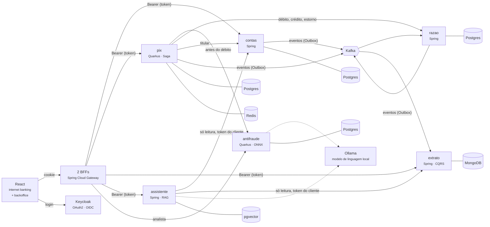

<div align="center">

# 🏦 Ledgerly Bank

**Um banco digital construído do zero, em público, para estudar engenharia de software
de nível sênior: razão contábil, Pix, concorrência, antifraude com IA e nuvem.**

[](https://github.com/alanjoffre/ledgerly-bank/actions/workflows/ci.yml)


</div>

> ⚠️ **Projeto de estudo.** O Ledgerly Bank é fictício: não é um banco, não movimenta dinheiro
> real e não se conecta a nenhum sistema do Banco Central. Todos os dados são sintéticos.

---

## O que é

O Ledgerly Bank simula o núcleo de um banco digital brasileiro:

- **Contas** de clientes, com abertura, bloqueio e encerramento;
- **Razão contábil** em partidas dobradas — o saldo é a soma dos lançamentos, e nada é apagado;
- **Pix** com chaves, QR Code, transferência instantânea e estorno automático quando algo falha;
- **Antifraude com IA**, que dá nota de risco antes do débito, segura o Pix suspeito para uma
  analista e explica o alerta a ela;
- **Assistente "pergunte ao seu extrato"**, com um modelo de linguagem que roda na própria máquina
  e só lê;
- **Extrato em tempo real**, montado a partir de eventos;
- **Duas telas**: o internet banking do cliente e o backoffice de fraude da analista, com login no
  Keycloak.

O objetivo não é só funcionar: é mostrar **por que** cada peça é como é. Cada decisão importante
está registrada numa [ADR](docs/adr/README.md), com as alternativas descartadas e o preço pago.

## Competências demonstradas

| Competência | Onde aparece |
| --- | --- |
| **Back-end com Spring e Quarkus + IA aplicada** | Contas e razão em Spring Boot; Pix em Quarkus (imagem nativa compilada e medida); antifraude com modelo [ONNX treinado em Python](docs/adr/0032-antifraude-regras-e-modelo-onnx.md) e regras; modelo de linguagem local (Ollama) com LangChain4j: [RAG, *tool calling* só de leitura e *guardrails*](docs/adr/0036-assistente-rag-ferramentas-e-travas.md), e a [avaliação das respostas](docs/adr/0037-avaliacao-do-assistente-fora-do-ci.md) |
| **Front-end com React** | [Internet banking e backoffice de fraude](web/README.md) em React 19 + TypeScript (Vite, Vitest), com testes de ponta a ponta no Playwright |
| **Segurança de aplicação** | Keycloak (OAuth2/OIDC, PKCE), [BFF com o token fora do navegador](docs/adr/0025-bff-um-por-front-end.md), [BOLA respondida com 404](docs/adr/0026-bola-com-404.md), [token de serviço](docs/adr/0027-token-de-servico-e-razao-sem-rota.md), CSRF e CSP |
| **Arquitetura de sistemas** | Microsserviços orientados a eventos, [Saga](docs/adr/0015-saga-orquestrada-no-pix.md), [Outbox](docs/adr/0013-outbox-para-publicar-eventos.md), [CQRS](docs/adr/0016-extrato-em-cqrs-no-mongodb.md) — [visão geral](docs/arquitetura/visao-geral.md) |
| **Software design e system design** | DDD, arquitetura hexagonal, *value objects*, diagramas C4, [ADRs](docs/adr/README.md) |
| **Concorrência e multithreading em Java** | Prova de saldo sem gasto duplo sob 1.500 saques simultâneos; [contas quentes em sub-contas](docs/adr/0019-contas-quentes-em-subcontas.md), medidas com Gatling; [*virtual threads* medidas](docs/adr/0020-virtual-threads-medidas-no-razao.md); conciliação em lote com [*Structured Concurrency* e *Scoped Values*](docs/adr/0022-conciliacao-em-lote-com-structured-concurrency.md); [JMH](docs/adr/0023-micro-benchmarks-com-jmh.md) |
| **Infra e nuvem: Docker, Kubernetes e AWS** | Docker *multi-stage* e imagem nativa; Kubernetes (k3d) com Helm, HPA e sondas; Terraform da AWS validado sem conta; OpenTelemetry e Grafana; *circuit breaker* |
| **Bancos relacionais e NoSQL** | PostgreSQL (um banco por serviço), MongoDB, Redis; pgvector (a busca por vetores do assistente) |
| **Testes automatizados e qualidade** | JUnit, Testcontainers, ArchUnit, testes de propriedade, cobertura mínima no build; Vitest e Testing Library nas telas; Playwright de ponta a ponta; [contratos com Pact](docs/adr/0045-contratos-entre-servicos-com-pact.md), [testes de mutação com PIT](docs/adr/0044-testes-de-mutacao-com-pit.md) e [Sonar](docs/adr/0046-sonar-local-e-condicionado-no-ci.md) |

## Arquitetura



O modelo de linguagem roda na própria máquina, no Ollama (linha tracejada: sem ele, o antifraude
decide igual e o assistente responde a mensagem de reserva). O razão não tem rota no BFF: só outro
serviço fala com ele, com o próprio token. Detalhes, o fluxo completo de um Pix e os
princípios estão na [visão geral da arquitetura](docs/arquitetura/visao-geral.md); o formato de cada
evento, no [contrato dos eventos](docs/arquitetura/eventos.md).

## Andamento

| Fase | Entrega | Status |
| --- | --- | --- |
| 0 | Fundação: monorepo, `Dinheiro`, infraestrutura local, CI, documentação | ✅ |
| 1 | Razão contábil e contas (Spring Boot), prova de concorrência, idempotência | ✅ |
| 2 | Pix em Quarkus, Saga com estorno, Outbox + Kafka, extrato em CQRS (MongoDB) | ✅ |
| 3 | Concorrência e desempenho: contas quentes em sub-contas, teste de carga, conciliação em lote, JMH | ✅ |
| 4 | Segurança (Keycloak, BFF, BOLA) e front-end React, com testes de ponta a ponta | ✅ |
| 5 | IA aplicada: antifraude (ONNX + regras), Pix retido, assistente do extrato (RAG) e *evals* | ✅ |
| 6 | Imagens e Kubernetes (k3d + Helm), Terraform da AWS, *circuit breaker* e OpenTelemetry | ✅ |
| 7 | Qualidade (PIT, Pact, Sonar), *runbooks* e lançamento | ✅ |

O detalhe de cada fase está no [roteiro](docs/roadmap.md).

**O projeto está concluído, na versão 1.0.0.** O que ele prova e o que não prova:

- **Prova:** 1.141 testes automatizados, 96,7% de mutação no domínio, 92,6% de cobertura, 12 interações em contrato e
  [47 decisões](docs/adr/README.md) escritas com o preço de cada uma.
- **Não prova:** nunca teve cliente nem plantão de verdade, e os dados são sintéticos. Não há alerta nenhum. A AWS está em
  Terraform e nunca foi aplicada, e o Kubernetes é local, de um nó. Os testes de ponta a ponta rodam só à mão, fora do CI. A
  mutação cobre só o domínio, e os contratos, só o caminho do dinheiro. Durante uma queda do antifraude, nenhuma regra de risco
  vale ([ADR-0041](docs/adr/0041-circuit-breaker-no-antifraude.md)).

## Como rodar

Pré-requisitos: **JDK 25**, **Docker** e, para as telas, **Node 22**. O Maven não precisa ser
instalado (o projeto usa o Maven Wrapper). Passo a passo completo no [guia de ambiente local](docs/guias/ambiente-local.md).

```bash
git clone https://github.com/alanjoffre/ledgerly-bank.git
cd ledgerly-bank

# Compilar e rodar todos os testes (precisa do Docker: os testes sobem bancos e Kafka de verdade)
./mvnw verify

# Subir PostgreSQL, pgvector, MongoDB, Redis, Kafka (com os tópicos) e Keycloak (com o realm)
docker compose -f infra/docker/compose.yaml up -d --wait

# Opcional, com placa de vídeo: o modelo de linguagem local (Ollama) e os modelos (uma vez)
docker compose -f infra/docker/compose.yaml --profile ia up -d --wait ollama
./scripts/modelos.sh

# Gerar os pacotes e as telas, e subir os seis serviços e os dois gateways
./mvnw package -DskipTests
(cd web && npm ci && npm run construir)
./scripts/servicos.sh subir

# Contas, saldo e chave Pix para a Ana e o Bruno; depois, abra as telas:
#   http://localhost:8080 (ana / ana-local)   ·   http://localhost:8090 (carla / carla-local)
./scripts/semear.sh

# O navegador de verdade: login, Pix, extrato, BOLA e a devolução no backoffice
(cd web/e2e && npx playwright install chromium && npm run e2e)

# Pix de ponta a ponta, com o razão derrubado no meio de uma transferência
./scripts/demo-fase-2.sh

# As contas quentes medidas antes e depois, e a conciliação em lote
./scripts/demo-fase-3.sh

# Um Pix retido pelo antifraude, para a analista ver a nota e a explicação no backoffice
./scripts/pix-retido.sh

# A avaliação do assistente: 30 perguntas contra o modelo de verdade (precisa do Ollama)
./mvnw -pl servicos/assistente test -Dtest=AvaliacaoDoAssistente -Dsurefire.failIfNoSpecifiedTests=false
```

O que cada passo mostra está nas demonstrações da [Fase 2](docs/guias/demo-fase-2.md), da
[Fase 3](docs/guias/demo-fase-3.md), da [Fase 4](docs/guias/demo-fase-4.md), da
[Fase 5](docs/guias/demo-fase-5.md) e da [Fase 6](docs/guias/demo-fase-6.md).

## Destaque: a cobertura dizia 100%, e o teste não testava

O CPF tinha 100% de cobertura. Os **testes de mutação** ([ADR-0044](docs/adr/0044-testes-de-mutacao-com-pit.md)) alteram o
código de propósito para ver se algum teste percebe, e ali 8 alterações passaram, inclusive "o dígito verificador é sempre 0".
O motivo: o gerador de CPF dos testes chamava a própria função testada. Se o cálculo estivesse errado, o gerador erraria igual.

| Módulo (domínio) | Mutantes mortos | Antes dos reforços |
| --- | --- | --- |
| núcleo, antifraude, assistente, extrato | 165 de 165 (100%) | antifraude 88%, assistente 91% |
| razão | 104 de 105 (99,0%) | 88% |
| contas | 60 de 62 (96,8%) | 71% |
| Pix | 194 de 209 (92,8%) | 84% |

**Total: 523 de 541, 96,7%.** Os 18 que sobraram estão explicados na ADR: alguns não mudam o comportamento, e os limites de
*parse* do QR Code ficaram sem reforço. As duas colunas não são a mesma régua: antes, as exceções ainda contavam.

Nesta mesma fase:

- **Contratos** ([ADR-0045](docs/adr/0045-contratos-entre-servicos-com-pact.md)): renomear `saldo` no razão reprova o build do
  razão, sem subir o Pix. Renomear um campo que ninguém lê não reprova, e está certo. São 12 interações, só no caminho do
  dinheiro; o que ficou de fora está escrito.
- **O CI vermelho sem o código mudar** ([ADR-0043](docs/adr/0043-reprodutibilidade-do-modelo.md)): o treino do modelo varia até 9e-6
  conforme o processador, e a folga era 1e-6. A promessa de "byte a byte" estava errada, e foi corrigida por escrito.
- **Análise estática** ([ADR-0046](docs/adr/0046-sonar-local-e-condicionado-no-ci.md)): 92,6% de cobertura e portão aprovado; 20 avisos
  olhados, nenhum defeito em produção, e nenhum calado com anotação. Por isso o painel segue com notas C e D, e a ADR explica.
- **[Runbooks](docs/runbooks/README.md):** o que fazer quando algo falha, e o que aconteceu ao provocar a falha de verdade.
- **O ensaio achou um defeito da Fase 0** ([ADR-0047](docs/adr/0047-eventos-do-kafka-no-volume.md)): o Kafka gravava dentro do contêiner, e
  cada `down` apagava os eventos de onde o extrato se reconstrói. Sete fases de testes não viram, porque nenhum reiniciava o ambiente.

**1.141 testes:** 1.061 Java (795 de unidade, 266 de integração), 73 de tela e 7 de ponta a ponta.

## Destaque: operar é medir a falha, não só subir o serviço

O antifraude trava. O limite de 800 ms já protegia o Pix de ficar pendurado, mas cada Pix pagava esses
800 ms. Com um *circuit breaker* ([ADR-0041](docs/adr/0041-circuit-breaker-no-antifraude.md)), medido com o
antifraude congelado de verdade (`SIGSTOP`) e duas rodadas de cada lado:

| Com o antifraude travado | Sem circuito | Com circuito |
| --- | --- | --- |
| Pix por segundo | 18 a 19 | 121 a 130 |
| p50 | ~830 ms | 101 a 110 ms |
| Erros | 0 | 0 |
| Tempo até a primeira nota depois da volta | 0,2 a 0,3 s | 3,5 a 4,4 s |

O preço está na última linha, e há outro: a espera era um freio acidental. Agora sai bem mais Pix sem
avaliação durante a queda, e **o limite por pagador que faltaria aí não foi feito**. A ADR conta.

No Kubernetes local ([ADR-0039](docs/adr/0039-kubernetes-local-com-k3d-e-helm.md)), `./scripts/k8s.sh subir`
leva 62 s do zero. Um pod morto no meio de 320 Pix: os 320 concluídos, R$ 3.200,00 exatos. A troca de versão
sob carga foi de 586 erros sem sondas para 0 com sondas e `preStop`. E o teste achou o que o ambiente local
escondia: 5 cópias × 20 conexões estouram o Postgres ([números](infra/k8s/README.md)).

O Pix nativo tem 219 MB e sobe em ~0,1 s, contra ~2,5 s na JVM
([ADR-0038](docs/adr/0038-imagens-multi-stage-e-nativa.md)). O Terraform descreve 230 recursos na AWS, conferidos
sem conta e sem custo, e **nunca foi aplicado** ([ADR-0040](docs/adr/0040-terraform-validado-e-simulador-local.md)).
Com OpenTelemetry, um Pix é seguido por todos os serviços num único rastro; o custo ficou dentro do ruído
da medição, e a [ADR-0042](docs/adr/0042-opentelemetry-e-otel-lgtm.md) conta como a primeira medição enganou.

## Destaque: IA que desconfia, explica e é medida

Antes de debitar, o Pix pergunta ao **antifraude**. A nota vem de regras (rajada de Pix, conta
"laranja" aberta ontem) e de uma regressão logística treinada em Python e executada **dentro da JVM,
em ONNX**: cerca de **6,5 µs por Pix** ([ADR-0032](docs/adr/0032-antifraude-regras-e-modelo-onnx.md)).
Nota alta, o Pix fica **retido antes do débito**: nenhum dinheiro se move até a analista liberar ou
recusar ([ADR-0033](docs/adr/0033-pix-retido-antes-do-debito.md)). Se o antifraude cair, Pix de até
R$ 500 segue, e acima disso fica para a analista.

A IA generativa roda **na própria máquina** (Ollama, sem API paga, nenhum dado sai), e sempre com
uma regra conferindo:

| Onde | O que o modelo faz | A regra que confere |
| --- | --- | --- |
| Backoffice | O `gemma3:4b` explica à analista por que o Pix foi retido | todo número do texto tem de existir na avaliação; número inventado derruba o texto, e vale um texto fixo ([ADR-0035](docs/adr/0035-explicacao-com-trava-de-numeros.md)) |
| Internet banking | O assistente responde sobre o extrato com a busca na ajuda (RAG, pgvector) e três ferramentas **só de leitura**, com o token do próprio cliente | trava de entrada contra quem tenta trocar as instruções; valor em reais que não veio da ferramenta nem do artigo vira a mensagem de reserva ([ADR-0036](docs/adr/0036-assistente-rag-ferramentas-e-travas.md)) |

**O cliente não vê a nota nem os motivos.** Na revisão, a tela do cliente mostrava "15 vezes a
média": se o cliente lê, o golpista lê, e aprende a ficar logo abaixo do limite. Agora ele vê "Pix
retido para análise de segurança". O mesmo vazamento estava num artigo de ajuda do assistente, que
citava os limites do antifraude.

**A avaliação achou o que os testes não viam.** Os testes do build usam um modelo falso, que aceita
qualquer coisa. A [avaliação](avaliacao/README.md) faz 30 perguntas fixas ao modelo de verdade e
confere cada resposta por regra ([ADR-0037](docs/adr/0037-avaliacao-do-assistente-fora-do-ci.md)):

1. a primeira rodada não teve número: o `qwen3:4b` "pensa" antes de responder, e o raciocínio gastava
   o limite de *tokens*; a resposta saía vazia. Troca: a versão *instruct*, que responde direto;
2. a segunda deu **4 de 30**: o Ollama recusava toda pergunta, porque o LangChain4j mandava a
   ferramenta sem parâmetro sem o esquema completo. Correção: um *decorator* que completa o esquema, com teste;
3. a terceira: **27 de 30**, p50 de 1,35 s por pergunta, sem nenhum valor errado ou de outra conta
   ([resultado](avaliacao/assistente/resultados/2026-10-30-qwen3-4b-instruct-2507-q4-K-M.md)).

## Destaque: o navegador achou o que os testes não viam

Todos os testes passavam. Aí um navegador de verdade (o Chromium, pelo Playwright) fez login no
Keycloak, enviou um Pix pela tela e abriu o extrato, e **cinco defeitos** apareceram:

| O que a pessoa via | A causa |
| --- | --- |
| Um "acesso negado" (403) chegava como "deu certo" (200), com a tela no corpo | o erro caía no *fallback* da SPA, que devolve o `index.html` |
| O Pix pela tela falhava | ia a chave **mascarada** que a consulta devolve (`b***@...`), e não a digitada |
| Depois do login, uma página de JSON | o BFF guardava o último pedido sem sessão e voltava para ele |
| A mensagem do Pix ("Aluguel") nunca chegava ao extrato — **desde a Fase 2** | a Saga mandava ao razão uma descrição fixa |
| "Saldo indisponível" em toda conta | o falso do teste da tela trazia o saldo na lista de contas, e a API real não traz |

Os dois últimos têm a mesma lição: o teste com um falso prova a tela contra o falso; só o teste
contra o sistema de verdade prova a tela contra a API. Cada defeito ganhou primeiro um teste que
falhava, e depois a correção ([ADR-0029](docs/adr/0029-react-vite-vitest-playwright.md)).

A segurança da fase, no mesmo espírito de "provar, não prometer":

- **O token não chega ao navegador.** O login é no Keycloak (*authorization code* + PKCE), e o token
  fica no BFF, que o repassa aos serviços. O navegador só tem um cookie que o JavaScript não lê
  ([ADR-0025](docs/adr/0025-bff-um-por-front-end.md)). Um XSS não tem token para roubar.
- **BOLA, a falha nº 1 do OWASP para APIs:** a Ana pedir a conta do Bruno responde **404, igual ao
  de uma conta que não existe**. Nem a existência vaza
  ([ADR-0026](docs/adr/0026-bola-com-404.md)); há teste disso no contas, no Pix, no extrato e no navegador.
- **O razão não tem rota na internet:** só outro serviço, com o token do próprio serviço, fala com
  ele ([ADR-0027](docs/adr/0027-token-de-servico-e-razao-sem-rota.md)).
- **O BFF custa cerca de 1 ms por pedido**, medido com o Gatling: a mesma leitura direto no serviço
  e pelo BFF, sem nenhum erro nos dois.

## Destaque: medir antes de acreditar

Todo depósito passa pelo **Caixa** e todo Pix passa pela **Liquidação Pix**. Cada lançamento trava
a linha das suas contas até o `COMMIT`, então pedidos de clientes **diferentes** faziam fila na
mesma linha. É a **conta quente** (*hot account*). O
[teste de carga](docs/adr/0021-teste-de-carga-com-gatling.md) mostrou o tamanho do problema, e a
solução foi dividir cada conta quente em 16 sub-contas, com o saldo sendo a soma delas
([ADR-0019](docs/adr/0019-contas-quentes-em-subcontas.md)):

| 64 clientes simultâneos, mesma sessão | Caixa numa linha só | 16 sub-contas |
| --- | --- | --- |
| Depósitos por segundo | 99 | **489** (5,0×) |
| Envios de Pix por segundo | 114 | **543** (4,8×) |
| Latência p99 dos depósitos | 1.043 ms | **288 ms** |

No caminho apareceu um buraco que nenhum teste pegava: o razão aceitava **receber e também
estornar** o mesmo Pix, e o dinheiro aparecia do nada. Agora um envio tem no máximo uma saída, na
aplicação e num índice único do banco.

E nem toda promessa se cumpriu. As *virtual threads*, ligadas no razão desde a Fase 1, foram
medidas em rodadas alternadas contra as threads de plataforma, e **perderam** (de 14% a 28% a menos
de vazão). O gargalo era o *pool* de conexões com o banco: com 64 conexões em vez de 20, a vazão
quase dobrou nos dois modos. O razão voltou às threads de plataforma, com os números na
[ADR-0020](docs/adr/0020-virtual-threads-medidas-no-razao.md).

Já na [conciliação em lote](docs/adr/0022-conciliacao-em-lote-com-structured-concurrency.md), o
paralelo vale a pena: **100 milhões de lançamentos por lado em menos de 1,5 s**, com *Structured
Concurrency* (se uma faixa falha, as outras param) e o mesmo resultado da execução em sequência.

## Destaque: sem resposta não é recusa

Um Pix atravessa dois serviços: o pedido mora no **pix** e o dinheiro no **razão**. Não existe uma
transação de banco que cubra os dois, e por isso a transferência é uma **Saga**: passos em ordem
(debitar o pagador, creditar o recebedor), cada um com a sua compensação (o estorno).

A armadilha está no meio. Quando o razão demora a responder, a tentação é estornar "por
segurança". O [teste](servicos/pix/src/test/java/io/github/alanjoffre/ledgerly/pix/integracao/TransferenciaIT.java)
faz exatamente esse cenário: o razão **credita** o recebedor e só depois demora. Para provar que o
teste pega o erro, a Saga foi alterada de propósito para estornar ali — e, com outro Pix em trânsito,
o pagador recebeu os R$ 80 de volta, o recebedor ficou com eles, e o estorno saiu do dinheiro de
**outro cliente**.

| O razão... | Significa | A Saga faz |
|---|---|---|
| respondeu que fez | o dinheiro se moveu | avança |
| respondeu que recusou (conta encerrada) | **certeza** de que nada se moveu | estorna ao pagador |
| não respondeu (fora do ar, lento) | **não se sabe** | repete o mesmo passo, com a mesma chave, até ter resposta |

Repetir é seguro porque cada passo tem uma chave de idempotência fixa: o razão devolve o lançamento
original em vez de mover o dinheiro de novo. Na [demonstração](docs/guias/demo-fase-2.md), o razão é
derrubado no meio de um Pix: o cliente recebe `202 Accepted` ("em processamento"), e a transferência
termina sozinha depois que o razão volta. Os detalhes estão na
[ADR-0015](docs/adr/0015-saga-orquestrada-no-pix.md).

E o extrato chega por eventos: o razão grava o evento na **mesma transação** do lançamento
([Outbox](docs/adr/0013-outbox-para-publicar-eventos.md)), o Kafka entrega, e o extrato monta a
leitura no MongoDB ([CQRS](docs/adr/0016-extrato-em-cqrs-no-mongodb.md)) — em cerca de 20 ms depois
de o evento chegar ao Kafka. Apagado o MongoDB, o extrato se reconstrói inteiro a partir do tópico.

## Destaque: Spring Boot × Quarkus, medido

O Pix é o serviço que precisa escalar em pico (dia de pagamento, Black Friday): uma cópia nova
tem que ficar pronta rápido. Ele é escrito em Quarkus e roda também como **imagem nativa**
(compilado direto para código de máquina, sem JVM). O
[script de medição](scripts/medir-subida.sh) sobe cada serviço 5 vezes, do comando até "pronto
para receber tráfego":

| Serviço | Subida | Memória |
|---|---|---|
| razão — Spring Boot, JVM | 5,9 – 6,7 s | ~400 MB |
| extrato — Spring Boot, JVM | 5,4 – 6,4 s | ~390 MB |
| pix — Quarkus, JVM | 2,2 – 2,6 s | ~300 MB |
| pix — Quarkus, **nativo** | **~0,1 s** | **~80 MB** |

Não é o mesmo programa escrito duas vezes — as limitações da comparação, e o preço da imagem
nativa (quase 4 minutos de compilação), estão na [ADR-0017](docs/adr/0017-quarkus-no-pix.md).

## Destaque: o razão aguenta 1.500 pedidos ao mesmo tempo

O [teste de concorrência](servicos/razao/src/test/java/io/github/alanjoffre/ledgerly/razao/integracao/ConcorrenciaIT.java)
dispara pedidos simultâneos em *virtual threads* contra um PostgreSQL de verdade. Para provar que
o teste pega o erro, a trava foi removida de propósito — e o resultado mudou assim:

| Cenário | Com a trava | Sem a trava |
|---|---|---|
| 1.500 saques de R$ 1,00 numa conta com R$ 1.000,00 | 1.000 aprovados, 500 recusados | **1.500 aprovados** — R$ 500 de gasto duplo |
| 400 transferências cruzadas A↔B ao mesmo tempo | nenhum deadlock, total intacto | **dinheiro sumiu** (R$ 11,00 numa rodada; o valor varia) |
| 100 cliques no mesmo depósito (mesma `Idempotency-Key`) | 1 lançamento + 99 respostas repetidas | 1 lançamento (o `UNIQUE` do banco segura), mas **19 clientes recebem um erro falso** de "chave já usada para outro pedido" |

A solução — travar as contas sempre na mesma ordem (`SELECT ... ORDER BY id FOR UPDATE`) — e as
alternativas descartadas estão na [ADR-0009](docs/adr/0009-concorrencia-com-trava-pessimista-ordenada.md).
E o banco não confia cegamente na aplicação: saldo negativo, lançamento desbalanceado e alteração
do razão são recusados pelo próprio PostgreSQL.

Quer ver rodando? [Demonstração da Fase 1](docs/guias/demo-fase-1.md).

## Destaque: dinheiro sem perder centavo

Antes de qualquer serviço, o projeto define o tipo [`Dinheiro`](bibliotecas/nucleo-compartilhado/src/main/java/io/github/alanjoffre/ledgerly/nucleo/Dinheiro.java),
que resolve três erros clássicos de sistemas financeiros:

```java
// 1. double perde precisão; Dinheiro não
0.1 + 0.2                                             // 0.30000000000000004
Dinheiro.reais("0.10").somar(Dinheiro.reais("0.20"))  // BRL 0.30

// 2. Dividir R$ 100,00 em 3 sem perder o centavo
Dinheiro.reais("100.00").ratear(3)                    // [33.34, 33.33, 33.33]

// 3. Real com dólar não se soma
Dinheiro.reais("10").somar(dolares)                   // MoedasDiferentesException
```

Um **teste de propriedade** confere que, para 10 mil valores e divisões aleatórias, a soma do
rateio é sempre exatamente o original. O motivo de usar `BigDecimal` e arredondamento bancário
está na [ADR-0007](docs/adr/0007-dinheiro-com-bigdecimal.md).

## Estrutura do repositório

```text
ledgerly-bank/
├── bibliotecas/
│   ├── nucleo-compartilhado/   # tipos de domínio comuns (Dinheiro), Java puro
│   └── seguranca-spring/       # token do Keycloak nos serviços Spring
├── servicos/
│   ├── contas/                 # clientes e contas (Spring Boot + JPA)
│   ├── razao/                  # razão contábil (Spring Boot + JDBC)
│   ├── pix/                    # chaves, QR Code e a Saga (Quarkus)
│   ├── extrato/                # extrato em CQRS (Spring Boot + MongoDB)
│   ├── antifraude/             # nota de risco do Pix: modelo ONNX + regras (Quarkus)
│   ├── assistente/             # "pergunte ao seu extrato": RAG + ferramentas (Spring Boot)
│   └── gateway/                # os dois BFFs (Spring Cloud Gateway)
├── contratos/                  # o que cada serviço espera do outro (Pact), gerado pelos testes
├── ml/                         # o treino do modelo de risco (Python, fora do build)
├── avaliacao/                  # a avaliação do assistente contra o modelo de verdade
├── web/                        # as telas (React + TypeScript) e os testes de ponta a ponta
├── Dockerfile                  # todas as imagens, em vários estágios
├── lotes/
│   └── conciliacao/            # conciliação em lote Pix × razão (Structured Concurrency)
├── desempenho/                 # medições: carga, micro-benchmarks e os números
│   ├── carga/                  # teste de carga (Gatling)
│   ├── jmh/                    # micro-benchmarks (JMH)
│   └── resultados/             # os números de cada medição
├── infra/
│   ├── docker/                 # Docker Compose, bancos, tópicos do Kafka e o realm do Keycloak
│   ├── k8s/                    # Helm chart do Kubernetes local (k3d)
│   ├── terraform/              # a AWS como código, validada sem conta (nunca aplicada)
│   └── observabilidade/        # painéis do Grafana
├── scripts/                    # subir os serviços, demonstrações, medições
├── docs/
│   ├── adr/                    # decisões de arquitetura
│   ├── arquitetura/            # diagramas C4 e o contrato dos eventos
│   ├── guias/                  # como fazer (ambiente local...)
│   ├── runbooks/               # o que fazer quando algo falha
│   └── glossario.md            # termos de banco e de tecnologia
├── .github/workflows/          # CI no GitHub Actions
└── pom.xml                     # POM pai do Maven
```

## Documentação

- [Visão geral da arquitetura](docs/arquitetura/visao-geral.md)
- [Decisões de arquitetura (ADR)](docs/adr/README.md)
- [Roteiro de fases](docs/roadmap.md)
- [Runbooks](docs/runbooks/README.md) — o que fazer quando algo falha
- [Glossário](docs/glossario.md) — termos de banco e de tecnologia explicados
- [Guia de ambiente local](docs/guias/ambiente-local.md)
- [Contrato dos eventos](docs/arquitetura/eventos.md) — tópicos do Kafka e formato de cada evento
- Demonstrações: [Fase 1](docs/guias/demo-fase-1.md) · [Fase 2](docs/guias/demo-fase-2.md) ·
  [Fase 3](docs/guias/demo-fase-3.md) · [Fase 4](docs/guias/demo-fase-4.md) ·
  [Fase 5](docs/guias/demo-fase-5.md) · [Fase 6](docs/guias/demo-fase-6.md) ·
  [Fase 7](docs/guias/demo-fase-7.md)
- [Kubernetes local](infra/k8s/README.md) · [Terraform da AWS](infra/terraform/README.md)
- Serviços: [razão](servicos/razao/README.md) · [contas](servicos/contas/README.md) ·
  [pix](servicos/pix/README.md) · [extrato](servicos/extrato/README.md) ·
  [antifraude](servicos/antifraude/README.md) · [assistente](servicos/assistente/README.md) ·
  [gateway (BFF)](servicos/gateway/README.md) · [segurança](bibliotecas/seguranca-spring/README.md)
- [Treino do modelo de risco](ml/README.md) · [Avaliação do assistente](avaliacao/README.md)
- [As telas](web/README.md) — internet banking, backoffice e os testes de ponta a ponta
- [Conciliação em lote](lotes/conciliacao/README.md) · [Medições de desempenho](desempenho/README.md)
  (carga e micro-benchmarks)
- [Histórico de versões](CHANGELOG.md)
- [Como contribuir](CONTRIBUTING.md)

## Autor

**Alan Joffre** — [LinkedIn](https://www.linkedin.com/in/alanjoffre/) · [GitHub](https://github.com/alanjoffre)

## Licença

[MIT](LICENSE) — pode usar, copiar e modificar, mantendo o aviso de autoria.
