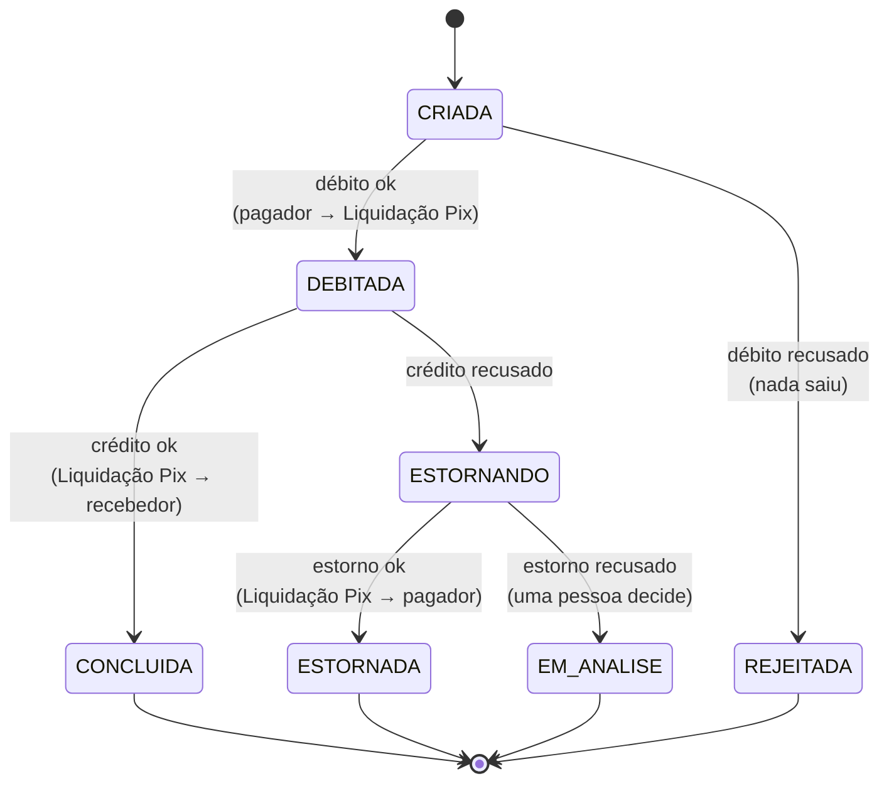

# ADR-0015: Saga orquestrada no Pix, com conta de liquidação e estorno

- **Status:** Aceita
- **Data:** 2026-10-27

## Contexto

Uma transferência Pix atravessa dois serviços com bancos separados: o **pix** (o pedido, a chave,
o andamento) e o **razão** (o dinheiro). Não existe uma transação de banco que cubra os dois. E, no
Pix real, o crédito acontece em outra instituição, depois de passar pelo SPI do Banco Central: o
dinheiro sai de um lugar, viaja, e chega — ou não — a outro.

Três coisas podem dar errado no meio:

1. o crédito ser **recusado** (a conta de destino foi encerrada);
2. o razão **não responder** (fora do ar, ou lento demais);
3. o serviço Pix **morrer** entre um passo e outro.

## Decisão

**Saga orquestrada**: a transferência é uma sequência de passos, cada um uma transação local no
razão, e um orquestrador no serviço Pix ([OrquestradorDaSaga](../../servicos/pix/src/main/java/io/github/alanjoffre/ledgerly/pix/aplicacao/OrquestradorDaSaga.java))
sabe a ordem e decide a **compensação** — o passo que desfaz o anterior.

**A conta de liquidação.** O dinheiro em trânsito fica numa conta interna do razão, a
**Liquidação Pix**, entre sair do pagador e chegar ao recebedor. Ela é visível (o balanço fecha a
qualquer momento) e não pode ficar negativa: o razão recusa creditar um Pix que nunca saiu de
ninguém.

**Cada passo tem uma chave de idempotência fixa** — `pix:<id>:envio`, `pix:<id>:recebimento`,
`pix:<id>:estorno`. Repetir um passo mil vezes move o dinheiro uma vez só ([ADR-0010](0010-idempotencia-pela-chave-no-banco.md)).

**Sem resposta não é recusa.** É a regra que mais importa:

| O razão respondeu | Significa | A Saga faz |
|---|---|---|
| 201 / 200 | o dinheiro se moveu | avança |
| 422 / 404 / 400 | **certeza** de que nada se moveu | avança para o estado de recusa, ou compensa |
| tempo esgotado, 503, conexão recusada | **não se sabe** | repete o mesmo passo mais tarde, com a mesma chave |

Compensar no tempo esgotado parece prudente, e é um erro caro. O teste
[`tempoEsgotadoNaoEhRecusa`](../../servicos/pix/src/test/java/io/github/alanjoffre/ledgerly/pix/integracao/TransferenciaIT.java)
faz o razão **creditar** e só depois demorar a responder: para o Pix, foi "sem resposta". Se a Saga
estornasse ali, o pagador teria o dinheiro de volta **e** o recebedor ficaria com ele — R$ 80
criados do nada. Repetindo o passo, o razão devolve o lançamento original, e a Saga conclui sem
estorno.

**Para não fazer o mesmo passo duas vezes ao mesmo tempo**, cada execução **reserva** a
transferência por 30 s (um `UPDATE ... WHERE reservada_ate < now() RETURNING *`, atômico). A
chamada ao razão acontece **fora** de qualquer transação de banco: segurar uma conexão esperando
outro serviço esgota o pool sob carga.

**Para não esquecer nenhuma Saga parada no meio**, um agendador acorda a cada segundo e retoma as
que têm um passo pendente e a hora da nova tentativa já chegou. A espera dobra a cada falha (1 s,
2 s, 4 s... até 1 minuto) e não tem limite de tentativas: o dinheiro já saiu do pagador e precisa
chegar a algum lugar. Depois de 10 tentativas, o log avisa que alguém precisa olhar.

| Se o serviço morrer... | O que acontece |
|---|---|
| antes de chamar o razão | a reserva vence em 30 s e outra execução chama |
| depois de o razão mover o dinheiro e antes de gravar | a próxima execução chama de novo, com a mesma chave, e recebe o lançamento original |

## Alternativas consideradas

- **Saga coreografada** (cada serviço reage aos eventos do outro, sem um coordenador) — menos
  acoplamento, mas a regra "se o crédito falhar, estorne" fica espalhada entre serviços, e
  descobrir em que pé está um Pix exige juntar eventos de vários lugares. Com três passos e uma
  compensação, um orquestrador é mais fácil de entender, testar e operar.
- **Uma transferência só no razão** (`POST /v1/transferencias`, numa transação) — funciona para
  Pix entre duas contas do Ledgerly, mas não representa o Pix real (o crédito em outra instituição,
  via SPI) e não deixa espaço para o passo do antifraude, que entra entre o débito e o crédito na
  Fase 5.
- **Two-phase commit (XA)** entre os bancos — descartado pelos mesmos motivos da
  [ADR-0011](0011-contas-chama-razao-dentro-da-transacao.md): trava recursos dos dois lados e
  depende de um coordenador.
- **Compensar quando o razão não responde** — mais simples, e errado: ver acima.

## Consequências

- **Positivas:** provado em teste com o razão fora do ar no meio, com o razão lento depois de
  creditar, com o serviço "morto" segurando a reserva, e com 50 cliques simultâneos — em nenhum caso
  um centavo se moveu duas vezes ou sumiu.
- **Negativas:**
  - **consistência eventual**: com o razão fora do ar, o cliente recebe `202 Accepted` e o Pix
    termina depois; o app precisa mostrar "em processamento";
  - **mais uma conta quente** (*hot account*): todo Pix trava a Liquidação Pix, como os depósitos
    travam o Caixa ([ADR-0009](0009-concorrencia-com-trava-pessimista-ordenada.md)). Fica para ser
    medido na Fase 3;
  - **estorno recusado** (o pagador encerrou a conta no meio) não tem saída automática: a
    transferência vai para `EM_ANALISE` e o dinheiro fica na Liquidação Pix até uma pessoa decidir.
    O backoffice para isso entra na Fase 4.
