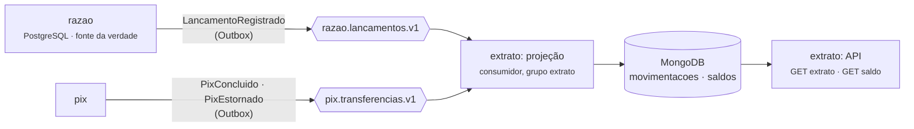

# ADR-0016: Extrato em CQRS, num modelo de leitura no MongoDB

- **Status:** Aceita
- **Data:** 2026-10-27

## Contexto

O extrato é a tela mais aberta de um banco: o cliente olha o saldo e as últimas movimentações
muitas vezes para cada vez que move dinheiro. Na Fase 1 ele vinha do próprio razão
(`GET /v1/contas/{id}/extrato`), lendo a tabela de partidas — a mesma onde ficam as travas de
concorrência ([ADR-0009](0009-concorrencia-com-trava-pessimista-ordenada.md)).

Dois problemas com isso, que crescem juntos:

- **Carga no lugar errado:** cada consulta de extrato disputa o banco do razão com os lançamentos,
  que são a operação crítica. A leitura não pode atrasar o dinheiro.
- **O razão não sabe o que a tela precisa:** a linha "Pix enviado para Maria Souza" exige o nome
  de quem recebeu, que está no serviço de Pix, não no razão. Juntar os dois a cada consulta seria
  uma chamada entre serviços em cada abertura da tela.

## Decisão

**CQRS** (*Command Query Responsibility Segregation*): quem escreve e quem lê ficam separados. O
razão continua sendo o lado da escrita e a fonte da verdade. O serviço **extrato** é só leitura:
mantém um **modelo de leitura** no MongoDB, montado a partir dos eventos, já no formato da tela.

As regras que fazem isso funcionar com entrega **repetida e fora de ordem** (o que o Outbox e o
Kafka garantem é "pelo menos uma vez", [ADR-0013](0013-outbox-para-publicar-eventos.md)):

| Regra | Como |
|---|---|
| **Uma linha = lançamento + conta**, juntada de dois pedaços | Documento com `_id = "<lancamentoId>:<contaId>"`. O evento do razão grava o pedaço `razao` (valor, saldo após); o do Pix grava o pedaço `pix` (nome da outra pessoa). Cada um com upsert `$set` só nos próprios campos: os dois se juntam **em qualquer ordem**. |
| **Linha só aparece com o pedaço do razão** | A consulta filtra por `sequencia`, que só o razão grava. O Pix que chega antes espera, invisível. |
| **Idempotente** | Regravar o mesmo pedaço não muda nada. |
| **Saldo nunca volta no tempo** | Vale o `saldoApos` da partida de **maior sequência**, gravado por um **upsert condicional** (`_id = conta AND sequencia < nova`), numa operação só. |
| **Contas internas ficam de fora** | Partidas com `contaInterna: true` (Caixa, Liquidação Pix) não viram linha. |
| **Mensagem fora do contrato** | Vai na hora para `<tópico>.dlt`, e a fila segue. |
| **Erro de ambiente** (MongoDB fora) | Nova tentativa com espera crescente (0,5 s → 30 s), **sem desistir**: extrato atrasado é ruim; extrato sem um lançamento é pior. |
| **Descartável** | O tópico do razão guarda tudo para sempre (`retention.ms=-1`). Apagou o MongoDB? Volta o grupo para o início e relê ([reconstruir-extrato.sh](../../scripts/reconstruir-extrato.sh)). |
| **Paginação por cursor** | `antesDe=<sequência>` em vez de `OFFSET`: vai direto ao ponto pelo índice `{contaId: 1, sequencia: -1}`, e um lançamento novo no meio da navegação não repete nem pula linha. |

## Números medidos

Testcontainers (Kafka 4.4 + MongoDB 9.0) num notebook com WSL, com outros builds rodando ao mesmo
tempo — números para comparar ordens de grandeza, não para prometer desempenho.

| O quê | Resultado |
|---|---|
| Atraso de um evento, do Kafka até o extrato (200 amostras, uma a uma) | p50 **18–25 ms** · p95 **35–46 ms** · máx 0,4–1,2 s (a primeira) |
| Projeção de 1.096 mensagens (998 linhas, 100 Pix) | **2,3–3,2 s** |
| Reconstrução: apagar o MongoDB e reler 1.296 mensagens desde o início | **3,7–5,2 s**, e o resultado é **idêntico** ao de antes, documento por documento |
| 3 eventos de um Pix, com repetições, em 200 ordens de chegada sorteadas | o mesmo modelo de leitura nas 200 |

Somando o Outbox (até 100 ms entre o COMMIT e a publicação), o lançamento aparece no extrato em
torno de **100–150 ms** depois de feito.

### Prova reversa do saldo — e o erro que ela achou

O teste de concorrência grava 40 saldos de cada conta ao mesmo tempo (64 threads), **o mais novo
chegando primeiro** — o pior caso de eventos fora de ordem. Depois confere se cada conta ficou com
o de maior sequência:

| Versão do código | Contas com saldo velho no fim |
|---|---|
| "Ler, comparar e gravar" em passos separados | **44 de 50** e **41 de 50** (duas rodadas) |
| Upsert condicional que aceitava a primeira "chave duplicada" como "o guardado é mais novo" | **4 de 50** |
| Upsert condicional que repete uma vez depois da chave duplicada (a atual) | **0 de 200**, em quatro rodadas |

A segunda linha é um erro do primeiro desenho, achado pelo teste: no **primeiro** saldo de uma
conta, dois upserts simultâneos não acham documento e os dois tentam criar; se o mais velho cria
primeiro, o mais novo leva "chave duplicada" e era descartado. A chave duplicada só quer dizer "o
guardado é mais novo" quando o documento já existia — por isso a correção tenta de novo uma vez,
e aí o filtro decide de verdade. Detalhes no
[MongoSaldoRepository](../../servicos/extrato/src/main/java/io/github/alanjoffre/ledgerly/extrato/adaptadores/saida/mongo/MongoSaldoRepository.java).

A primeira versão do teste (uma conta, 2.000 saldos em ordem sorteada) **passava com o código
errado** — ele foi refeito até falhar com a versão ingênua. Teste que não falha com o código
quebrado não prova nada.

## Alternativas consideradas

- **Continuar lendo do razão** (ou de uma réplica de leitura do PostgreSQL) — resolve a carga com
  a réplica, mas não o nome da outra pessoa no Pix: a junção com o serviço de Pix continuaria a
  cada consulta. A réplica é a escolha certa quando o modelo da tela é igual ao da escrita; aqui
  não é.
- **View materializada no PostgreSQL do razão** — seria leitura pronta, mas de novo no banco do
  razão, e sem os dados do Pix.
- **Um documento por conta e por mês, com as linhas dentro** (*bucket pattern*) — menos
  documentos e uma leitura só por mês, mas cada lançamento reescreve um documento que cresce, e a
  junção fora de ordem com o Pix fica bem mais difícil. Um documento por linha é mais simples, e o
  índice composto dá a leitura em ordem.
- **Kafka Streams / ksqlDB** para montar a visão — poderoso para agregações (soma por categoria,
  por mês), mas o extrato é uma lista de linhas; seria uma peça a mais para operar sem ganho agora.
- **PostgreSQL também no extrato** — funcionaria. O MongoDB foi escolhido porque a linha do
  extrato é um documento com partes opcionais que chegam separadas (`$set` por pedaço é natural
  ali), e porque o projeto quer mostrar SQL e NoSQL cada um onde faz sentido.

## Consequências

- **Positivas:**
  - a consulta de extrato não toca no banco do razão;
  - a linha já sai pronta para a tela, com o nome da outra pessoa, sem chamada entre serviços;
  - o modelo de leitura pode mudar de formato à vontade: é só reconstruir;
  - o extrato fora do ar não atrapalha nenhum lançamento.
- **Negativas:**
  - **consistência eventual**: o cliente pode fazer um Pix e, por ~100 ms, não vê-lo no extrato. A
    API mostra até onde está atualizada (`saldo.sequencia`). A tela de confirmação do Pix deve
    mostrar a resposta do próprio Pix, não recarregar o extrato;
  - **mais uma base para operar** (MongoDB), com usuário, backup e monitoramento próprios;
  - **datas em milissegundos**: o MongoDB não guarda microssegundos; o extrato mostra a hora do
    lançamento com três casas, o razão com seis;
  - **a reconstrução cresce com o histórico**: hoje são segundos; com anos de lançamentos, reler
    tudo seria lento. Aí entram *snapshots* (fotografias periódicas do modelo de leitura) — fica
    registrado para quando houver volume;
  - o razão continua sendo a fonte da verdade: o `GET /v1/contas/{id}/extrato` do razão segue
    existindo para conferência e suporte.
