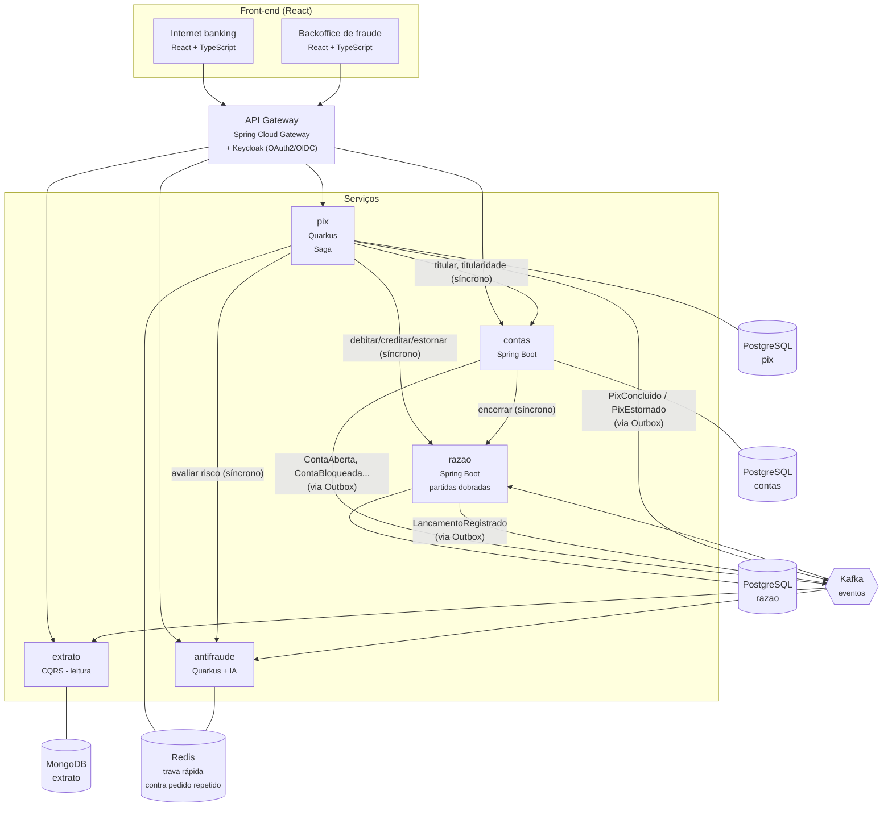
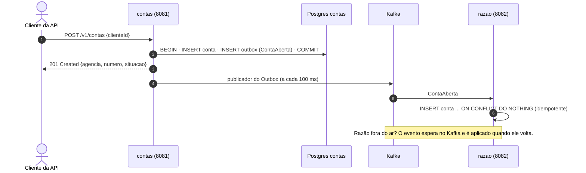
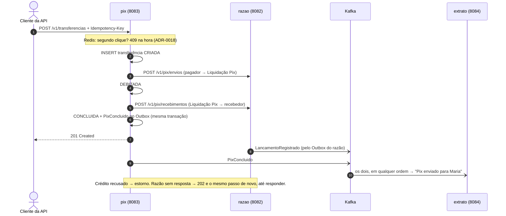

# Visão geral da arquitetura

Este documento usa o **modelo C4** (de Simon Brown): a arquitetura é desenhada em níveis de zoom,
como um mapa — do mundo inteiro até a rua. Aqui estão os dois primeiros níveis:

1. **Contexto** — o sistema como uma caixa só: quem usa e com quem ele conversa.
2. **Contêineres** — o que roda separadamente por dentro (serviços, bancos, filas).

> "Contêiner", no C4, é qualquer coisa que roda separada (um serviço, um banco de dados) —
> não é o mesmo que contêiner Docker, embora aqui cada um rode num.

## Nível 1 — Contexto

O **SPI** (Sistema de Pagamentos Instantâneos) é a infraestrutura do Banco Central que liquida o Pix
entre instituições. Aqui ele é **simulado**: o projeto não se conecta a nenhum sistema real.

## Nível 2 — Contêineres

O formato de cada evento e de cada API interna está no [contrato dos eventos](eventos.md).

### O que já roda (Fase 2)

Rodam os serviços **contas**, **razao**, **pix** e **extrato**. Front-end, gateway, Keycloak
(Fase 4) e antifraude (Fase 5) ainda não existem: hoje a API é chamada direto.

Abrir uma conta **não depende mais do razão no ar** ([ADR-0014](../adr/0014-contas-avisa-o-razao-por-evento.md)):
o serviço de contas grava a conta e o evento juntos, e o razão abre a dele quando o evento chega.

Uma transferência Pix é uma **Saga** ([ADR-0015](../adr/0015-saga-orquestrada-no-pix.md)): o pedido
mora no pix, o dinheiro no razão, e o dinheiro em trânsito numa conta interna, a Liquidação Pix.

O **extrato** é o lado de leitura do CQRS ([ADR-0016](../adr/0016-extrato-em-cqrs-no-mongodb.md)):
não calcula saldo, só guarda o que o razão já calculou, num formato pronto para mostrar. Se o
MongoDB for apagado, ele se reconstrói lendo o tópico `razao.lancamentos.v1` desde o começo.

### O que muda nas próximas fases

- **Fase 4:** o cliente entra pelo **gateway**, que confere o token do Keycloak; as APIs internas
  passam a exigir token de serviço.
- **Fase 5:** entre o débito e o crédito, o pix pergunta ao **antifraude** a nota de risco. Risco
  alto → a transferência para e vai para o analista.

## Princípios

- **Um banco por serviço.** Nenhum serviço lê a tabela de outro (ver
  [01-bancos-por-servico.sql](../../infra/docker/postgres/init/01-bancos-por-servico.sql)).
- **Domínio no centro (arquitetura hexagonal).** As regras de negócio não importam Spring nem
  Quarkus; o framework fica nas bordas (*adapters*). Testes de arquitetura (ArchUnit) garantem.
- **Nada se apaga no razão.** Um lançamento errado é corrigido com um lançamento de estorno, como
  na contabilidade real.
- **Toda operação que move dinheiro é idempotente.**

As decisões e seus motivos estão nas [ADRs](../adr/README.md).
