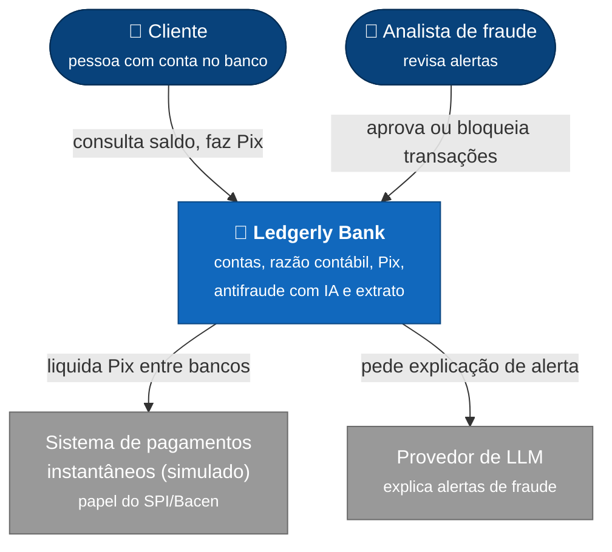
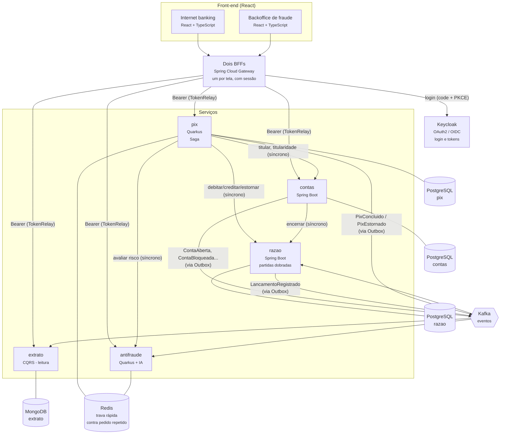
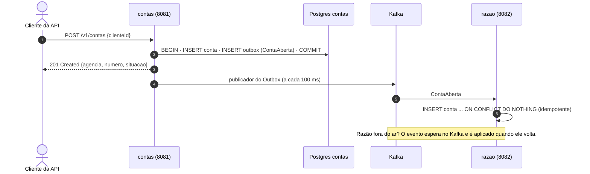
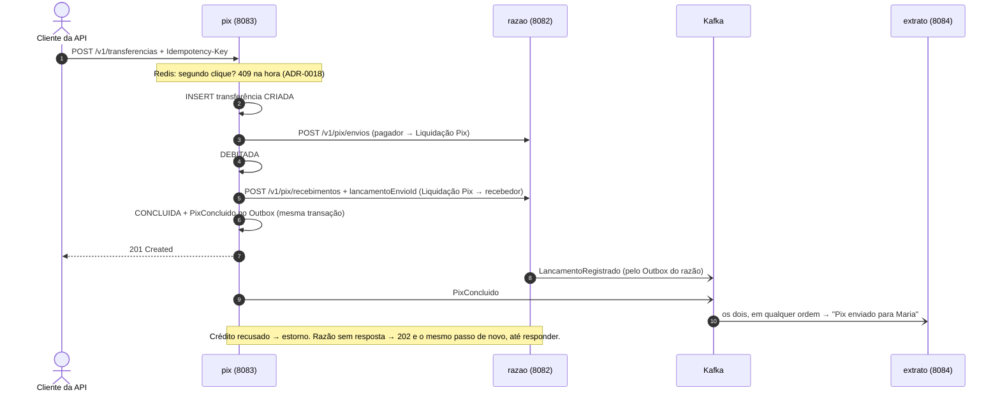
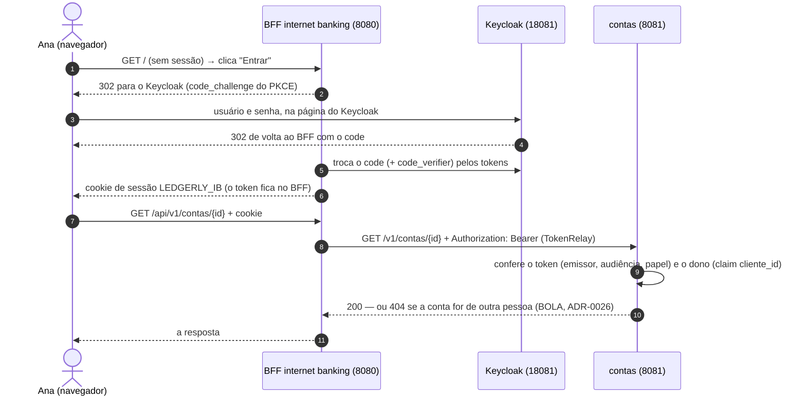

# Visão geral da arquitetura

Este documento usa o **modelo C4** (de Simon Brown): a arquitetura é desenhada em níveis de zoom,
como um mapa — do mundo inteiro até a rua. Aqui estão os dois primeiros níveis:

1. **Contexto** — o sistema como uma caixa só: quem usa e com quem ele conversa.
2. **Contêineres** — o que roda separadamente por dentro (serviços, bancos, filas).

> "Contêiner", no C4, é qualquer coisa que roda separada (um serviço, um banco de dados) —
> não é o mesmo que contêiner Docker, embora aqui cada um rode num.

## Nível 1 — Contexto

O **SPI** (Sistema de Pagamentos Instantâneos) é a infraestrutura do Banco Central que liquida o Pix
entre instituições. Aqui ele é **simulado**: o projeto não se conecta a nenhum sistema real.

## Nível 2 — Contêineres

O formato de cada evento e de cada API interna está no [contrato dos eventos](eventos.md).

### O que já roda (Fases 2 a 4)

Rodam os serviços **contas**, **razao**, **pix** e **extrato**, o **Keycloak**, os dois **BFFs**
(internet banking na porta 8080 e backoffice na 8090) e as duas telas em React, servidas pelos
próprios BFFs. Só o antifraude (Fase 5) ainda não existe.

Abrir uma conta **não depende mais do razão no ar** ([ADR-0014](../adr/0014-contas-avisa-o-razao-por-evento.md)):
o serviço de contas grava a conta e o evento juntos, e o razão abre a dele quando o evento chega.

Uma transferência Pix é uma **Saga** ([ADR-0015](../adr/0015-saga-orquestrada-no-pix.md)): o pedido
mora no pix, o dinheiro no razão, e o dinheiro em trânsito numa conta interna, a Liquidação Pix.

O **extrato** é o lado de leitura do CQRS ([ADR-0016](../adr/0016-extrato-em-cqrs-no-mongodb.md)):
não calcula saldo, só guarda o que o razão já calculou, num formato pronto para mostrar. Se o
MongoDB for apagado, ele se reconstrói lendo o tópico `razao.lancamentos.v1` desde o começo.

### Desempenho (Fase 3)

O Caixa e a Liquidação Pix são **contas quentes**: quase todo lançamento passa por uma delas, e a
trava de cada lançamento fazia todos os depósitos e todos os Pix esperarem na mesma linha. Cada
uma virou 16 **sub-contas**, e cada lançamento trava só a do cliente
([ADR-0019](../adr/0019-contas-quentes-em-subcontas.md)). Por isso o crédito e o estorno do Pix
apontam o envio (`lancamentoEnvioId`): o dinheiro sai da mesma sub-conta em que entrou, uma vez só.

Fora dos serviços, três módulos de medição e lote, que não vão para produção:

| Módulo | O que faz |
| --- | --- |
| `desempenho/carga` | Teste de carga com o Gatling contra o razão no ar ([ADR-0021](../adr/0021-teste-de-carga-com-gatling.md)) |
| `desempenho/jmh` | Micro-benchmarks com o JMH ([ADR-0023](../adr/0023-micro-benchmarks-com-jmh.md)) |
| `lotes/conciliacao` | Conciliação Pix × razão em lote, em paralelo com *Structured Concurrency* ([ADR-0022](../adr/0022-conciliacao-em-lote-com-structured-concurrency.md)) |

Hoje a conciliação lê uma base sintética; ligá-la aos bancos do Pix e do razão é implementar a
interface `Fonte` com uma consulta por faixa de ids.

### Segurança e telas (Fase 4)

A pessoa nunca fala com um serviço: fala com o **BFF** da sua tela
([ADR-0025](../adr/0025-bff-um-por-front-end.md)). O login acontece na página do Keycloak, e o
token fica guardado na sessão do BFF — o navegador só tem um cookie.

- **Todo serviço exige token**, inclusive de outro serviço: contas, pix e extrato se chamam com
  *client credentials* (papel `servico`). O **razão** aceita só `servico` e não tem rota no BFF
  ([ADR-0027](../adr/0027-token-de-servico-e-razao-sem-rota.md)).
- **O extrato não sabe o dono da conta** (ele se monta só dos eventos): pergunta ao contas, com
  token de serviço, e guarda a resposta num cache sem prazo — o dono de uma conta não muda.
- **O backoffice** (papel `analista`) mostra a fila de Pix em análise e devolve um Pix para outra
  conta do mesmo titular ([ADR-0030](../adr/0030-devolucao-de-pix-em-analise.md)).
- **As telas** ([ADR-0029](../adr/0029-react-vite-vitest-playwright.md)) são testadas com Vitest
  e, de ponta a ponta, com o Playwright contra o sistema inteiro no ar.

### O que muda nas próximas fases

- **Fase 5:** entre o débito e o crédito, o pix pergunta ao **antifraude** a nota de risco. Risco
  alto → a transferência para e vai para o analista.

## Princípios

- **Um banco por serviço.** Nenhum serviço lê a tabela de outro (ver
  [01-bancos-por-servico.sql](../../infra/docker/postgres/init/01-bancos-por-servico.sql)).
- **Domínio no centro (arquitetura hexagonal).** As regras de negócio não importam Spring nem
  Quarkus; o framework fica nas bordas (*adapters*). Testes de arquitetura (ArchUnit) garantem.
- **Nada se apaga no razão.** Um lançamento errado é corrigido com um lançamento de estorno, como
  na contabilidade real.
- **Toda operação que move dinheiro é idempotente.**

As decisões e seus motivos estão nas [ADRs](../adr/README.md).
