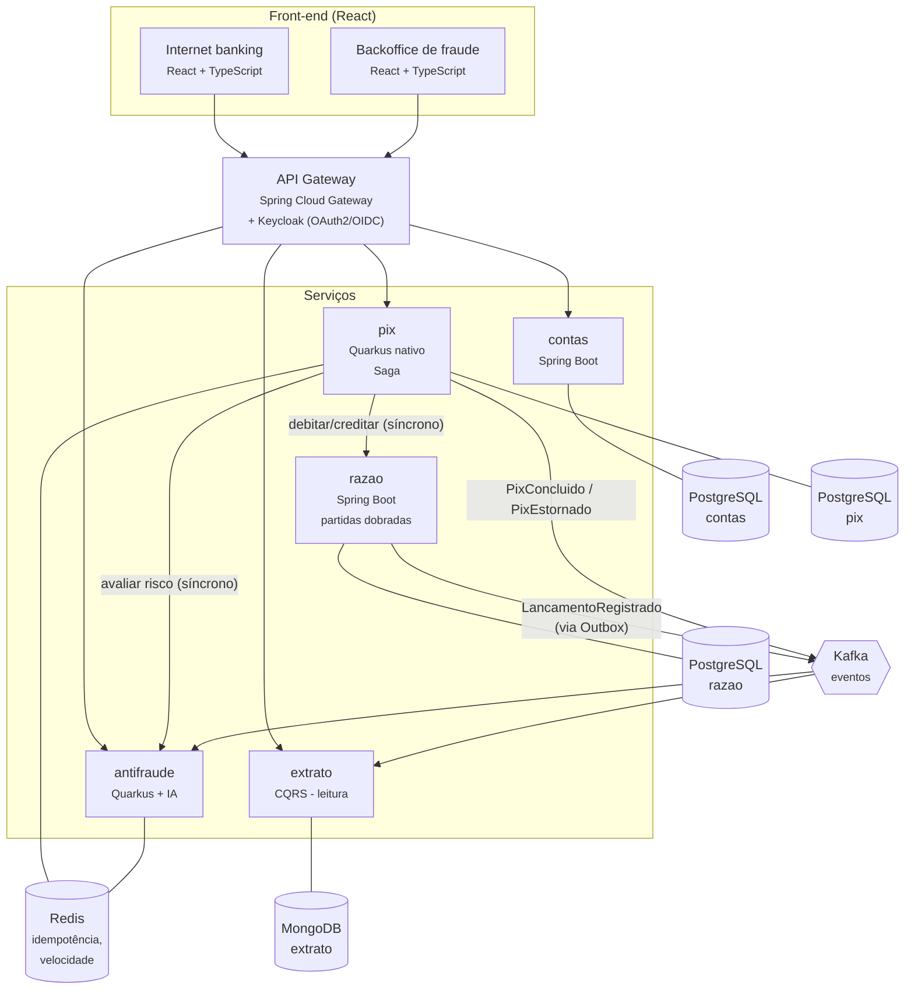
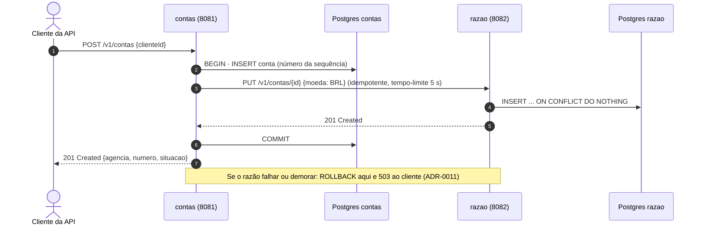
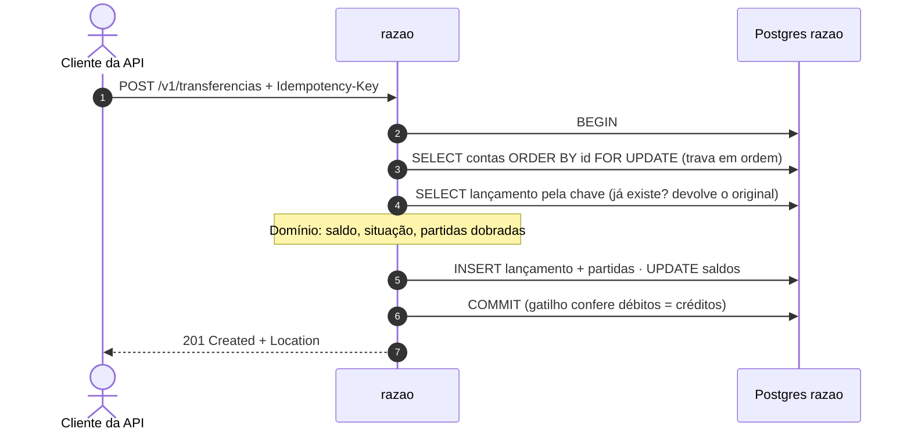

# Visão geral da arquitetura

Este documento usa o **modelo C4** (de Simon Brown): a arquitetura é desenhada em níveis de zoom,
como um mapa — do mundo inteiro até a rua. Aqui estão os dois primeiros níveis:

1. **Contexto** — o sistema como uma caixa só: quem usa e com quem ele conversa.
2. **Contêineres** — o que roda separadamente por dentro (serviços, bancos, filas).

> "Contêiner", no C4, é qualquer coisa que roda separada (um serviço, um banco de dados) —
> não é o mesmo que contêiner Docker, embora aqui cada um rode num.

## Nível 1 — Contexto

O **SPI** (Sistema de Pagamentos Instantâneos) é a infraestrutura do Banco Central que liquida o Pix
entre instituições. Aqui ele é **simulado**: o projeto não se conecta a nenhum sistema real.

## Nível 2 — Contêineres

### O que já roda (Fase 1)

Hoje rodam os serviços **contas** e **razao**. Abrir uma conta atravessa os dois:

E uma transferência, dentro do razão, numa transação só:

### Como uma transferência Pix atravessará o sistema (visão da Fase 2)

1. O cliente pede um Pix no internet banking; o **gateway** confere o token de acesso.
2. O serviço **pix** registra o pedido com uma **chave de idempotência** (no Redis): se o mesmo
   pedido chegar duas vezes (o cliente clicou duas vezes, a rede repetiu), ele é processado uma só.
3. O **antifraude** devolve uma nota de risco em milissegundos. Risco alto → o Pix para e vai para
   o analista.
4. O **razão** debita a conta de origem e credita a de destino numa única transação de banco, com
   **partidas dobradas** — e grava, na mesma transação, o evento numa tabela de **Outbox**.
5. Um publicador lê o Outbox e manda o evento ao **Kafka**. O **extrato** consome e atualiza o
   MongoDB; o cliente vê a transação na tela.
6. Se um passo falhar depois do débito, a **Saga** executa a compensação (o estorno).

## Princípios

- **Um banco por serviço.** Nenhum serviço lê a tabela de outro (ver
  [01-bancos-por-servico.sql](../../infra/docker/postgres/init/01-bancos-por-servico.sql)).
- **Domínio no centro (arquitetura hexagonal).** As regras de negócio não importam Spring nem
  Quarkus; o framework fica nas bordas (*adapters*). Testes de arquitetura (ArchUnit) garantem.
- **Nada se apaga no razão.** Um lançamento errado é corrigido com um lançamento de estorno, como
  na contabilidade real.
- **Toda operação que move dinheiro é idempotente.**

As decisões e seus motivos estão nas [ADRs](../adr/README.md).
