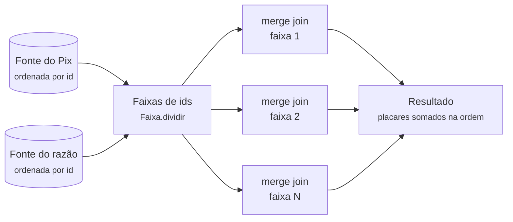

# Conciliação em lote

Confere que o **Pix e o razão contam a mesma história**: cada lançamento de Pix existe nos dois
lados, com o mesmo tipo e o mesmo valor. É o que um banco roda todo dia, sobre o dia inteiro, com
milhões de registros. O porquê de cada escolha está na
[ADR-0022](../../docs/adr/0022-conciliacao-em-lote-com-structured-concurrency.md).

**Stack:** Java 25 puro, sem Spring · *Structured Concurrency* e *Scoped Values* (*preview*, roda
com `--enable-preview`) · fora dos serviços, num módulo à parte

## Como funciona



- **Merge join** (junção por intercalação): os dois lados chegam ordenados por id, e o conciliador
  anda com um dedo em cada lista. Memória constante: guarda só o registro atual de cada lado.
- **Faixas em paralelo:** cada faixa é uma subtarefa de um `StructuredTaskScope`, numa *virtual
  thread*. Se uma falha, as outras são canceladas e a conciliação inteira falha: nada de resultado
  pela metade.
- **Id da execução** num `ScopedValue` (`Conciliador.EXECUCAO`): cada divergência sabe em qual
  rodada foi achada, sem o id passar por parâmetro em cada método.

| Divergência | Quando |
| --- | --- |
| `FALTA_NO_RAZAO` | o id está no Pix e não no razão |
| `SOBRA_NO_RAZAO` | o id está no razão e não no Pix |
| `DIVERGENTE` | o id está nos dois, com tipo ou valor diferente |

| Classe | Papel |
| --- | --- |
| `Conciliador` | o *merge join*, em sequência ou em faixas paralelas |
| `OrdemDosIds` | compara UUIDs como o PostgreSQL (16 bytes **sem sinal**), e não como o `UUID.compareTo` |
| `Faixa` | divide o espaço de ids em partes iguais |
| `Fonte`, `FonteSintetica` | de onde vêm os registros; a sintética gera a base na hora, com divergências plantadas |
| `Resultado`, `Divergencia` | o placar e a amostra de até 100 divergências |
| `ConciliacaoEmLote` | o programa de linha de comando que mede sequência × paralelo |

## Como rodar

```bash
lotes/conciliacao/medir.sh                       # 10 milhões por lado, uma faixa por núcleo, 3 rodadas
lotes/conciliacao/medir.sh 100000000 16 3        # registros, faixas, rodadas
```

O resumo vai para `desempenho/resultados/conciliacao/`. Com 100 milhões de registros por lado:
**1,4 s em paralelo** contra 4,2 s em sequência, com o mesmo resultado (números e ressalvas na
ADR-0022).

## Testes

`./mvnw -pl lotes/conciliacao verify`: 25 testes de unidade. Conferem as três divergências, as
faixas, a ordem do PostgreSQL, o cancelamento quando uma faixa falha, a fonte fora de ordem (para
com erro em vez de inventar divergências) e que o resultado em paralelo é **idêntico** ao em
sequência.

Cobertura: **98% das linhas, 91% dos ramos**.
