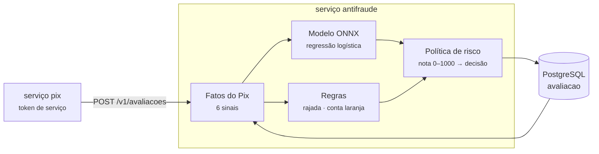

# Serviço antifraude

Pergunta, **antes do débito**, se um Pix parece golpe. Ele responde com uma **nota de 0 a 1000**, uma
**decisão** (aprovar, segurar para uma pessoa analisar, ou recusar) e os **motivos**, em português.
Quem pergunta é só o serviço de Pix, no primeiro passo da Saga
([ADR-0033](../../docs/adr/0033-pix-retido-antes-do-debito.md)). Para a analista do backoffice,
um modelo de linguagem local escreve também uma **explicação** do Pix retido
([ADR-0035](../../docs/adr/0035-explicacao-com-trava-de-numeros.md)).

**Stack:** Java 25 · Quarkus 3.40 (REST, OIDC, Flyway, JDBC) · ONNX Runtime 1.31 · LangChain4j 1.23 + Ollama · PostgreSQL 18 · porta `8085`

## Como decide



1. **Os fatos.** Do pedido do Pix (valor, horário, contas, a abertura da conta que recebe) e do
   histórico do próprio antifraude (as avaliações anteriores do pagador), saem os seis sinais que o
   modelo lê: o valor, a razão sobre a média do pagador, os Pix na última hora, se o recebedor é
   novo, se é madrugada (Brasília) e a idade da conta que recebe.
2. **O modelo**, treinado em Python e exportado em ONNX ([ml/](../../ml/README.md),
   [ADR-0032](../../docs/adr/0032-antifraude-regras-e-modelo-onnx.md)), dá a probabilidade de
   fraude. A nota é essa probabilidade × 1000. Os motivos do modelo são os três sinais que mais
   pesaram, em palavras ("15,0 vezes a média dos Pix anteriores do pagador").
3. **As regras** só sobem a nota, até "segurar":
   - **rajada**: 5 Pix ou mais do pagador na hora anterior;
   - **conta laranja**: R$ 1.000,00 ou mais para uma conta aberta há menos de 2 dias, que nunca recebeu
     deste pagador.
4. **A decisão**: nota a partir de **200**, segurar; a partir de **900**, recusar. Os limites saíram
   da tabela de limiares do treino ([ml/metricas.json](../../ml/metricas.json)).

Pix recusado não entra no histórico como costume do pagador: um golpe que não passou não deve
ensinar ao antifraude que aquele valor é normal.

### Organização interna (arquitetura hexagonal)

| Pacote | O que tem |
|---|---|
| `dominio` | `FatosDoPix`, `Sinal`, `PoliticaDeRisco` (regras, nota e decisão), `Avaliacao`, `Motivo`, `Explicacao`, `GuardrailDeNumeros`: Java puro |
| `aplicacao` | `AvaliacaoService` (idempotente pela transferência), `ExplicacaoService` e as portas `ModeloDeRisco`, `Redator`, `AvaliacaoRepository` |
| `adaptadores.entrada.web` | API REST, papéis e Problem Details |
| `adaptadores.saida.modelo` | `ModeloOnnx`: o `risco-pix.onnx` no ONNX Runtime |
| `adaptadores.saida.linguagem` | `RedatorOllama`: a explicação pelo LangChain4j, no Ollama local |
| `adaptadores.saida.persistencia` | JDBC no PostgreSQL |

O [teste de arquitetura](src/test/java/io/github/alanjoffre/ledgerly/antifraude/ArquiteturaTest.java)
reprova o build se o domínio passar a depender de framework, ONNX ou LangChain4j.

## A explicação para a analista

`GET /v1/avaliacoes/{id}/explicacao` devolve um parágrafo curto escrito pelo `gemma3:4b`, que recebe
só a nota, a decisão, os fatos e os motivos (nenhum id, nenhum nome). Antes de ir para a tela, o
[`GuardrailDeNumeros`](src/main/java/io/github/alanjoffre/ledgerly/antifraude/dominio/GuardrailDeNumeros.java)
confere que **todo número do texto existe na avaliação**; um número inventado derruba o texto
inteiro. Quando o texto cai, ou o Ollama está fora do ar, vale um texto fixo montado com os motivos.

| Situação | O que volta | Fica gravado? |
|---|---|---|
| O modelo escreveu, e a trava aprovou | o texto do modelo (`origem: MODELO_DE_LINGUAGEM`) | sim: a próxima leitura não chama o modelo |
| O modelo inventou um número | o texto fixo (`origem: TEXTO_FIXO`) | sim |
| O Ollama não respondeu (30 s) | o texto fixo | **não**: a próxima leitura tenta de novo |
| O Pix foi aprovado | o texto fixo, sem chamar o modelo | sim |

## API

Dinheiro como texto (`"10.50"`), como em todo o Ledgerly. Toda rota exige um token do Keycloak.

| Método e caminho | O que faz | Quem pode | Sucesso |
|---|---|---|---|
| `POST /v1/avaliacoes` | Avalia um Pix. Repetir o mesmo `transferenciaId` devolve a mesma avaliação | serviço | 200 |
| `GET /v1/avaliacoes/{transferenciaId}` | A avaliação: nota, decisão, motivos, os fatos como o modelo leu, a versão do modelo | analista, serviço | 200 |
| `GET /v1/avaliacoes/{transferenciaId}/explicacao` | O texto para a analista, a origem e o modelo que escreveu | analista, serviço | 200 |
| `GET /q/health/ready` | Saúde do serviço | aberto | 200 |

O cliente não tem acesso a nada daqui: a nota e os motivos ensinariam o golpista onde fica o limite
(ADR-0033). No gateway do backoffice, só os dois `GET` têm rota.

```json
// POST /v1/avaliacoes
{ "transferenciaId": "5d0a…", "pagadorContaId": "c1…", "recebedorContaId": "c2…",
  "valor": "1500.00", "instante": "2026-10-29T15:12:00Z", "contaRecebedoraAbertaEm": "2026-10-28T22:00:00Z" }

// resposta
{ "transferenciaId": "5d0a…", "nota": 500, "decisao": "SEGURAR",
  "motivos": [ { "codigo": "regra:conta-nova-valor-alto", "texto": "…" } ],
  "fatos": { "valor": "1500.00", "razaoDaMedia": null, "pixNaUltimaHora": 0, "recebedorNovo": true,
             "madrugada": false, "idadeDaContaRecebedoraEmDias": 0 },
  "modelo": "risco-pix@<6 bytes do SHA-256 do arquivo>", "avaliadaEm": "2026-10-29T15:12:00.004Z" }
```

### Erros

Formato Problem Details (RFC 9457). Decida pelo `type`, nunca pelo texto.

| `type` (`urn:ledgerly:erro:...`) | HTTP | Quando |
|---|---|---|
| `requisicao-invalida` | 400 | Campo faltando, valor zero ou com formato errado, JSON inválido |
| `nao-autenticado` | 401 | Sem token, token vencido ou de outro emissor |
| `acesso-negado` | 403 | Papel errado: o analista consulta mas não avalia; o cliente não vê nada |
| `avaliacao-nao-encontrada` | 404 | Não há avaliação para essa transferência |
| `metodo-nao-permitido` | 405 | Método que a rota não tem (ex.: `DELETE`) |
| `tipo-de-conteudo-nao-suportado` | 415 | Corpo que não é `application/json` |

## Banco

Banco próprio, `antifraude`, no mesmo PostgreSQL do compose (o antifraude não lê o banco de
ninguém). Uma tabela, `avaliacao`, com a chave na transferência: avaliar de novo o mesmo Pix
devolve a mesma linha. A explicação fica na mesma linha (migração `V2`), com uma restrição que não
aceita texto sem origem nem origem "modelo" sem o nome do modelo.

## Rodar

Para enviar rastros e métricas ao Grafana local: `LEDGERLY_OTEL=1` ([ADR-0042](../../docs/adr/0042-opentelemetry-e-otel-lgtm.md)).

```bash
docker compose -f infra/docker/compose.yaml up -d --wait                  # na raiz do projeto
docker compose -f infra/docker/compose.yaml --profile ia up -d --wait ollama   # opcional: a explicação
./scripts/modelos.sh                                                       # uma vez: baixa os modelos
./mvnw -pl servicos/antifraude -am package -DskipTests
java -jar servicos/antifraude/target/quarkus-app/quarkus-run.jar
```

Ou `./scripts/servicos.sh subir antifraude`, que também cria o banco do antifraude num volume das
fases anteriores. Sem o Ollama, o antifraude avalia igual, e a explicação vai com o texto fixo.

Variáveis de ambiente: `ANTIFRAUDE_PORTA`, `ANTIFRAUDE_DB_URL`, `ANTIFRAUDE_DB_USUARIO`,
`ANTIFRAUDE_DB_SENHA`, `LEDGERLY_EMISSOR`, `ANTIFRAUDE_OLLAMA_URL`, `ANTIFRAUDE_MODELO_DE_LINGUAGEM`
(padrão `gemma3:4b`) e `ANTIFRAUDE_LINGUAGEM_TEMPO_LIMITE` (padrão `30s`).

## Testes

```bash
./mvnw -pl servicos/antifraude -am verify     # precisa de Docker (PostgreSQL em contêiner)
```

Nenhum teste precisa do Ollama: o modelo de linguagem é um falso, com respostas roteirizadas.

| Tipo | Classe | O que prova |
|---|---|---|
| Unidade | `ModeloOnnxTest` | **Paridade Python × Java**: as 50 linhas de `referencia.csv` dão na JVM a mesma probabilidade do treino; os pesos somados dão a mesma conta; Pix de costume tem risco baixo e golpe tem risco alto |
| Unidade | `FatosDoPixTest` | Os sinais são as mesmas contas do treino; madrugada pelo horário de Brasília, não pelo do servidor; primeiro Pix sem média |
| Unidade | `PoliticaDeRiscoTest` | Os limites de segurar e recusar; rajada com 5 Pix, e 4 não é rajada; conta laranja precisa das três coisas; regra só sobe a nota e nenhuma recusa sozinha; os motivos do modelo são os três que mais pesaram |
| Unidade | `GuardrailDeNumerosTest` | Número que existe passa; inventado cai; "1.5" em inglês cai; os números dos motivos contam |
| Unidade | `RedatorOllamaTest` | O pedido ao modelo leva os fatos e nenhum id; Ollama fora do ar vira "sem texto" |
| Arquitetura | `ArquiteturaTest` | Domínio em Java puro; as camadas; a entrada não fala com a saída |
| Integração | `AvaliacaoIT` | A API de ponta a ponta: aprovado, segurado pela regra, recusado; **dois pedidos iguais ao mesmo tempo gravam uma avaliação só**; o recusado não ensina o costume; JSON inválido (400), corpo que não é JSON (415) e método que não existe (405) em Problem Details; papéis (o analista consulta mas não avalia, o cliente não vê nada, sem token 401) |
| Integração | `ExplicacaoIT` | O texto do modelo é gravado e lido de novo sem chamar o modelo; número inventado vira texto fixo; fora do ar, texto fixo sem gravar; aprovado não chama o modelo; **leituras ao mesmo tempo gravam uma explicação só**; o cliente não lê |

**Prova reversa:** sem o `GuardrailDeNumeros`, o teste do número inventado falha: o texto com o
número falso chegaria à analista.

**Medido** (100 mil Pix, 3 rodadas): o modelo na JVM leva p50 ≈ 6,5 µs e p99 ≈ 17–24 µs por Pix.
