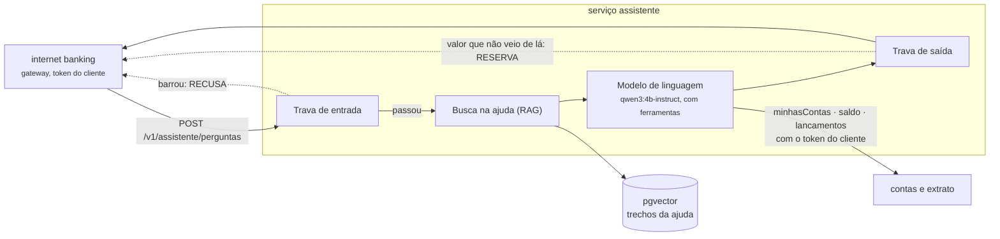

# Serviço assistente

"Pergunte ao seu extrato." O cliente do internet banking pergunta em português ("quanto gastei no
mercado em outubro?", "por que o meu Pix ficou retido?") e um **modelo de linguagem local** responde
com os dados da conta dele e com as regras do banco. O modelo **só lê**: não existe ferramenta que
faça Pix, mude limite ou bloqueie nada. O porquê de cada peça está na
[ADR-0036](../../docs/adr/0036-assistente-rag-ferramentas-e-travas.md).

**Stack:** Java 25 · Spring Boot 4.1 (Web MVC, Security, JDBC) · LangChain4j 1.23 · Ollama (`qwen3:4b-instruct-2507-q4_K_M`, `bge-m3`) · pgvector 0.8 (PostgreSQL 18) · porta `8086`

## O caminho de uma pergunta



1. **Trava de entrada** ([`GuardrailDeEntrada`](src/main/java/io/github/alanjoffre/ledgerly/assistente/dominio/GuardrailDeEntrada.java)):
   barra a pergunta vazia, com mais de 500 caracteres, ou com as frases de quem tenta trocar as
   instruções ("ignore as instruções anteriores", "você agora é…"). Barrou, a resposta é a recusa
   fixa, e o modelo nem vê a pergunta.
2. **Busca na ajuda** (RAG, *retrieval-augmented generation*): os 3 trechos dos artigos de ajuda
   mais parecidos com a pergunta (semelhança acima de 0,55) vão junto, na mensagem do cliente.
3. **O modelo de linguagem** responde e, se precisar, chama as ferramentas (*tool calling*), no
   máximo 6 vezes por pergunta. Sem memória entre perguntas.
4. **Trava de saída** ([`GuardrailDeSaida`](src/main/java/io/github/alanjoffre/ledgerly/assistente/dominio/GuardrailDeSaida.java)):
   todo valor em reais da resposta tem de ter saído de uma ferramenta ou de um trecho da ajuda
   **daquela** pergunta, e a resposta não pode trazer chave Pix, CPF, telefone ou e-mail inteiro.
   Barrou, ou o modelo não respondeu: vale o texto fixo de reserva.

### As ferramentas

O modelo vê três, todas de leitura ([`FerramentasDoCliente`](src/main/java/io/github/alanjoffre/ledgerly/assistente/aplicacao/FerramentasDoCliente.java)):

| Ferramenta | O que devolve |
|---|---|
| `minhasContas` | agência e número de cada conta do cliente (nunca o id) |
| `saldo` | o saldo de uma conta, em reais; com uma conta só, o número é opcional |
| `lancamentos` | os lançamentos de um período (até 90 dias; padrão, os últimos 30), **com os totais de entradas e saídas já somados**: modelo pequeno erra soma |

As ferramentas chamam o contas e o extrato **com o token do próprio cliente**. Um número de conta
que não é dele vira "não achei", sem chamada ao extrato; e, mesmo que o modelo fosse enganado, o
extrato confere o dono pelo token ([ADR-0026](../../docs/adr/0026-bola-com-404.md)).

### A ajuda

Sete artigos em Markdown, em [`src/main/resources/ajuda/`](src/main/resources/ajuda/): Pix retido,
chaves Pix, estorno e devolução, conta bloqueada ou encerrada, extrato e saldo, tarifas e horários,
golpes comuns. Cada seção `##` vira um trecho, e cada trecho, um vetor de 1024 números (o `bge-m3`,
pelo Ollama), guardado no pgvector. A indexação só roda quando um artigo ou o modelo de vetores
muda (a versão fica na tabela `ajuda_indice`).

Cada artigo diz o que o código faz: a regra do artigo foi conferida contra a regra do serviço.
**Mudou uma regra no código, mude o artigo.** O artigo do Pix retido não diz os limites do
antifraude: o banco não divulga onde fica a linha
([ADR-0033](../../docs/adr/0033-pix-retido-antes-do-debito.md)).

### Organização interna (arquitetura hexagonal)

| Pacote | O que tem |
|---|---|
| `dominio` | `GuardrailDeEntrada`, `GuardrailDeSaida`, `Resposta`, `Reais` (o dinheiro escrito e lido em português), `Trecho`, `Conta`, `Lancamento`: Java puro |
| `aplicacao` | `AssistenteService` (o caminho acima), `FerramentasDoCliente` e as portas `Conversa`, `BaseDeAjuda`, `Bancario` |
| `adaptadores.entrada.web` | a API e a segurança (só o cliente) |
| `adaptadores.saida.linguagem` | `ConversaComModelo`: o LangChain4j e o Ollama; `ModeloComEsquemaCompleto`: completa o esquema da ferramenta sem parâmetro (`"properties": {}`), que o Ollama recusava |
| `adaptadores.saida.ajuda` | `Artigos` (os trechos) e `PgVectorBaseDeAjuda` (a busca) |
| `adaptadores.saida.bancario` | `HttpBancario`: o contas e o extrato, com o token do cliente |

## API

| Método e caminho | O que faz | Quem pode | Sucesso |
|---|---|---|---|
| `POST /v1/assistente/perguntas` | Responde a pergunta | cliente (token com `cliente_id`) | 200 |
| `GET /actuator/health` | Saúde do serviço | aberto | 200 |

```json
// pergunta
{ "pergunta": "Quanto gastei em outubro?" }

// resposta
{ "texto": "Em outubro, as suas saídas somaram R$ 1.727,95.",
  "origem": "MODELO_DE_LINGUAGEM",
  "fontes": [] }
```

`origem` diz de onde veio a resposta: `MODELO_DE_LINGUAGEM` (normal), `RECUSA` (a trava de entrada
barrou) ou `RESERVA` (a trava de saída barrou, ou o modelo não respondeu). Recusa e reserva também
respondem **200**: para o cliente, é uma resposta, não um erro. `fontes` traz os títulos dos artigos
de ajuda usados. Sem token, 401; analista, serviço ou cliente sem `cliente_id`, 403.

## Rodar

Para enviar rastros e métricas ao Grafana local: `LEDGERLY_OTEL=1` ([ADR-0042](../../docs/adr/0042-opentelemetry-e-otel-lgtm.md)).

```bash
docker compose -f infra/docker/compose.yaml up -d --wait                       # na raiz: inclui o pgvector
docker compose -f infra/docker/compose.yaml --profile ia up -d --wait ollama   # o Ollama, com a placa de vídeo
./scripts/modelos.sh                                                            # uma vez: qwen3:4b-instruct, gemma3:4b e bge-m3
./mvnw -pl servicos/assistente -am package -DskipTests
java -jar servicos/assistente/target/assistente-0.1.0-SNAPSHOT.jar
```

Ou `./scripts/servicos.sh subir assistente`. Sem o Ollama, o serviço sobe e responde a reserva.

Variáveis de ambiente: `ASSISTENTE_PORTA`, `ASSISTENTE_BANCO_URL`, `ASSISTENTE_BANCO_USUARIO`,
`ASSISTENTE_BANCO_SENHA`, `ASSISTENTE_OLLAMA_URL`, `ASSISTENTE_MODELO_DE_LINGUAGEM` (padrão
`qwen3:4b-instruct-2507-q4_K_M`), `ASSISTENTE_MODELO_DE_VETORES` (padrão `bge-m3`), `ASSISTENTE_LINGUAGEM_TEMPO_LIMITE`
(padrão `60s`), `ASSISTENTE_CONTAS_URL`, `ASSISTENTE_EXTRATO_URL` e `LEDGERLY_EMISSOR`.

O usuário e o banco `assistente` do pgvector são criados por
[01-assistente.sql](../../infra/docker/pgvector/init/01-assistente.sql) na primeira subida do
contêiner.

## Testes

```bash
./mvnw -pl servicos/assistente -am verify     # precisa de Docker (Testcontainers: pgvector)
```

Nenhum teste do build precisa do Ollama: o modelo de linguagem e o de vetores são falsos e
roteirizados. **A qualidade do modelo de verdade se mede com a avaliação**, fora do build:
[avaliacao/](../../avaliacao/README.md) ([ADR-0037](../../docs/adr/0037-avaliacao-do-assistente-fora-do-ci.md)).

| Tipo | Classe | O que prova |
|---|---|---|
| Unidade | `GuardrailDeEntradaTest` | A tentativa de trocar as instruções é barrada, com ou sem acento e maiúscula; vazia ou longa demais é barrada |
| Unidade | `GuardrailDeSaidaTest` | Valor da ferramenta ou do artigo passa, escrito de qualquer jeito brasileiro; valor inventado é barrado; data, contagem e número da conta não são conferidos; chave Pix, documento ou telefone inteiro é barrado |
| Unidade | `FerramentasDoClienteTest` | Nunca o id; conta de outro "não achei" sem chamar o extrato; o período pelo dia de Brasília, com os totais somados; datas erradas; mais de 30 lançamentos mostra 30, e os totais contam todos |
| Unidade | `ConversaComModeloTest` | O LangChain4j executa a ferramenta e devolve ao modelo; a ajuda vai como referência, não como instrução; ferramenta que não existe ("fazer Pix") vira aviso; o modelo que não para de pedir ferramenta é cortado |
| Unidade | `ModeloComEsquemaCompletoTest` | O defeito do LangChain4j (ferramenta sem parâmetro sem esquema); ela sai com `"properties": {}`, e o resto do pedido não muda |
| Unidade | `AssistenteServiceTest` | O caminho inteiro; **um valor de outra pergunta não vale** como prova; modelo ou busca fora do ar |
| Unidade | `ArtigosTest` | Um trecho por seção; todo artigo com título e sem valor de cliente |
| Unidade | `ConferenciaDaAvaliacaoTest` | A régua da avaliação e o próprio conjunto de perguntas |
| Arquitetura | `ArquiteturaTest` | Domínio em Java puro; a aplicação só com o `@Service` do Spring, sem LangChain4j nem banco; as camadas |
| Integração | `AssistenteIT` | De ponta a ponta com o pgvector de verdade: saldo com o token da Ana; o total copiado da ferramenta; o trecho certo da ajuda vem do pgvector e aparece como fonte; valor inventado vira reserva; só o cliente pergunta (401, 403); os artigos indexados uma vez |

**Prova reversa:** sem a trava de saída, o teste do valor inventado falha: o cliente leria o número
que o modelo inventou.
