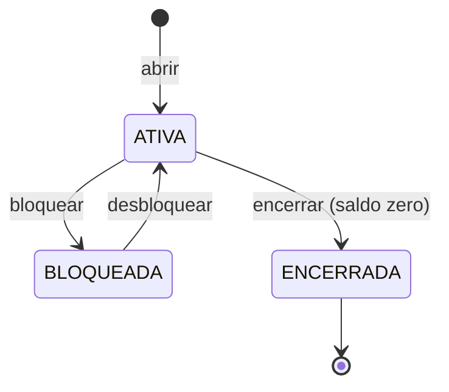

# Serviço contas

Cadastro de **clientes** e o **ciclo de vida das contas**: abrir, bloquear, desbloquear, encerrar.
O saldo **não** mora aqui — é do [serviço razão](../razao/README.md), que este serviço consulta e
avisa por eventos.

**Stack:** Java 25 · Spring Boot 4 (Web MVC, Data JPA, RestClient, Kafka) · Hibernate · PostgreSQL 18 ·
Flyway · Spring Security (*resource server* com JWT) · porta `8081`

## Como funciona

### A conta é uma máquina de estados



Qualquer outra transição é recusada (`422 transicao-invalida`). Conta bloqueada não encerra direto:
o motivo do bloqueio (fraude, ordem judicial) precisa ser resolvido antes.

### Dados pessoais (LGPD)

- O **CPF** é validado pelos dígitos verificadores antes de ir ao banco.
- A API devolve o CPF **mascarado** (`***.ddd.ddd-**`): quem consulta não precisa do número inteiro
  (princípio da minimização).
- O `toString()` do CPF também mascara: ele não vaza inteiro num log por descuido.
- Os testes usam CPFs **gerados por algoritmo**; nenhum dado pessoal real está no repositório.

### Conversa com o razão: evento para avisar, HTTP para perguntar

Desde a Fase 2 ([ADR-0014](../../docs/adr/0014-contas-avisa-o-razao-por-evento.md)):

| Operação | Como o razão fica sabendo | Com o razão fora do ar |
|---|---|---|
| Abrir, bloquear, desbloquear | Evento no Kafka, via **Outbox** ([ADR-0013](../../docs/adr/0013-outbox-para-publicar-eventos.md)) | **Funciona**; o razão recebe quando voltar |
| Encerrar | HTTP, dentro da transação local — só o razão sabe se o saldo é zero | `503` + `Retry-After: 5`; nada muda |
| Consultar | HTTP (o saldo é do razão) | `503` + `Retry-After: 5` |

**Outbox:** a mudança na conta e o evento são gravados na **mesma transação** (tabela `outbox`).
Um publicador, a cada 100 ms, manda os pendentes ao Kafka, espera a confirmação (`acks=all`) e só
então os marca como publicados. Kafka fora do ar: a conta abre normalmente, e o evento espera na
tabela. Publicados há mais de 7 dias são apagados.

**Conta recém-aberta:** entre o COMMIT aqui e o razão consumir o `ContaAberta` (normalmente até
~100 ms, o intervalo do publicador, mais o consumo), o razão ainda não conhece a conta. Nessa janela,
`GET /v1/contas/{id}` mostra saldo `0.00` — e isso é exato: sem o evento, o razão não aceitou nenhum
movimento. Encerrar nessa janela também funciona: o `ContaEncerrada` sai depois do `ContaAberta`
(mesma chave, mesma partição), e o razão abre e encerra a conta nessa ordem.

O cliente HTTP do razão tem tempo-limite de 2 s para conectar e 5 s para responder. Sem isso, um
razão lento prenderia as threads deste serviço.

### Eventos publicados

Tópico `contas.eventos.v1`, chave `contaId`. Formato em [eventos.md](../../docs/arquitetura/eventos.md#contaseventosv1).

| Evento | Quando |
|---|---|
| `ContaAberta` | `POST /v1/contas` |
| `ContaBloqueada` · `ContaDesbloqueada` | `POST` · `DELETE /v1/contas/{id}/bloqueio` |
| `ContaEncerrada` | `POST /v1/contas/{id}/encerramento`, depois que o razão aceitou |

### Concorrência: trava otimista

Duas alterações simultâneas na mesma conta: a segunda a gravar recebe `409 conflito-de-atualizacao`
em vez de sobrescrever a primeira (`@Version` do JPA). Sem a trava, 10 de 50 bloqueios simultâneos
gravariam por cima uns dos outros — ver [ADR-0009](../../docs/adr/0009-concorrencia-com-trava-pessimista-ordenada.md).

### Segurança (Fase 4)

Todo pedido em `/v1/**` exige um token JWT do Keycloak no cabeçalho `Authorization: Bearer`. O
serviço confere a assinatura (pela chave pública do emissor), o emissor, a validade e a audiência
`ledgerly-api` ([ADR-0024](../../docs/adr/0024-keycloak-e-realm-como-codigo.md)). A conferência
vem da biblioteca [seguranca-spring](../../bibliotecas/seguranca-spring/README.md), igual nos três
serviços Spring.

A autorização tem duas camadas:

1. **O papel** (*role*), na configuração de segurança: `cliente`, `analista` ou `servico` (outro
   serviço, com o token pedido por *client credentials*,
   [ADR-0027](../../docs/adr/0027-token-de-servico-e-razao-sem-rota.md)). O que não está na lista
   é negado (negar por padrão).
2. **O dono**, no caso de uso: o cliente só vê o próprio cadastro e as próprias contas. O token traz
   o `cliente_id` da pessoa, e a conta de outro cliente responde **404, igual ao de uma conta que
   não existe**. Assim nem a existência da conta vaza, e o razão nem é consultado. É a defesa
   contra BOLA (*Broken Object Level Authorization*), a falha nº 1 da lista do OWASP para APIs
   ([ADR-0026](../../docs/adr/0026-bola-com-404.md)).

O `/actuator/health` continua aberto, sem token. Para falar com o razão, o contas pede o próprio
token de serviço ao Keycloak na primeira chamada (não na subida: o contas sobe mesmo com o Keycloak
fora do ar) e o renova antes de vencer.

## API

| Método e caminho | O que faz | Quem pode | Sucesso |
|---|---|---|---|
| `POST /v1/clientes` | `{"nome","cpf"}` (CPF com ou sem máscara) | serviço | 201 |
| `GET /v1/clientes/{id}` | Dados do cliente (CPF mascarado) | cliente (só o dono), analista, serviço | 200 |
| `GET /v1/clientes/{id}/contas` | Contas do cliente (sem o saldo: `saldo` e `moeda` vêm `null`) | cliente (só o dono), analista, serviço | 200 |
| `POST /v1/contas` | `{"clienteId"}` — abre a conta; o razão recebe o `ContaAberta` | serviço | 201 |
| `GET /v1/contas/{id}` | Conta com o saldo (vindo do razão; `0.00` se o razão ainda não a conhece) | cliente (só o dono), analista, serviço | 200 |
| `GET /v1/contas/{id}/titular` | Titular e situação, sem o saldo (`contaId`, `clienteId`, `nome`, `situacao` e, desde a Fase 5, `abertaEm`: o antifraude desconfia de conta recém-aberta recebendo valor alto): responde mesmo com o razão fora do ar. Usado pelo Pix e pelo extrato | serviço | 200 |
| `POST /v1/contas/{id}/bloqueio` | Bloqueia | analista, serviço | 200 |
| `DELETE /v1/contas/{id}/bloqueio` | Desbloqueia | analista, serviço | 200 |
| `POST /v1/contas/{id}/encerramento` | Encerra (o razão exige saldo zero) | serviço | 200 |
| `POST /v1/contas/{id}/titularidade` | `{"cpf"}` — o CPF é o do titular? Resposta `{"confere": true\|false}`; o CPF completo nunca sai daqui. Usado pelo Pix | serviço | 200 |

### Erros

| `type` (`urn:ledgerly:erro:...`) | HTTP | Quando |
|---|---|---|
| `requisicao-invalida` | 400 | Campo inválido (detalhe em `campos`) |
| `nao-autenticado` | 401 | Sem token, token vencido, de outro emissor ou de outra audiência (com o cabeçalho `WWW-Authenticate`) |
| `acesso-negado` | 403 | Token bom, papel errado (ex.: cliente tentando abrir conta) |
| `cpf-invalido` · `dado-invalido` | 400 | CPF com dígito errado ou mal formado (também na titularidade); nome curto ou longo demais |
| `cliente-nao-encontrado` · `conta-nao-encontrada` | 404 | Não existe, ou é de outro cliente (a mesma resposta, de propósito) |
| `cpf-ja-cadastrado` | 409 | CPF repetido (inclusive em cadastros simultâneos) |
| `conflito-de-atualizacao` | 409 | Outra operação alterou a conta ao mesmo tempo |
| `transicao-invalida` | 422 | Ex.: desbloquear conta que não está bloqueada |
| `encerramento-com-saldo` | 422 | O razão recusou: saldo diferente de zero |
| `razao-indisponivel` | 503 | O razão não respondeu ao consultar ou encerrar; nada foi alterado |

## Rodar

Para enviar rastros e métricas ao Grafana local: `LEDGERLY_OTEL=1` ([ADR-0042](../../docs/adr/0042-opentelemetry-e-otel-lgtm.md)).

A infraestrutura local precisa estar de pé (PostgreSQL e Kafka, `docker compose -f
infra/docker/compose.yaml up -d --wait`). O razão só é preciso para consultar saldo e encerrar
([como rodar](../razao/README.md#rodar)). Depois:

```bash
./mvnw -pl servicos/contas -am package -DskipTests
java -jar servicos/contas/target/contas-0.1.0-SNAPSHOT.jar
```

Variáveis: `CONTAS_PORTA`, `CONTAS_DB_URL`, `CONTAS_DB_USUARIO`, `CONTAS_DB_SENHA`, `CONTAS_RAZAO_URL`,
`CONTAS_KAFKA` (padrão `localhost:19092`), `CONTAS_OUTBOX_INTERVALO_MS` (padrão `100`),
`LEDGERLY_EMISSOR` (o Keycloak, padrão `http://localhost:18081/realms/ledgerly`), `CONTAS_CLIENTE_ID` e
`CONTAS_CLIENTE_SEGREDO` (o token de serviço para o razão; o segredo padrão só vale no ambiente local).

## Testes

```bash
./mvnw -pl servicos/contas -am verify     # precisa de Docker (Testcontainers: PostgreSQL e Kafka)
```

| Tipo | Classe | O que prova |
|---|---|---|
| Unidade | `CpfTest` | 200 CPFs gerados aceitos; qualquer dígito trocado é recusado |
| Unidade | `ContaTest`, `NumeroContaEClienteTest`, `EventoDeContaTest` | Máquina de estados, dígito da conta, nome, eventos |
| Unidade | `HttpRazaoTest` | Tradução de cada resposta do razão (servidor simulado): `404 conta-nao-encontrada` = conta desconhecida, outro 404 = erro, tempo esgotado |
| Arquitetura | `ArquiteturaTest` | Domínio sem JPA; entidade JPA não sai do adaptador |
| Integração | `ApiIT` | API de ponta a ponta; titularidade; abrir e bloquear com o razão fora do ar funcionam; encerrar recusado não deixa evento |
| Integração | `OutboxIT` | Transação desfeita → nem conta nem evento; o evento chega ao Kafka com o envelope do contrato; ordem por conta |
| Integração | `KafkaForaDoArIT` | Kafka parado (`docker pause`): abrir responde na hora, o evento espera e sai quando o Kafka volta |
| Integração | `PublicadorDoOutboxIT` | Limpeza: só some o publicado há mais de 7 dias |
| Integração | `ConcorrenciaIT` | Trava otimista: 50 bloqueios simultâneos → 1 gravação e **1 evento**; 20 cadastros do mesmo CPF → 1 cliente |
| Integração | `AutorizacaoIT` | **BOLA**: a conta do Bruno, para a Ana, dá o mesmo 404 de uma conta inexistente, e o razão nem é consultado; token sem `cliente_id` não é dono de nada; o analista vê todas; sem token, 401; cliente em rota de serviço, 403 |

Nos testes de integração, o razão é um **dublê em memória** (`RazaoFalso`), que dá para derrubar
de propósito; o PostgreSQL e o Kafka são de verdade. Os tokens são assinados no próprio teste, com
uma chave de teste: o Keycloak não precisa estar no ar. O contrato real entre os dois serviços é
conferido com Pact ([ADR-0045](../../docs/adr/0045-contratos-entre-servicos-com-pact.md)).

Cobertura (unidade + integração): **97% das linhas, 90% dos ramos**.
