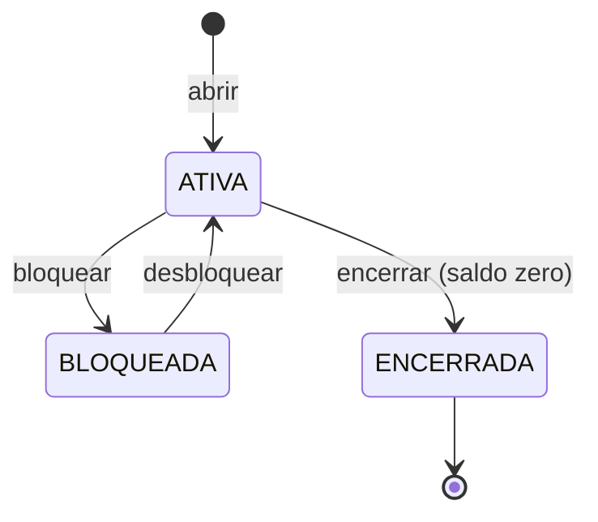

# Serviço contas

Cadastro de **clientes** e o **ciclo de vida das contas**: abrir, bloquear, desbloquear, encerrar.
O saldo **não** mora aqui — é do [serviço razão](../razao/README.md), que este serviço consulta.

**Stack:** Java 25 · Spring Boot 4 (Web MVC, Data JPA, RestClient) · Hibernate · PostgreSQL 18 ·
Flyway · porta `8081`

## Como funciona

### A conta é uma máquina de estados



Qualquer outra transição é recusada (`422 transicao-invalida`). Conta bloqueada não encerra direto:
o motivo do bloqueio (fraude, ordem judicial) precisa ser resolvido antes.

### Dados pessoais (LGPD)

- O **CPF** é validado pelos dígitos verificadores antes de ir ao banco.
- A API devolve o CPF **mascarado** (`***.ddd.ddd-**`): quem consulta não precisa do número inteiro
  (princípio da minimização).
- O `toString()` do CPF também mascara: ele não vaza inteiro num log por descuido.
- Os testes usam CPFs **gerados por algoritmo**; nenhum dado pessoal real está no repositório.

### Conversa com o razão

Abrir, bloquear e encerrar avisam o razão por HTTP **dentro da transação local**
([ADR-0011](../../docs/adr/0011-contas-chama-razao-dentro-da-transacao.md)). Se o razão recusar ou
estiver fora do ar, nada muda aqui — comprovado em teste e ao vivo (`503` + `Retry-After: 5`).

O cliente HTTP tem tempo-limite de 2 s para conectar e 5 s para responder. Sem isso, um razão lento
prenderia as threads deste serviço.

### Concorrência: trava otimista

Duas alterações simultâneas na mesma conta: a segunda a gravar recebe `409 conflito-de-atualizacao`
em vez de sobrescrever a primeira (`@Version` do JPA). Sem a trava, 10 de 50 bloqueios simultâneos
gravariam por cima uns dos outros — ver [ADR-0009](../../docs/adr/0009-concorrencia-com-trava-pessimista-ordenada.md).

## API

| Método e caminho | O que faz | Sucesso |
|---|---|---|
| `POST /v1/clientes` | `{"nome","cpf"}` (CPF com ou sem máscara) | 201 |
| `GET /v1/clientes/{id}` | Dados do cliente (CPF mascarado) | 200 |
| `GET /v1/clientes/{id}/contas` | Contas do cliente | 200 |
| `POST /v1/contas` | `{"clienteId"}` — abre a conta aqui e no razão | 201 |
| `GET /v1/contas/{id}` | Conta com o saldo (vindo do razão) | 200 |
| `POST /v1/contas/{id}/bloqueio` | Bloqueia | 200 |
| `DELETE /v1/contas/{id}/bloqueio` | Desbloqueia | 200 |
| `POST /v1/contas/{id}/encerramento` | Encerra (o razão exige saldo zero) | 200 |

### Erros

| `type` (`urn:ledgerly:erro:...`) | HTTP | Quando |
|---|---|---|
| `requisicao-invalida` | 400 | Campo inválido (detalhe em `campos`) |
| `cpf-invalido` · `dado-invalido` | 400 | CPF com dígito errado; nome curto ou longo demais |
| `cliente-nao-encontrado` · `conta-nao-encontrada` | 404 | Não existe |
| `cpf-ja-cadastrado` | 409 | CPF repetido (inclusive em cadastros simultâneos) |
| `conflito-de-atualizacao` | 409 | Outra operação alterou a conta ao mesmo tempo |
| `transicao-invalida` | 422 | Ex.: desbloquear conta que não está bloqueada |
| `encerramento-com-saldo` | 422 | O razão recusou: saldo diferente de zero |
| `razao-indisponivel` | 503 | O razão não respondeu; nada foi alterado |

## Rodar

O razão precisa estar rodando ([como](../razao/README.md#rodar)). Depois:

```bash
./mvnw -pl servicos/contas -am package -DskipTests
java -jar servicos/contas/target/contas-0.1.0-SNAPSHOT.jar
```

Variáveis: `CONTAS_PORTA`, `CONTAS_DB_URL`, `CONTAS_DB_USUARIO`, `CONTAS_DB_SENHA`, `CONTAS_RAZAO_URL`.

## Testes

| Tipo | Classe | O que prova |
|---|---|---|
| Unidade | `CpfTest` | 200 CPFs gerados aceitos; qualquer dígito trocado é recusado |
| Unidade | `ContaTest`, `NumeroContaEClienteTest` | Máquina de estados, dígito da conta, nome |
| Unidade | `HttpRazaoTest` | Tradução de cada resposta do razão (servidor simulado), inclusive tempo esgotado |
| Arquitetura | `ArquiteturaTest` | Domínio sem JPA; entidade JPA não sai do adaptador |
| Integração | `ApiIT` | API de ponta a ponta; razão fora do ar não deixa nada pela metade |
| Integração | `ConcorrenciaIT` | Trava otimista; 20 cadastros simultâneos do mesmo CPF → 1 cliente |

Nos testes de integração, o razão é um **dublê em memória** (`RazaoFalso`), que dá para derrubar
de propósito. O contrato real entre os dois serviços será testado com Pact na Fase 7.

Cobertura (unidade + integração): **98% das linhas, 91% dos ramos**.
