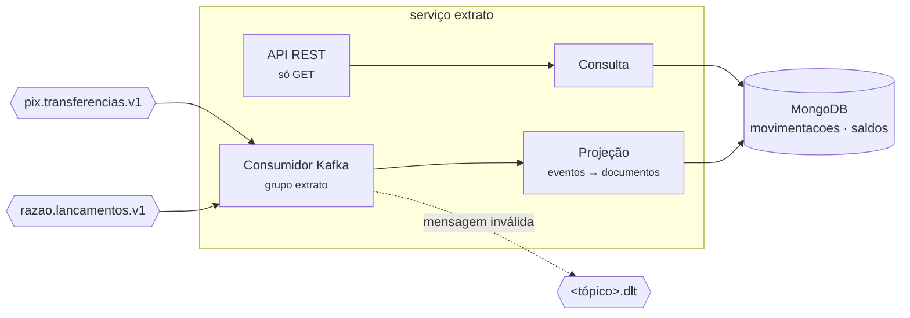

# Serviço extrato

O **extrato** do cliente: saldo e movimentações, já no formato da tela ("Pix enviado para Maria
Souza"). É o lado da **leitura** do CQRS — não recebe nenhuma escrita pela API. Ele se monta
sozinho, consumindo os eventos do razão e do Pix no Kafka, e guarda o resultado no MongoDB. O
porquê está na [ADR-0016](../../docs/adr/0016-extrato-em-cqrs-no-mongodb.md).

**Stack:** Java 25 · Spring Boot 4 (Web MVC, Data MongoDB, Kafka, Security) · MongoDB 9 · Kafka 4 · porta `8084`

## Como funciona



Uma linha do extrato é o **lançamento visto por uma conta**, montada com dois pedaços que chegam
por tópicos diferentes, **em qualquer ordem**:

| Pedaço | Vem de | Traz | Obrigatório? |
|---|---|---|---|
| `razao` | `LancamentoRegistrado` | valor, débito ou crédito, saldo após, sequência, hora | sim — sem ele a linha não aparece |
| `pix` | `PixConcluido` / `PixEstornado` | o nome da outra pessoa, a chave mascarada, o motivo do estorno | não — sem ele a linha sai como "Pix enviado" |

Num Pix de João para Maria, o extrato do João mostra "Pix enviado para Maria Souza" e o da Maria
"Pix recebido de João da Silva". Num Pix estornado, o João vê a saída marcada como estornada e
"Estorno do Pix para Maria Souza: a conta de destino está encerrada"; a Maria não vê nada.

### Organização interna (arquitetura hexagonal)

| Pacote | O que tem |
|---|---|
| `dominio` | `Movimentacao` (a linha e a descrição dela), `ParteDoRazao`, `ParteDoPix`, `Saldo` — Java puro |
| `aplicacao` | `ProjecaoDoExtrato` (eventos → gravações), `ConsultaDoExtrato` (leitura e paginação) e as portas |
| `adaptadores.entrada.kafka` | `ConsumidorDeEventos`, `LeitorDeEventos` (o contrato JSON, campo a campo), DLT |
| `adaptadores.entrada.web` | API REST e Problem Details |
| `adaptadores.saida.mongo` | as coleções, os índices e os upserts |

O [teste de arquitetura](src/test/java/io/github/alanjoffre/ledgerly/extrato/ArquiteturaTest.java)
reprova o build se o domínio ou a aplicação passarem a depender do Kafka ou do MongoDB.

### As garantias, e como cada uma é feita

| Garantia | Como |
|---|---|
| Evento repetido não duplica | Documento com `_id = "<lancamentoId>:<contaId>"` e upsert `$set`: regravar é igual a gravar uma vez |
| Pix antes do lançamento não se perde | Cada tópico grava só o próprio pedaço; os dois se juntam no mesmo documento |
| Evento atrasado não volta o saldo | Upsert condicional: só grava se a sequência for maior que a guardada, numa operação só |
| Mensagem quebrada não trava a fila | Vai na hora para `<tópico>.dlt`, com o erro no cabeçalho; o consumidor segue |
| MongoDB fora do ar não perde evento | Nova tentativa com espera crescente, sem desistir; o offset só avança depois de gravar |
| O MongoDB é descartável | Reconstrução relendo os tópicos do início (abaixo) |

## Coleções no MongoDB

```js
// movimentacoes — uma por lançamento + conta. Índice: { contaId: 1, sequencia: -1 }
{ _id: "<lancamentoId>:<contaId>", lancamentoId, contaId,
  sequencia: 1041,
  razao: { operacao: "PIX_ENVIO", tipo: "DEBITO", valor: Decimal128("1200.00"),
           saldoApos: Decimal128("300.00"), moeda: "BRL", mensagem: "Aluguel", registradoEm: ISODate() },
  pix:   { pixId, papel: "ENVIADO", situacao: "CONCLUIDO", contraparte: "Maria Souza",
           tipoChave: "EMAIL", chave: "m***@exemplo.com", motivo: null } }

// saldos — um por conta: o da partida de maior sequência
{ _id: "<contaId>", saldo: Decimal128("300.00"), moeda: "BRL", sequencia: 1041, atualizadoEm: ISODate() }
```

Dinheiro em `Decimal128`, o decimal exato do MongoDB — nunca `double` ([ADR-0007](../../docs/adr/0007-dinheiro-com-bigdecimal.md)).
Datas em milissegundos (a precisão do MongoDB; o razão manda microssegundos).

## Segurança (Fase 4): o extrato só para o dono

Toda leitura exige um token JWT do Keycloak (biblioteca
[seguranca-spring](../../bibliotecas/seguranca-spring/README.md)), com o papel `cliente`, `analista`
ou `servico`; o resto é negado por padrão. O analista e os serviços leem qualquer conta.

O cliente só lê a **própria** conta. O extrato não guarda de quem é cada conta, e por isso pergunta
ao contas (`GET /v1/contas/{id}/titular`, com o token de
serviço do próprio extrato, [ADR-0027](../../docs/adr/0027-token-de-servico-e-razao-sem-rota.md)).
A resposta fica num **cache sem prazo**: o dono de uma conta nunca muda. O cache tem só um limite de
tamanho (100 mil contas; passou, sai a usada há mais tempo, o LRU), e "conta não existe" não é
guardado, porque ela pode ser aberta no segundo seguinte. A conta de outro cliente
responde **404, igual ao de uma conta que não existe**, sem o saldo
([ADR-0026](../../docs/adr/0026-bola-com-404.md)).

E se o contas estiver fora do ar? Para o cliente, `503` com `Retry-After`, e não 404: a conta pode
ser dele, e "não existe" seria mentira. O analista e os serviços continuam lendo, porque para eles
não há dono a conferir.

**Devolução de Pix em análise** ([ADR-0030](../../docs/adr/0030-devolucao-de-pix-em-analise.md)):
o `PixEstornado` pode trazer `contaDevolucaoId`, e a linha da volta vai para essa conta (a outra
conta do mesmo titular), e não para a que pagou, que foi encerrada.

## API

Só leitura. Dinheiro como texto (`"10.50"`), como em todo o Ledgerly.

| Método e caminho | O que faz | Quem pode | Sucesso |
|---|---|---|---|
| `GET /v1/contas/{id}/extrato?limite=50&antesDe={sequencia}` | Saldo e linhas, da mais nova para a mais antiga (limite 1–500) | cliente (só o dono), analista, serviço | 200 |
| `GET /v1/contas/{id}/saldo` | Saldo, moeda, `sequencia` (até onde está atualizado) e `atualizadoEm` | cliente (só o dono), analista, serviço | 200 |
| `GET /actuator/health` | Saúde do serviço | aberto | 200 |

**Paginação por cursor:** a resposta traz `proximaPagina`; a página seguinte é pedida com
`antesDe=<proximaPagina>`. Quando `proximaPagina` vem `null`, acabou.

```json
{ "contaId": "c1…",
  "saldo": { "contaId": "c1…", "saldo": "300.00", "moeda": "BRL", "sequencia": 1041, "atualizadoEm": "2026-10-27T18:30:00.123Z" },
  "itens": [
    { "sequencia": 1041, "lancamentoId": "9b2e…", "operacao": "PIX_ENVIO", "tipo": "DEBITO",
      "valor": "1200.00", "saldoApos": "300.00", "moeda": "BRL",
      "descricao": "Pix enviado para Maria Souza", "mensagem": "Aluguel",
      "registradoEm": "2026-10-27T18:30:00.123Z",
      "pix": { "pixId": "5d0a…", "situacao": "CONCLUIDO", "contraparte": "Maria Souza",
               "tipoChave": "EMAIL", "chave": "m***@exemplo.com", "motivo": null } } ],
  "proximaPagina": null }
```

**Consistência eventual:** um lançamento feito agora no razão aparece aqui em torno de 100–150 ms
depois (Outbox + Kafka + projeção — números na ADR-0016).

### Erros

Formato Problem Details (RFC 9457). Decida pelo `type`, nunca pelo texto.

| `type` (`urn:ledgerly:erro:...`) | HTTP | Quando |
|---|---|---|
| `requisicao-invalida` | 400 | `limite` fora de 1–500, `antesDe` não positivo, parâmetro com formato inválido |
| `nao-autenticado` | 401 | Sem token, token vencido ou de outro emissor (com `WWW-Authenticate`) |
| `acesso-negado` | 403 | Papel errado, ou caminho que não é extrato nem saldo |
| `conta-nao-encontrada` | 404 | O extrato não tem nada da conta (ela não existe, ou ainda não teve lançamento), ou ela é de outro cliente |
| `contas-indisponivel` | 503 | O contas não respondeu, e não dá para saber se a conta é de quem pede; `Retry-After` |

## Rodar

Para enviar rastros e métricas ao Grafana local: `LEDGERLY_OTEL=1` ([ADR-0042](../../docs/adr/0042-opentelemetry-e-otel-lgtm.md)).

```bash
docker compose -f infra/docker/compose.yaml up -d --wait     # na raiz do projeto
./mvnw -pl servicos/extrato -am package -DskipTests
java -jar servicos/extrato/target/extrato-0.1.0-SNAPSHOT.jar
```

Variáveis de ambiente: `EXTRATO_PORTA`, `EXTRATO_MONGO_URI`, `EXTRATO_KAFKA`, `EXTRATO_CONTAS_URL`,
`LEDGERLY_EMISSOR` (o Keycloak, padrão `http://localhost:18081/realms/ledgerly`), `EXTRATO_CLIENTE_ID` e
`EXTRATO_CLIENTE_SEGREDO` (o token de serviço para o contas; o segredo padrão só vale no ambiente local).

O usuário `extrato` do MongoDB é criado por [01-usuario-extrato.js](../../infra/docker/mongo/init/01-usuario-extrato.js)
na primeira subida do contêiner. Num volume que já existia, o comentário do script mostra como
criá-lo à mão.

### Reconstruir o extrato do zero

```bash
# pare o serviço extrato, e então:
./scripts/reconstruir-extrato.sh     # apaga as coleções e volta o grupo "extrato" ao início dos tópicos
java -jar servicos/extrato/target/extrato-0.1.0-SNAPSHOT.jar     # relê tudo
```

## Testes

```bash
./mvnw -pl servicos/extrato -am verify     # precisa de Docker (Testcontainers: Kafka e MongoDB)
```

| Tipo | Classe | O que prova |
|---|---|---|
| Unidade | `MovimentacaoTest` | A descrição de cada linha; hora em milissegundos; saldo só substitui se for mais novo |
| Unidade | `ProjecaoDoExtratoTest` | Contas internas de fora; cada lado do Pix vê o outro; estorno; **200 ordens de chegada sorteadas, com repetições, dão o mesmo extrato** |
| Unidade | `ConsultaDoExtratoTest` | Paginação por cursor sem repetir nem pular; limites; conta desconhecida |
| Unidade | `LeitorDeEventosTest` | Os exemplos do contrato; cada forma de mensagem errada diz qual campo |
| Arquitetura | `ArquiteturaTest` | Domínio e aplicação sem Kafka nem MongoDB |
| Integração | `ProjecaoIT` | Kafka → MongoDB de verdade: duplicado, fora de ordem, Pix antes do lançamento, estorno, DLT, tipo desconhecido, **8.000 saldos concorrentes** |
| Integração | `ApiIT` | API de ponta a ponta: paginação, Pix, 404, 400 |
| Unidade | `HttpDonoDaContaTest` | A pergunta ao contas (servidor simulado): a segunda consulta não chama ninguém; conta inexistente não é guardada; o limite do cache; contas fora do ar vira 503 |
| Integração | `AutorizacaoIT` | **BOLA**: a conta do Bruno, para a Ana, é igual a uma inexistente (404, sem o saldo); token sem `cliente_id`, 404; analista e serviço leem tudo, mesmo com o contas fora do ar; contas fora do ar, para o cliente, 503 com `Retry-After`; sem token ou com token vencido, 401 |
| Integração | `ReconstrucaoIT` | Apagar o MongoDB e reler os tópicos dá o mesmo extrato, documento por documento; mede o atraso de cada evento |

**Prova reversa:** com "ler, comparar e gravar" no lugar do upsert condicional, o teste de saldo
concorrente falha (44 de 50 contas com saldo velho). Números na ADR-0016.

Cobertura (unidade + integração): **98,0% das linhas, 89,6% dos ramos**. Os ramos de fora são,
quase todos, a nova tentativa depois de uma corrida de criação no MongoDB — difícil de provocar
de propósito num teste.
