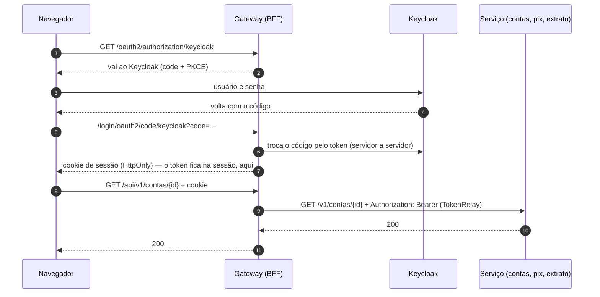

# Gateway (BFF)

A porta de entrada das telas. Um **BFF** (*Backend for Frontend*, o "back-end da tela") por
front-end: o mesmo pacote sobe duas vezes, cada uma com um perfil
([ADR-0025](../../docs/adr/0025-bff-um-por-front-end.md)).

| Perfil | Porta | Tela | Cookie de sessão | Papel exigido | Cliente no Keycloak |
|---|---|---|---|---|---|
| `internet-banking` | `8080` | internet banking do cliente | `LEDGERLY_IB` | `cliente` | `ledgerly-internet-banking` |
| `backoffice` | `8090` | backoffice de fraude | `LEDGERLY_BO` | `analista` | `ledgerly-backoffice` |

**Stack:** Java 25 · Spring Boot 4.0 · Spring Cloud Gateway Server Web MVC · Spring Security
(OAuth2 Client) · *virtual threads*. Por que o Boot 4.0 e o Gateway em Web MVC (e não o reativo):
[ADR-0028](../../docs/adr/0028-gateway-no-boot-4-0.md).

## Como funciona

### O token fica aqui, não no navegador



O login é o fluxo *authorization code* com **PKCE** (*Proof Key for Code Exchange*, S256): mesmo que
alguém intercepte o código na volta do Keycloak, sem o segredo que só o gateway tem ele não vale
nada. O token de acesso e o *refresh token* ficam na **sessão HTTP, no servidor**. O navegador só
recebe o cookie de sessão, que é `HttpOnly` (o JavaScript não lê) e `SameSite=Lax`. Um XSS na
página não tem token nenhum para roubar.

A cada pedido em `/api/**`, o **TokenRelay** põe o token da sessão no cabeçalho `Authorization`
e o renova com o *refresh token* quando vence. O gateway não confere a assinatura: quem confere,
em toda chamada, é o serviço.

### As rotas

`/api/v1/...` vai ao serviço dono do caminho, sem o `/api` ([Rotas](src/main/java/io/github/alanjoffre/ledgerly/gateway/Rotas.java)):

| Caminho | Serviço |
|---|---|
| `/api/v1/contas/{id}/extrato`, `/api/v1/contas/{id}/saldo` | extrato (`:8084`) |
| `/api/v1/transferencias/**`, `/api/v1/chaves/**`, `/api/v1/contas/{id}/chaves`, `/api/v1/qrcodes/**` | pix (`:8083`) |
| `/api/v1/clientes/**`, `/api/v1/contas/**` | contas (`:8081`) |
| `GET /api/v1/avaliacoes/{id}` e `GET /api/v1/avaliacoes/{id}/explicacao` | antifraude (`:8085`): a analista lê por que o Pix foi retido |
| `POST /api/v1/assistente/perguntas` | assistente (`:8086`): só o cliente pergunta, e quem confere é o próprio serviço |

O **razão não tem rota**: só outro serviço, com token de serviço, fala com ele
([ADR-0027](../../docs/adr/0027-token-de-servico-e-razao-sem-rota.md)). Do antifraude, só a leitura passa: pedir
uma avaliação é coisa do Pix, e o `POST /api/v1/avaliacoes` nem chega ao serviço
([ADR-0032](../../docs/adr/0032-antifraude-regras-e-modelo-onnx.md)). O assistente responde em
segundos, e o gateway não põe tempo limite de leitura
([ADR-0036](../../docs/adr/0036-assistente-rag-ferramentas-e-travas.md)). O cookie de sessão e o
cabeçalho de CSRF não seguem para os serviços: lá eles não significam nada. O corpo do pedido vai
inteiro, com `Content-Length`, e nunca "em partes": contorna uma corrida no cliente HTTP do JDK 25
([ClienteHttp](src/main/java/io/github/alanjoffre/ledgerly/gateway/ClienteHttp.java),
[ADR-0031](../../docs/adr/0031-as-duas-corridas-dos-testes-instaveis.md)).

| Caminho do próprio gateway | O que faz |
|---|---|
| `GET /api/eu` | Quem está logado: o usuário, os papéis e o `cliente_id`, **sem o token**. Responde a qualquer pessoa logada, mesmo sem o papel deste front-end, para a tela dizer "este acesso não é seu" |
| `GET /oauth2/authorization/keycloak` | Começa o login |
| `POST /logout` | Apaga a sessão e devolve `{"redirecionar": "..."}`, o endereço de saída do Keycloak (*RP-initiated logout*): a sessão do Keycloak também acaba |
| `GET /actuator/health` | Saúde, aberta |
| qualquer outro | A tela (abaixo) |

### As defesas

| Defesa | Como |
|---|---|
| **Sem sessão, 401 em JSON** | `/api/**` sem sessão responde `401` (Problem Details), sem redirecionar ao login: numa chamada do JavaScript, o redirecionamento viraria um HTML estranho. Quem manda ao login é a tela |
| **Nada guardado para "depois do login"** | O Spring guardaria o último pedido sem sessão para voltar a ele depois do login. Como a tela é aberta, não há o que retomar — e voltar a um `/api/eu` que deu 401 fazia o login terminar numa página de JSON (um dos defeitos que o E2E achou) |
| **Papel errado, 403** | O analista no internet banking, ou o cliente no backoffice: `403` em JSON, e o pedido não sai do gateway |
| **CSRF de SPA** | O token de CSRF vai num cookie legível (`XSRF-TOKEN`) e volta no cabeçalho `X-XSRF-TOKEN`. Um site de fora não lê o cookie, então não forja o POST. Sem o cabeçalho, `403` |
| **CSP** | `default-src 'self'; img-src 'self' data:; object-src 'none'; base-uri 'none'; form-action 'self'; frame-ancestors 'none'`: só roda script daqui, nada embutido; ninguém põe a tela num iframe (*clickjacking*) |
| **Outros cabeçalhos** | Sem `Referer`, sem cache e sem o navegador adivinhar o tipo do conteúdo (`nosniff`) |

### A tela

O gateway serve a tela construída pelo Vite (`web/<tela>/dist`), na **mesma origem** que a API:
o cookie de sessão e o de CSRF funcionam sem CORS. Um endereço da tela (`/contas/123`) não tem
arquivo: devolve o `index.html`, e o roteador do React mostra a página certa (o *fallback* de SPA).
Duas exceções, de propósito: `/api/**` e `/error` **nunca** viram `index.html`. Sem isso, um `403`
saía como `200` com a tela no corpo (outro defeito que o E2E achou).

### O custo, medido

A mesma leitura de conta, direto no contas e pelo gateway, com 16 usuários por 30 s
([medir-gateway.sh](../../desempenho/carga/medir-gateway.sh)): cerca de **1 ms a mais por pedido**
e 9% menos vazão, com zero erros nos dois. Os números estão na
[ADR-0025](../../docs/adr/0025-bff-um-por-front-end.md).

## Rodar

```bash
docker compose -f infra/docker/compose.yaml up -d --wait     # na raiz: com o Keycloak
(cd web && npm ci && npm run construir)                      # as telas
./mvnw -pl servicos/gateway -am package -DskipTests
./scripts/servicos.sh subir gateway-ib                       # ou gateway-bo
```

Sem um perfil, o gateway nem sobe, e diz o que falta. Suba sempre da raiz do repositório: o
caminho da tela (`web/<tela>/dist`) é relativo a ela.

Variáveis: `GATEWAY_PORTA`, `GATEWAY_PAGINA` (a pasta da tela, como `file:...`),
`GATEWAY_CLIENTE_SEGREDO` (o segredo do cliente no Keycloak; o padrão só vale no ambiente local),
`LEDGERLY_EMISSOR` (padrão `http://localhost:18081/realms/ledgerly`), `GATEWAY_CONTAS_URL`,
`GATEWAY_EXTRATO_URL`, `GATEWAY_PIX_URL`, `GATEWAY_ANTIFRAUDE_URL`, `GATEWAY_ASSISTENTE_URL`.

O cookie sai sem `Secure` só porque o ambiente local é `http`. Em nuvem, com `https`, ele liga.

## Testes

```bash
./mvnw -pl servicos/gateway -am verify     # não precisa de Docker
```

| Classe | O que prova |
|---|---|
| `InternetBankingTest` | Cada caminho vai ao serviço dono, sem o `/api` e com o token; cookie e CSRF não seguem; **o razão não tem rota**; sem sessão, 401 em JSON e nada guardado para depois do login; analista, 403; POST sem CSRF, 403, e o Pix não sai; login com PKCE (S256); `/api/eu` sem o token; sair encerra no Keycloak; o *fallback* de SPA, mas nunca para `/api/**` nem `/error`; CSP e cabeçalhos |
| `BackofficeTest` | A analista vê a fila e devolve o Pix, com o token dela; o cliente, 403; a tela e o cliente do Keycloak do backoffice |
| `DoTokenTest` | Papéis e `cliente_id` lidos do token de acesso; token sem papéis, opaco ou com `cliente_id` que não é UUID; subir sem perfil falha logo |

Os serviços, nos testes, são um servidor HTTP falso que registra o que chegou (caminho,
cabeçalhos e corpo). O navegador de verdade, com o Keycloak e os serviços de verdade, é o
[teste de ponta a ponta](../../web/README.md#testes-de-ponta-a-ponta-playwright).

Cobertura (unidade + integração): **98,6% das linhas, 91,7% dos ramos**.
