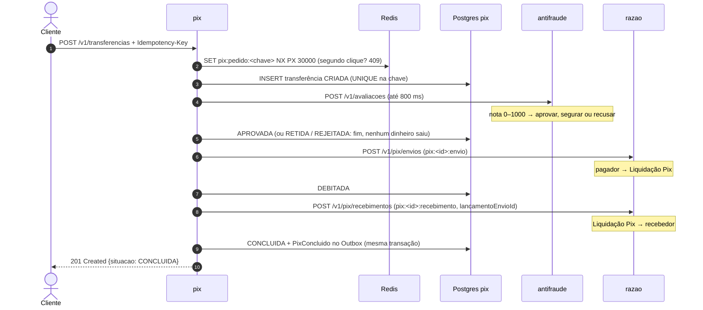

# Serviço pix

O **Pix** do Ledgerly Bank: chaves, QR Code e transferências. Uma transferência atravessa três
serviços (o pedido mora aqui, a análise de risco no antifraude, o dinheiro no razão), e por isso é conduzida como uma **Saga**:
uma sequência de passos, cada um com a sua compensação.

**Stack:** Java 25 · Quarkus 3 (REST, JDBC/Agroal, Flyway, Redis, Kafka/SmallRye, Scheduler, OIDC) ·
PostgreSQL 18 · Redis 8 · Kafka 4 · porta `8083`

Por que Quarkus aqui, e não Spring Boot como nos outros: ver
[ADR-0017](../../docs/adr/0017-quarkus-no-pix.md), com a medição de tempo de subida e memória.

## Como funciona

### A transferência (Saga orquestrada)



| O antifraude ou o razão responde | A Saga faz |
|---|---|
| antifraude aprova | `APROVADA` → o débito |
| antifraude segura | `RETIDA` — parada antes do débito, esperando a analista (abaixo) |
| antifraude recusa | `REJEITADA` — nenhum dinheiro saiu |
| **antifraude sem resposta** (fora do ar, mais de 800 ms) | **falha segura por valor**: até R$ 500,00, `APROVADA` sem nota; acima, `RETIDA` |
| débito recusado (saldo, conta bloqueada) | `REJEITADA` — nenhum dinheiro saiu |
| crédito recusado (conta de destino encerrada) | `ESTORNANDO` → estorno (Liquidação Pix → pagador) → `ESTORNADA` |
| **sem resposta** (fora do ar, tempo esgotado) | **nada muda**: repete o mesmo passo, com a mesma chave, em 1 s, 2 s, 4 s... (até 1 min) |
| estorno recusado | `EM_ANALISE` — uma pessoa decide |

Sem resposta **não é** recusa: o razão pode ter movido o dinheiro e a resposta se perdido.
Compensar ali devolveria ao pagador um dinheiro que já chegou ao recebedor, e quem pagaria a diferença seria o dinheiro de outros clientes em trânsito na Liquidação Pix. Os detalhes e o teste que prova estão na
[ADR-0015](../../docs/adr/0015-saga-orquestrada-no-pix.md).

O crédito e o estorno levam o id do lançamento do envio (`lancamentoEnvioId`, desde a Fase 3): o
razão tira o dinheiro da mesma sub-conta da Liquidação Pix em que o envio entrou, e aceita uma
saída só por envio, mesmo que alguém peça as duas
([ADR-0019](../../docs/adr/0019-contas-quentes-em-subcontas.md)).

Se o serviço morrer no meio, outra execução assume: cada passo **reserva** a transferência por 30 s,
e um agendador retoma, a cada segundo, as que ficaram paradas. O pedido que criou o Pix fica com a
reserva do começo ao fim, e o agendador só pega o que parou sem resposta do razão
([ADR-0031](../../docs/adr/0031-as-duas-corridas-dos-testes-instaveis.md)).

### O antifraude antes do débito (Fase 5)

O primeiro passo da Saga é perguntar ao [antifraude](../antifraude/README.md) se o Pix parece
golpe ([ADR-0033](../../docs/adr/0033-pix-retido-antes-do-debito.md)). O pedido leva as duas
contas, o valor, o instante e a abertura da conta que recebe (o contas passou a devolvê-la no
`GET /v1/contas/{id}/titular`). Pix retido ou recusado não move dinheiro: não há o que estornar.

O Pix **retido** (`RETIDA`) espera uma pessoa. A analista vê a fila
(`GET /v1/transferencias?situacao=RETIDA`), com a nota, os motivos e a explicação do antifraude, e
**libera** (a Saga segue na hora: débito e crédito) ou **recusa** (fim, nenhum dinheiro saiu), com
justificativa. A decisão vai para a mesma `decisao_de_analise` da devolução. Para o cliente, o Pix
retido responde `202`, como um em andamento: ele ainda pode sair.

**O cliente não vê a análise de risco.** A `notaDeRisco` vem vazia para ele, e o motivo de um Pix
barrado pelo antifraude vira um texto genérico ("Pix em análise de segurança antes de sair da sua
conta. Nenhum dinheiro saiu."): a nota e os motivos ensinariam o golpista onde fica o limite. O
motivo que não é de risco, como "saldo insuficiente", aparece como sempre. A analista e os serviços
veem tudo.

### A devolução de um Pix em análise (Fase 4)

Um Pix fica `EM_ANALISE` quando o estorno é recusado: a conta que pagou foi encerrada no meio do
caminho, e o dinheiro está parado na Liquidação Pix. A analista do backoffice vê a fila
(`GET /v1/transferencias?situacao=EM_ANALISE`) e decide devolver o dinheiro para **outra conta
ativa do mesmo titular**, com uma justificativa de pelo menos 10 letras
([ADR-0030](../../docs/adr/0030-devolucao-de-pix-em-analise.md)).

A decisão não move dinheiro por conta própria: grava a conta da volta na transferência
(`contaDevolucaoId`) e devolve a Saga para `ESTORNANDO`, que estorna para essa conta pelo mesmo
caminho de sempre, com uma chave de idempotência própria (`pix:{id}:devolucao:{conta}`) e a mesma
regra de uma saída por envio. Quem decidiu, quando
e por quê fica na tabela `decisao_de_analise`, que nunca é alterada nem apagada. Duas analistas ao
mesmo tempo resultam em uma devolução só; a segunda recebe `409`.

### Segurança (Fase 4)

O Pix confere o token do Keycloak como os serviços Spring: assinatura, emissor, validade, audiência
`ledgerly-api` e os papéis em `realm_access.roles` (com a extensão OIDC do Quarkus). Duas regras a
mais, próprias do Quarkus:

- **negar por padrão**: rota sem `@RolesAllowed` é recusada (esquecer a anotação não abre a rota);
- **autenticação só na rota que pede**: assim o 401 e o 403 passam pelos mesmos tradutores de erro e
  saem em Problem Details, como todos os outros erros.

O cliente só usa o que é dele: a conta que paga, as chaves e a consulta de um Pix. O de outro
cliente responde **404, igual ao de um que não existe** (BOLA,
[ADR-0026](../../docs/adr/0026-bola-com-404.md)). Para saber de quem é a conta, o Pix pergunta ao
contas. Para falar com o contas e com o razão, o Pix pede o próprio token de serviço (*client
credentials*) na primeira chamada e o renova antes de vencer
([ADR-0027](../../docs/adr/0027-token-de-servico-e-razao-sem-rota.md)).

### Chaves e QR Code

- Chaves **CPF** (só o do titular — o serviço de contas responde "confere" ou "não confere", sem
  entregar o CPF), **e-mail**, **telefone** (+55DDNNNNNNNNN) e **aleatória** (gerada pelo banco).
  Até 5 por conta. Uma chave aponta para uma conta só.
- QR Code **estático** no padrão **BR Code** do Banco Central (EMV + CRC16): o "copia e cola" e a
  imagem SVG. Um QR Code com um caractere trocado é recusado pelo CRC.

### Organização interna (arquitetura hexagonal)

| Pacote | O que tem |
|---|---|
| `dominio` | `ChavePix`, `BrCode`, `TransferenciaPix` (a Saga como máquina de estados) — Java puro |
| `aplicacao` | `TransferenciaService`, `OrquestradorDaSaga`, `ChaveService`, `QrCodeService` e as portas |
| `adaptadores.entrada.web` | API REST (Jakarta REST) e Problem Details |
| `adaptadores.entrada.agendamento` | a retomada das Sagas paradas |
| `adaptadores.saida.persistencia` | PostgreSQL, SQL explícito sobre JDBC |
| `adaptadores.saida.razao` / `.contas` / `.antifraude` | clientes HTTP declarativos (MicroProfile REST Client) |
| `adaptadores.saida.redis` | a trava rápida ([ADR-0018](../../docs/adr/0018-redis-na-frente-do-banco-no-pix.md)) |
| `adaptadores.saida.eventos` | Outbox e o publicador para o Kafka |

O [teste de arquitetura](src/test/java/io/github/alanjoffre/ledgerly/pix/ArquiteturaTest.java) é o
mesmo dos serviços Spring: o domínio não conhece o Quarkus, e a aplicação só usa as anotações
padrão Jakarta de escopo e de transação.

### O banco como segunda linha de defesa

| Regra | Como o banco garante ([V1](src/main/resources/db/migration/V1__esquema_do_pix.sql)) |
|---|---|
| Uma chave, uma conta | `PRIMARY KEY (chave)` |
| Um pedido, uma transferência | `UNIQUE (chave_idempotencia)` |
| Pagador ≠ recebedor | `CHECK` |
| A situação bate com os lançamentos (`CONCLUIDA` tem envio e recebimento, `ESTORNADA` tem estorno...) | `CHECK situacao_coerente` |
| Pix `APROVADA`, `RETIDA` ou `REJEITADA` não tem lançamento de envio; a nota fica entre 0 e 1000 | `CHECK situacao_coerente` e `CHECK` da nota ([V3](src/main/resources/db/migration/V3__antifraude_e_pix_retido.sql)) |

## API

| Método e caminho | O que faz | Quem pode | Sucesso |
|---|---|---|---|
| `POST /v1/chaves` | `{"contaId","tipo","valor"?}` — `ALEATORIA` sem `valor` | cliente (dono), serviço | 201 |
| `GET /v1/chaves/{chave}` | "Confira o destinatário": titular e chave mascarada | cliente, analista, serviço | 200 |
| `DELETE /v1/chaves/{chave}` | Exclui | cliente (dono), serviço | 204 |
| `GET /v1/contas/{contaId}/chaves` | As chaves da conta | cliente (dono), serviço | 200 |
| `GET /v1/chaves/{chave}/qrcode?valor=&descricao=` | QR Code estático (copia e cola) | cliente (dono), serviço | 200 |
| `GET /v1/chaves/{chave}/qrcode.svg?valor=` | O mesmo QR Code em imagem SVG | cliente (dono), serviço | 200 |
| `POST /v1/qrcodes/leitura` | `{"copiaECola"}` — o que há no QR Code, conferido | cliente, analista, serviço | 200 |
| `POST /v1/transferencias` | `{"pagadorContaId","chave" \| "copiaECola","valor"?,"descricao"?}` + `Idempotency-Key` | cliente (dono da conta que paga), serviço | 201 · 202 · 200 repetido |
| `GET /v1/transferencias/{id}` | Situação e andamento da Saga (a nota de risco, só para analista e serviço) | cliente (dono), analista, serviço | 200 |
| `GET /v1/transferencias?situacao=EM_ANALISE\|RETIDA&limite=50` | As filas do backoffice (limite 1–200) | analista | 200 |
| `POST /v1/transferencias/{id}/devolucao` | `{"contaDestinoId","justificativa"}` — devolve o Pix em análise | analista | 200 |
| `POST /v1/transferencias/{id}/liberacao` | `{"justificativa"}` — libera o Pix retido: a Saga segue | analista | 200 |
| `POST /v1/transferencias/{id}/recusa` | `{"justificativa"}` — recusa o Pix retido: nenhum dinheiro sai | analista | 200 |
| `GET /q/health` | Saúde do serviço | aberto | 200 |

`201` quando a Saga terminou na hora; `202 Accepted` quando um passo ficou sem resposta e a Saga
continua sozinha, ou quando o Pix ficou retido; `200` + `Idempotent-Replayed: true` no pedido repetido.

### Erros

Formato Problem Details (RFC 9457), o mesmo dos serviços Spring. Decida pelo `type`.

| `type` (`urn:ledgerly:erro:...`) | HTTP | Quando |
|---|---|---|
| `requisicao-invalida` | 400 | Campo inválido (detalhe em `campos`), JSON malformado, `Idempotency-Key` faltando, justificativa curta |
| `nao-autenticado` | 401 | Sem token, vencido, de outro emissor, de outra audiência ou forjado (com `WWW-Authenticate`) |
| `acesso-negado` | 403 | Papel errado: o analista não faz Pix; o cliente não vê a fila nem devolve |
| `chave-invalida` · `qrcode-invalido` | 400 | Formato da chave; QR Code adulterado ou que não é Pix |
| `chave-nao-encontrada` · `conta-nao-encontrada` · `transferencia-nao-encontrada` | 404 | Não existe, ou é de outro cliente (a mesma resposta, de propósito) |
| `chave-ja-cadastrada` | 409 | A chave já é de uma conta |
| `pedido-em-andamento` | 409 | O mesmo pedido ainda corre (segundo clique); `Retry-After: 1` |
| `transferencia-fora-de-analise` | 409 | Devolver um Pix que não está (ou não está mais) em análise; liberar ou recusar um que não está retido |
| `conta-de-outro-titular` | 422 | A conta da devolução é de outra pessoa |
| `titularidade-nao-confere` · `limite-de-chaves` · `conta-inativa` | 422 | Regras das chaves e da conta |
| `transferencia-invalida` · `chave-idempotencia-reutilizada` | 422 | Valor, mesma conta, QR Code de outro valor; chave usada em outro pedido |
| `servico-indisponivel` | 503 | O serviço de contas não respondeu; nada foi criado; `Retry-After: 5` |

## Eventos publicados

`PixConcluido` e `PixEstornado` no tópico `pix.transferencias.v1`, pelo Outbox
([ADR-0013](../../docs/adr/0013-outbox-para-publicar-eventos.md)). Formato em
[eventos.md](../../docs/arquitetura/eventos.md).

## Rodar

```bash
docker compose -f infra/docker/compose.yaml up -d --wait     # na raiz do projeto
./mvnw -pl servicos/pix -am package -DskipTests
java -jar servicos/pix/target/quarkus-app/quarkus-run.jar
```

Modo de desenvolvimento (recarrega o código a cada mudança): `./mvnw -pl servicos/pix quarkus:dev`.

Imagem nativa (GraalVM, compilada num contêiner — nada a instalar):
`./mvnw -pl servicos/pix -am package -Pnativo -DskipTests` → `servicos/pix/target/pix-*-runner`.

Variáveis de ambiente: `PIX_PORTA`, `PIX_DB_URL`, `PIX_DB_USUARIO`, `PIX_DB_SENHA`, `PIX_DB_POOL`,
`PIX_REDIS`, `PIX_KAFKA`, `PIX_RAZAO_URL`, `PIX_CONTAS_URL`, `PIX_ANTIFRAUDE_URL`, `PIX_OUTBOX_INTERVALO_MS`,
`PIX_SAGA_INTERVALO`, `LEDGERLY_EMISSOR` (o Keycloak, padrão `http://localhost:18081/realms/ledgerly`),
`LEDGERLY_AUDIENCIA`, `PIX_CLIENTE_ID` e `PIX_CLIENTE_SEGREDO` (o token de serviço; o segredo padrão só
vale no ambiente local).

## Testes

```bash
./mvnw -pl servicos/pix -am verify     # precisa de Docker (o Quarkus sobe PostgreSQL, Kafka e Redis sozinho)
```

| Tipo | Classe | O que prova |
|---|---|---|
| Unidade | `ChavePixTest` | Os quatro tipos de chave; 100 CPFs gerados; máscaras |
| Unidade | `BrCodeTest` | CRC16 de referência; ida e volta; QR Code adulterado recusado |
| Unidade | `TransferenciaPixTest` | Todos os caminhos da Saga; espera exponencial; passo fora de ordem |
| Arquitetura | `ArquiteturaTest` | Domínio sem framework; camadas em ordem |
| Integração | `TransferenciaIT` | Concluída, rejeitada, estornada; razão fora do ar → 202 → concluída; **razão creditou mas não respondeu → conclui sem estornar**; serviço morto no meio → outra execução assume |
| Integração | `IdempotenciaIT` | Pedido repetido; chave reutilizada; 409 do Redis; 50 cliques simultâneos → 1 transferência |
| Integração | `RedisForaDoArIT` | Sem Redis, 20 cliques simultâneos → 1 transferência (o banco segura sozinho) |
| Integração | `ChavesIT`, `QrCodeIT` | Regras das chaves; gerar, ler e pagar QR Code |
| Integração | `CaixaDeSaidaIT` | `PixConcluido` e `PixEstornado` no Kafka, no formato do contrato |
| Integração | `AutorizacaoIT` | **BOLA**: pagar com a conta de outro, ler o Pix de outro e mexer na chave de outro dão o mesmo 404 de um recurso inexistente; a chave de idempotência de outro cliente não vaza o Pix dele; o analista não faz Pix; token sem papel, vencido, de outro emissor, de outra audiência ou forjado: 401 |
| Integração | `DevolucaoIT` | Devolve para a outra conta do titular e grava a decisão; segunda decisão, 409, sem o dinheiro sair duas vezes; **duas analistas ao mesmo tempo: uma devolução só**; conta de outro titular, bloqueada ou inexistente, recusada; só a analista decide |
| Integração | `AntifraudeIT` | Aprovado vai até `CONCLUIDA`; segurado, `202 RETIDA` sem débito e na fila; recusado, `REJEITADA` sem débito; **antifraude fora do ar ou lento (mais de 800 ms): até R$ 500,00 segue, acima fica retido**; liberar e recusar, com auditoria; segunda decisão, 409; o cliente não libera o próprio Pix; **o cliente não vê a nota nem os motivos, e lê "saldo insuficiente" como sempre** |

O razão, o serviço de contas e o antifraude, nos testes, são **falsos** ([ServicosFalsos](src/test/java/io/github/alanjoffre/ledgerly/pix/integracao/ServicosFalsos.java)):
um servidor HTTP do próprio JDK que segue o contrato do razão de verdade — inclusive a
idempotência, desde a Fase 3 a referência ao envio no crédito e no estorno e, desde a Fase 4, a
descrição de cada lançamento (é ela que aparece no extrato) — e que o teste manda
falhar, demorar ou recusar. O mesmo servidor faz de emissor de tokens (as chaves públicas), para o
teste não depender do Keycloak. O Pix fala com ele por HTTP de
verdade, com os mesmos clientes e tempos-limite de produção.

Cobertura (unidade + integração): **92% das linhas, 87% dos ramos**.
