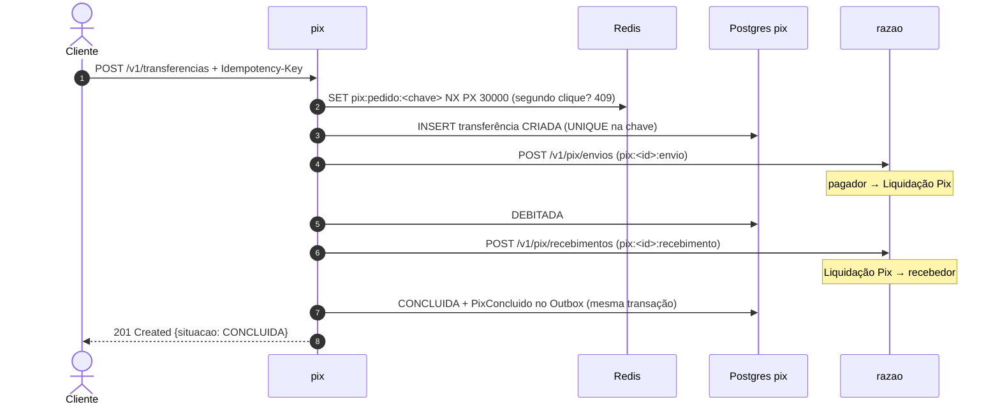

# Serviço pix

O **Pix** do Ledgerly Bank: chaves, QR Code e transferências. Uma transferência atravessa dois
serviços (o pedido mora aqui, o dinheiro mora no razão), e por isso é conduzida como uma **Saga**:
uma sequência de passos, cada um com a sua compensação.

**Stack:** Java 25 · Quarkus 3 (REST, JDBC/Agroal, Flyway, Redis, Kafka/SmallRye, Scheduler) ·
PostgreSQL 18 · Redis 8 · Kafka 4 · porta `8083`

Por que Quarkus aqui, e não Spring Boot como nos outros: ver
[ADR-0017](../../docs/adr/0017-quarkus-no-pix.md), com a medição de tempo de subida e memória.

## Como funciona

### A transferência (Saga orquestrada)



| O razão responde | A Saga faz |
|---|---|
| débito recusado (saldo, conta bloqueada) | `REJEITADA` — nenhum dinheiro saiu |
| crédito recusado (conta de destino encerrada) | `ESTORNANDO` → estorno (Liquidação Pix → pagador) → `ESTORNADA` |
| **sem resposta** (fora do ar, tempo esgotado) | **nada muda**: repete o mesmo passo, com a mesma chave, em 1 s, 2 s, 4 s... (até 1 min) |
| estorno recusado | `EM_ANALISE` — uma pessoa decide |

Sem resposta **não é** recusa: o razão pode ter movido o dinheiro e a resposta se perdido.
Compensar ali devolveria ao pagador um dinheiro que já chegou ao recebedor, e quem pagaria a diferença seria o dinheiro de outros clientes em trânsito na Liquidação Pix. Os detalhes e o teste que prova estão na
[ADR-0015](../../docs/adr/0015-saga-orquestrada-no-pix.md).

Se o serviço morrer no meio, outra execução assume: cada passo **reserva** a transferência por 30 s,
e um agendador retoma, a cada segundo, as que ficaram paradas.

### Chaves e QR Code

- Chaves **CPF** (só o do titular — o serviço de contas responde "confere" ou "não confere", sem
  entregar o CPF), **e-mail**, **telefone** (+55DDNNNNNNNNN) e **aleatória** (gerada pelo banco).
  Até 5 por conta. Uma chave aponta para uma conta só.
- QR Code **estático** no padrão **BR Code** do Banco Central (EMV + CRC16): o "copia e cola" e a
  imagem SVG. Um QR Code com um caractere trocado é recusado pelo CRC.

### Organização interna (arquitetura hexagonal)

| Pacote | O que tem |
|---|---|
| `dominio` | `ChavePix`, `BrCode`, `TransferenciaPix` (a Saga como máquina de estados) — Java puro |
| `aplicacao` | `TransferenciaService`, `OrquestradorDaSaga`, `ChaveService`, `QrCodeService` e as portas |
| `adaptadores.entrada.web` | API REST (Jakarta REST) e Problem Details |
| `adaptadores.entrada.agendamento` | a retomada das Sagas paradas |
| `adaptadores.saida.persistencia` | PostgreSQL, SQL explícito sobre JDBC |
| `adaptadores.saida.razao` / `.contas` | clientes HTTP declarativos (MicroProfile REST Client) |
| `adaptadores.saida.redis` | a trava rápida ([ADR-0018](../../docs/adr/0018-redis-na-frente-do-banco-no-pix.md)) |
| `adaptadores.saida.eventos` | Outbox e o publicador para o Kafka |

O [teste de arquitetura](src/test/java/io/github/alanjoffre/ledgerly/pix/ArquiteturaTest.java) é o
mesmo dos serviços Spring: o domínio não conhece o Quarkus, e a aplicação só usa as anotações
padrão Jakarta de escopo e de transação.

### O banco como segunda linha de defesa

| Regra | Como o banco garante ([V1](src/main/resources/db/migration/V1__esquema_do_pix.sql)) |
|---|---|
| Uma chave, uma conta | `PRIMARY KEY (chave)` |
| Um pedido, uma transferência | `UNIQUE (chave_idempotencia)` |
| Pagador ≠ recebedor | `CHECK` |
| A situação bate com os lançamentos (`CONCLUIDA` tem envio e recebimento, `ESTORNADA` tem estorno...) | `CHECK situacao_coerente` |

## API

| Método e caminho | O que faz | Sucesso |
|---|---|---|
| `POST /v1/chaves` | `{"contaId","tipo","valor"?}` — `ALEATORIA` sem `valor` | 201 |
| `GET /v1/chaves/{chave}` | "Confira o destinatário": titular e chave mascarada | 200 |
| `DELETE /v1/chaves/{chave}` | Exclui | 204 |
| `GET /v1/contas/{contaId}/chaves` | As chaves da conta | 200 |
| `GET /v1/chaves/{chave}/qrcode?valor=&descricao=` | QR Code estático (copia e cola) | 200 |
| `GET /v1/chaves/{chave}/qrcode.svg?valor=` | O mesmo QR Code em imagem SVG | 200 |
| `POST /v1/qrcodes/leitura` | `{"copiaECola"}` — o que há no QR Code, conferido | 200 |
| `POST /v1/transferencias` | `{"pagadorContaId","chave" \| "copiaECola","valor"?,"descricao"?}` + `Idempotency-Key` | 201 · 202 · 200 repetido |
| `GET /v1/transferencias/{id}` | Situação e andamento da Saga | 200 |
| `GET /q/health` | Saúde do serviço | 200 |

`201` quando a Saga terminou na hora; `202 Accepted` quando um passo ficou sem resposta e a Saga
continua sozinha; `200` + `Idempotent-Replayed: true` no pedido repetido.

### Erros

Formato Problem Details (RFC 9457), o mesmo dos serviços Spring. Decida pelo `type`.

| `type` (`urn:ledgerly:erro:...`) | HTTP | Quando |
|---|---|---|
| `requisicao-invalida` | 400 | Campo inválido (detalhe em `campos`), JSON malformado, `Idempotency-Key` faltando |
| `chave-invalida` · `qrcode-invalido` | 400 | Formato da chave; QR Code adulterado ou que não é Pix |
| `chave-nao-encontrada` · `conta-nao-encontrada` · `transferencia-nao-encontrada` | 404 | Não existe |
| `chave-ja-cadastrada` | 409 | A chave já é de uma conta |
| `pedido-em-andamento` | 409 | O mesmo pedido ainda corre (segundo clique); `Retry-After: 1` |
| `titularidade-nao-confere` · `limite-de-chaves` · `conta-inativa` | 422 | Regras das chaves e da conta |
| `transferencia-invalida` · `chave-idempotencia-reutilizada` | 422 | Valor, mesma conta, QR Code de outro valor; chave usada em outro pedido |
| `servico-indisponivel` | 503 | O serviço de contas não respondeu; nada foi criado; `Retry-After: 5` |

## Eventos publicados

`PixConcluido` e `PixEstornado` no tópico `pix.transferencias.v1`, pelo Outbox
([ADR-0013](../../docs/adr/0013-outbox-para-publicar-eventos.md)). Formato em
[eventos.md](../../docs/arquitetura/eventos.md).

## Rodar

```bash
docker compose -f infra/docker/compose.yaml up -d --wait     # na raiz do projeto
./mvnw -pl servicos/pix -am package -DskipTests
java -jar servicos/pix/target/quarkus-app/quarkus-run.jar
```

Modo de desenvolvimento (recarrega o código a cada mudança): `./mvnw -pl servicos/pix quarkus:dev`.

Imagem nativa (GraalVM, compilada num contêiner — nada a instalar):
`./mvnw -pl servicos/pix -am package -Pnativo -DskipTests` → `servicos/pix/target/pix-*-runner`.

Variáveis de ambiente: `PIX_PORTA`, `PIX_DB_URL`, `PIX_DB_USUARIO`, `PIX_DB_SENHA`, `PIX_DB_POOL`,
`PIX_REDIS`, `PIX_KAFKA`, `PIX_RAZAO_URL`, `PIX_CONTAS_URL`, `PIX_OUTBOX_INTERVALO_MS`,
`PIX_SAGA_INTERVALO`.

## Testes

```bash
./mvnw -pl servicos/pix -am verify     # precisa de Docker (o Quarkus sobe PostgreSQL, Kafka e Redis sozinho)
```

| Tipo | Classe | O que prova |
|---|---|---|
| Unidade | `ChavePixTest` | Os quatro tipos de chave; 100 CPFs gerados; máscaras |
| Unidade | `BrCodeTest` | CRC16 de referência; ida e volta; QR Code adulterado recusado |
| Unidade | `TransferenciaPixTest` | Todos os caminhos da Saga; espera exponencial; passo fora de ordem |
| Arquitetura | `ArquiteturaTest` | Domínio sem framework; camadas em ordem |
| Integração | `TransferenciaIT` | Concluída, rejeitada, estornada; razão fora do ar → 202 → concluída; **razão creditou mas não respondeu → conclui sem estornar**; serviço morto no meio → outra execução assume |
| Integração | `IdempotenciaIT` | Pedido repetido; chave reutilizada; 409 do Redis; 50 cliques simultâneos → 1 transferência |
| Integração | `RedisForaDoArIT` | Sem Redis, 20 cliques simultâneos → 1 transferência (o banco segura sozinho) |
| Integração | `ChavesIT`, `QrCodeIT` | Regras das chaves; gerar, ler e pagar QR Code |
| Integração | `CaixaDeSaidaIT` | `PixConcluido` e `PixEstornado` no Kafka, no formato do contrato |

O razão e o serviço de contas, nos testes, são **falsos** ([ServicosFalsos](src/test/java/io/github/alanjoffre/ledgerly/pix/integracao/ServicosFalsos.java)):
um servidor HTTP do próprio JDK que segue o contrato do razão de verdade — inclusive a
idempotência — e que o teste manda falhar, demorar ou recusar. O Pix fala com ele por HTTP de
verdade, com os mesmos clientes e tempos-limite de produção.

Cobertura (unidade + integração): **93% das linhas, 87% dos ramos**.
