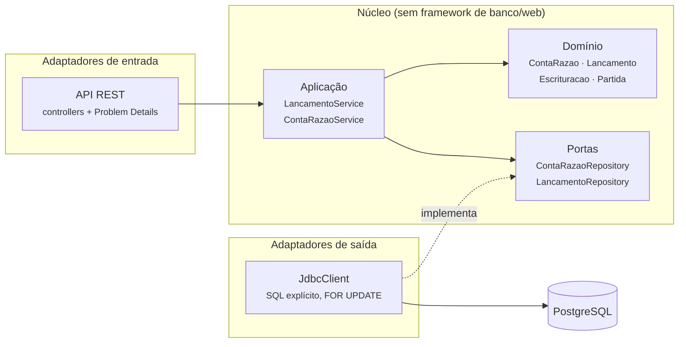

# Serviço razão

O **razão contábil** do Ledgerly Bank: guarda cada movimento de dinheiro como um lançamento em
**partidas dobradas** e mantém o saldo das contas. É o coração do banco e o ponto mais disputado do
sistema — aqui ficam a trava de concorrência e a idempotência.

**Stack:** Java 25 · Spring Boot 4 (Web MVC, JDBC, Kafka) · PostgreSQL 18 · Flyway · Kafka 4 · porta `8082`

## Como funciona

Um depósito de R$ 100,00 vira um lançamento com duas partidas:

| Conta | Natureza | Partida | Efeito no saldo |
|---|---|---|---|
| Caixa (interna) | devedora (ativo do banco) | **débito** R$ 100,00 | +100 |
| Maria | credora (o banco deve a ela) | **crédito** R$ 100,00 | +100 |

Débitos = créditos, sempre. A soma das contas devedoras é igual à das credoras — o **balanço fecha**,
e `GET /v1/integridade` confere isso a qualquer momento.

### Contas internas

| Conta | Id | Natureza | Para quê |
|---|---|---|---|
| Caixa | `00000000-0000-0000-0000-000000000001` | devedora | o dinheiro que entra nos depósitos e sai nos saques |
| Liquidação Pix | `00000000-0000-0000-0000-000000000002` | credora | o dinheiro de um Pix em andamento, entre o pagador e o recebedor ([ADR-0015](../../docs/adr/0015-saga-orquestrada-no-pix.md)) |

Nenhuma das duas é movimentada, aberta ou bloqueada pela API.

**Contas quentes, em sub-contas (Fase 3, [ADR-0019](../../docs/adr/0019-contas-quentes-em-subcontas.md)).**
Todo depósito passa pelo Caixa e todo Pix pela Liquidação Pix, e cada lançamento trava as suas
contas: medido, o razão fazia 124 depósitos por segundo contra 954 transferências entre clientes.
Por isso cada uma é dividida em **16 sub-contas**, e cada lançamento trava só a do cliente (pelo
hash do id da conta dele). O saldo da conta é a soma; `GET /v1/integridade` mostra a soma de cada
uma em `contasInternas`.

| Sub-conta | Id | Pode ficar negativa? |
| --- | --- | --- |
| Caixa, sub-conta *k* (0 a 15) | `00000000-0000-0000-0000-000000000k01` (em hexadecimal: `...0301` é a 3) | **sim** — o total, não (é a soma de clientes e Liquidação, conferida na integridade) |
| Liquidação Pix, sub-conta *k* | `00000000-0000-0000-0000-000000000k02` | **não** — o recebimento e o estorno saem da mesma sub-conta em que o envio entrou |

A sub-conta 0 é o id antigo. O razão recusa creditar um Pix que nunca saiu de ninguém, e cada envio
tem **no máximo uma saída** (recebimento ou estorno), conferido na aplicação e por um índice único
no banco.

### Eventos (Fase 2)

| Direção | Tópico | Eventos |
|---|---|---|
| publica | `razao.lancamentos.v1` | `LancamentoRegistrado` — um por lançamento, gravado no Outbox na mesma transação ([ADR-0013](../../docs/adr/0013-outbox-para-publicar-eventos.md)) |
| consome | `contas.eventos.v1` | `ContaAberta`, `ContaBloqueada`, `ContaDesbloqueada`, `ContaEncerrada` — idempotente; evento para conta já encerrada é descartado ([ADR-0014](../../docs/adr/0014-contas-avisa-o-razao-por-evento.md)) |

Mensagem que não dá para processar vai para `contas.eventos.v1.dlt` em vez de travar a fila.
Formatos em [eventos.md](../../docs/arquitetura/eventos.md).

### Organização interna (arquitetura hexagonal)



As setas só apontam para dentro: o domínio não conhece o banco nem o HTTP. O
[teste de arquitetura](src/test/java/io/github/alanjoffre/ledgerly/razao/ArquiteturaTest.java)
reprova o build se alguém inverter uma seta.

### O roteiro de toda operação que move dinheiro

Tudo numa transação só ([LancamentoService](src/main/java/io/github/alanjoffre/ledgerly/razao/aplicacao/LancamentoService.java)):

1. **travar** as contas, em ordem de id (`SELECT ... ORDER BY id FOR UPDATE`) — sem gasto duplo,
   sem deadlock ([ADR-0009](../../docs/adr/0009-concorrencia-com-trava-pessimista-ordenada.md));
2. **conferir a chave de idempotência** — depois de travar, para pedidos iguais entrarem em fila
   ([ADR-0010](../../docs/adr/0010-idempotencia-pela-chave-no-banco.md));
3. **escriturar** no domínio — saldo, situação da conta, partidas dobradas;
4. **gravar** o lançamento e os saldos novos.

### O banco de dados como segunda linha de defesa

Mesmo que a aplicação erre, o PostgreSQL recusa ([migração V1](src/main/resources/db/migration/V1__esquema_do_razao.sql)):

| Regra | Como o banco garante |
|---|---|
| Saldo de cliente nunca negativo | `CHECK (permite_saldo_negativo OR saldo >= 0)` |
| Débitos = créditos em todo lançamento | gatilho `partidas_dobradas`, conferido no COMMIT |
| Lançamento nunca é alterado nem apagado | gatilhos `lancamento_imutavel` e `partida_imutavel` |
| Uma chave de idempotência, um lançamento | `UNIQUE (chave_idempotencia)` |

## API

Todo pedido que move dinheiro exige o cabeçalho `Idempotency-Key`. Valores em dinheiro são texto
(`"10.50"`) — ver [ADR-0012](../../docs/adr/0012-erros-problem-details-e-dinheiro-como-texto.md).

| Método e caminho | O que faz | Sucesso |
|---|---|---|
| `PUT /v1/contas/{id}` | Abre a conta no razão (idempotente) — `{"moeda":"BRL"}` | 201 nova · 200 já existia |
| `GET /v1/contas/{id}` | Saldo e situação | 200 |
| `PUT /v1/contas/{id}/situacao` | `{"situacao":"BLOQUEADA"\|"ATIVA"\|"ENCERRADA"}` | 200 |
| `GET /v1/contas/{id}/extrato?limite=50` | Últimas partidas, com o saldo após cada uma (limite 1–500) | 200 |
| `POST /v1/depositos` | `{"contaId","valor","descricao"?}` | 201 · 200 repetido |
| `POST /v1/saques` | `{"contaId","valor","descricao"?}` | 201 · 200 repetido |
| `POST /v1/transferencias` | `{"origemId","destinoId","valor","descricao"?}` | 201 · 200 repetido |
| `POST /v1/pix/envios` | `{"contaId","valor","descricao"?}` — cliente → Liquidação Pix | 201 · 200 repetido |
| `POST /v1/pix/recebimentos` | `{"contaId","valor","descricao"?,"lancamentoEnvioId"}` — Liquidação Pix → recebedor | 201 · 200 repetido |
| `POST /v1/pix/estornos` | o mesmo corpo — Liquidação Pix → pagador (a compensação da Saga) | 201 · 200 repetido |
| `GET /v1/lancamentos/{id}` | Um lançamento com as partidas | 200 |
| `GET /v1/integridade` | Conferência do razão inteiro | 200 (`"integro": true/false`) |
| `GET /actuator/health` | Saúde do serviço | 200 |

Resposta repetida (mesma chave, mesmo pedido): `200 OK` + cabeçalho `Idempotent-Replayed: true` e
o lançamento original.

### Erros

Formato Problem Details (RFC 9457). Decida pelo `type`, nunca pelo texto.

| `type` (`urn:ledgerly:erro:...`) | HTTP | Quando |
|---|---|---|
| `requisicao-invalida` | 400 | Campo inválido (detalhe em `campos`), JSON malformado, cabeçalho faltando, limite fora da faixa |
| `conta-nao-encontrada` | 404 | Conta ou lançamento inexistente |
| `saldo-insuficiente` | 422 | O débito deixaria o saldo negativo |
| `conta-inativa` | 422 | Conta encerrada, ou bloqueada numa saída de dinheiro |
| `encerramento-com-saldo` | 422 | Encerrar conta com saldo diferente de zero |
| `lancamento-invalido` | 422 | Valor zero, moeda diferente, chave de idempotência mal formada |
| `chave-idempotencia-reutilizada` | 422 | A chave já foi usada num pedido diferente |
| `operacao-nao-permitida` | 422 | Movimentar uma conta interna (Caixa, Liquidação Pix); transferir para a mesma conta |
| `conta-ja-existe` | 422 | Abrir de novo a mesma conta com outra moeda |
| `envio-pix-invalido` | 422 | Recebimento ou estorno que aponta um lançamento que não é envio de Pix, com outro valor, estorno para quem não pagou, ou envio que já teve a sua saída |

## Rodar

```bash
docker compose -f infra/docker/compose.yaml up -d --wait     # na raiz do projeto
./mvnw -pl servicos/razao -am package -DskipTests
java -jar servicos/razao/target/razao-0.1.0-SNAPSHOT.jar
```

Variáveis de ambiente: `RAZAO_PORTA`, `RAZAO_DB_URL`, `RAZAO_DB_USUARIO`, `RAZAO_DB_SENHA`, `RAZAO_DB_POOL`,
`RAZAO_KAFKA`, `RAZAO_OUTBOX_INTERVALO_MS`, `RAZAO_SUBCONTAS` (1 a 16, padrão 16 — com 1, sem divisão das
contas quentes), `RAZAO_THREADS_VIRTUAIS` (padrão `false`: threads de plataforma, que mediram mais vazão, [ADR-0020](../../docs/adr/0020-virtual-threads-medidas-no-razao.md)).

## Testes

```bash
./mvnw -pl servicos/razao -am verify     # precisa de Docker (Testcontainers: PostgreSQL e Kafka)
```

| Tipo | Classe | O que prova |
|---|---|---|
| Unidade | `ContaRazaoTest`, `LancamentoTest`, `EscrituracaoTest`, `ContasQuentesTest` | Regras do domínio, sem banco (milissegundos); ids das sub-contas e o espalhamento dos clientes |
| Arquitetura | `ArquiteturaTest` | Domínio sem framework; camadas em ordem |
| Integração | `LancamentoServiceIT` | Casos de uso com PostgreSQL real; integridade conferida após cada teste |
| Integração | `ConcorrenciaIT` | 1.500 saques simultâneos sem gasto duplo; 400 transferências cruzadas sem deadlock; idempotência sob disputa |
| Integração | `BancoDeDadosIT` | O banco recusa sozinho: saldo negativo (menos na sub-conta do Caixa), lançamento desbalanceado, alteração do razão, segunda saída do mesmo envio de Pix |
| Integração | `ApiIT` | API de ponta a ponta: códigos HTTP, Problem Details, `Idempotency-Key` |
| Integração | `PixIT` | Envio, recebimento e estorno pela mesma sub-conta; saída que não bate com o envio; **recebimento e estorno do mesmo envio ao mesmo tempo: exatamente um passa**; contas internas protegidas |
| Integração | `CaixaDeSaidaIT` | O evento sai no formato do contrato, só de fato que aconteceu; **Kafka pausado no meio**: o depósito funciona e o evento sai quando ele volta |
| Integração | `ConsumidorDeEventosDeContaIT` | Abertura idempotente, ordem dos eventos, conta encerrada, tipo desconhecido, mensagem venenosa → DLT |

**Prova reversa:** com a trava `FOR UPDATE` removida, o `ConcorrenciaIT` falha — 1.500 saques
aprovados numa conta de R$ 1.000,00. Números na [ADR-0009](../../docs/adr/0009-concorrencia-com-trava-pessimista-ordenada.md).

Cobertura (unidade + integração): **97% das linhas, 92% dos ramos**.
